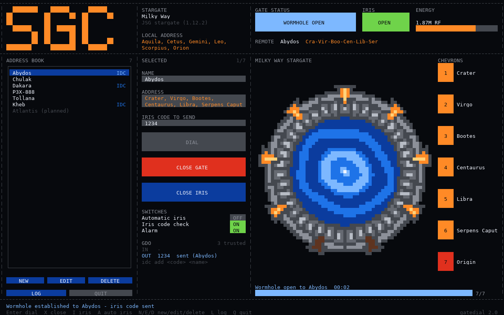

# gatedial 2.0's gate room console, and Infinity Stargate for JSG 1.4.0

This release brings a new screen for **gatedial**, the OpenComputers dialer: a gate room console for tier 2 and tier 3 screens. It also brings **Infinity Stargate for JSG 1.4.0**, with the cartoon's colours, a blue swirl in the wormhole, a screen DHD and DHD keys that work. The other downloads are the same as in v1.3.0 and are attached again so everything is in one place.

## New in gatedial 2.0: the console

On a tier 2 or tier 3 screen, gatedial now opens on a control screen made for a gate room:



- **Header**: a big logo, `SGC` by default (change it with `logo = ...` at the top of `gatedial.lua`). Next to it are the gate's type and local address, and badges for the gate status, the iris and the energy. The status badge flashes while another gate dials in. On tier 3 the header also names the gate on the other side.
- **Address book** in a box. Tap an address to select it and tap it again to dial. `IDC` marks addresses that send an iris code. Under the list are New, Edit, Delete, Log and Quit buttons.
- **Selected**: the name, address and iris code of the selected address, with big **Dial** (Abort while dialing), **Close Gate** and **Open/Close Iris** buttons.
- **Switches**: automatic iris, iris code check and alarm. Tap them, or press **A** for the automatic iris. gatedial remembers them.
- **GDO**: the last iris code that came in (accepted or rejected, and by whom), the last code you sent and its answer, and how many codes are trusted.
- **The gate** (tier 3): the gate picture with a box for each chevron and its symbol, the wormhole's time, and a bar of locked chevrons. On tier 2 the layout is compact and the chevrons are a list.

The console only redraws the parts of the screen that changed, so it uses fewer GPU calls than the old screen. `screen = "classic"` brings back the gatedial 1.0 screen, and tier 1 screens still get it. Your address book, iris codes and gate log carry over as they are.

To update, run the installer again on the computer, then `reboot`:

```
wget -f https://raw.githubusercontent.com/jarae1205-cpu/StargateJourney-ComputerCraft-Programs/main/OpenComputers/install.lua /tmp/install.lua
/tmp/install.lua
```

## New in Infinity Stargate for JSG 1.4.0

- **The DHD keys work.** In 1.1.0 to 1.3.0, pressing a key on the add-on's DHDs did nothing. Both DHDs now dial.
- **The gate in the cartoon's colours**: blue-grey metal with ink outlines, a grey track with dark symbols, and dark chevrons that glow pale cyan when locked. A closed iris is a pale blue spiral.
- **The wormhole**: a white horizon with a turning blue swirl, as in Carter's Addon Pack.
- **The Infinity DHD is now a console with a tilted screen.** It has two pads of glowing symbol keys, a gate in the middle that lights a chevron for each symbol dialed, the address dialed so far, and a control crystal lamp. The keys you see are the keys you press. The orange DHD keeps JSG's model and keys.

## Downloads

| File | What it is | Needs |
|---|---|---|
| `jsginfinity-1.4.0.jar` | **Infinity Stargate for JSG**: an add-on with its own Infinity gate and DHDs. New in this release. | Forge 47 (Minecraft 1.20.1), Just Stargate Mod 5.1.2.0 or newer |
| `chevron7-1.6.0.jar` | **Chevron Seven**, a stargate mod built from scratch. Same as in v1.3.0. | Forge 47 (Minecraft 1.20.1). CC: Tweaked and Ad Astra are optional. |
| `JSGInfinity-1.20.1.zip` | **Stargate Infinity look for JSG**: a resource pack that restyles every JSG Milky Way gate. Same as in v1.3.0. | Just Stargate Mod 1.20.1 (made for 5.1.2.0) |
| `sginfinity-1.0.0.jar` | **Infinity Stargate for SGCraft**. Same as in v1.2.0. | Forge 1.12.2 (14.23.5.2838 or newer), SGCraft 2.3.0 or newer |
| `sgcaddon-1.0.0.jar` | **Stargate Command Addon** for Stargate Journey. Same as in 1.0.0. | Forge 47 (Minecraft 1.20.1), Stargate Journey 0.6.40 or newer |
| `StargateJourneyVariants-1.20.1.zip` | **Stargate Journey Variants**: four looks for the Milky Way gate. Same as in 1.0.0. | Stargate Journey |

How to use each one: [gatedial](https://github.com/jarae1205-cpu/StargateJourney-ComputerCraft-Programs/tree/main/OpenComputers), [Infinity Stargate for JSG](https://github.com/jarae1205-cpu/StargateJourney-ComputerCraft-Programs/tree/main/JSGInfinityGate), [Chevron Seven](https://github.com/jarae1205-cpu/StargateJourney-ComputerCraft-Programs/tree/main/ChevronSeven), [the JSG Infinity pack](https://github.com/jarae1205-cpu/StargateJourney-ComputerCraft-Programs/tree/main/JSGInfinity), [Infinity Stargate for SGCraft](https://github.com/jarae1205-cpu/StargateJourney-ComputerCraft-Programs/tree/main/SGCraftInfinityGate), [Stargate Command Addon](https://github.com/jarae1205-cpu/StargateJourney-ComputerCraft-Programs/tree/main/StargateCommandAddon), [Stargate Journey Variants](https://github.com/jarae1205-cpu/StargateJourney-ComputerCraft-Programs/tree/main/StargateJourneyVariants).

The ComputerCraft programs (Gate Room, Network Hub, Personal Dialer) haven't changed since v1.3.0. Their install command is in the [README](https://github.com/jarae1205-cpu/StargateJourney-ComputerCraft-Programs#readme).

## Tested

- **gatedial 2.0's console** has only been tried in a headless OpenOS test harness with a simulated JSG 1.12.2 gate. It ran on tier 3 (160x50), tier 2 (80x25) and tier 1 screens; tier 1 falls back to the classic screen. These worked:
  - dialing out with the iris code sent, and closing the gate
  - an incoming wormhole with the automatic iris
  - iris codes accepted and rejected
  - the buttons, list and switches by touch
  - adding an address, and the gate log
  - no gate connected, a gate without an iris, and a Pegasus gate
- **The console has not been tried in a game yet.** The gate code underneath is the same as in gatedial 1.0, which was tested in-game on JSG 1.12.2 and SGCraft. If the console misbehaves, `screen = "classic"` brings back the 1.0 screen.
- **Infinity Stargate for JSG 1.4.0**, with Forge 47.4.29 and JSG 5.1.2.0:
  - In the dev server and client, with real right-clicks: the gate room's Infinity DHD dialed Carter's platform, and each key lit and added its symbol. The dial button opened the wormhole with the blue swirl on both gates and closed it again.
  - In a player's own game: the Infinity DHD's keys lit, and its dial button opened the wormhole. The orange DHD's keys worked too, and the screen's crystal lamp lit with a control crystal in.
  - **Not tested yet:** crafting in survival, placing the blocks by hand, closing the iris from a DHD, remote or computer, and a player breaking the base.

## License

The programs, the mods, the add-ons and the JSG pack are MIT. The add-ons' textures are drawn by their own scripts. Just Stargate Mod and SGCraft aren't included and keep their own licenses. The gate variant textures, in the variant pack and in the Stargate Command Addon, are recoloured from Stargate Journey's textures and are CC BY-NC-SA 4.0.

## SHA-256

```
a7e4de443f007534a759c49b0caa20ea31d6791e64e05d425ee8c0a7e8f9e976  jsginfinity-1.4.0.jar
bdba8411e4eda0faf93372bb8f9f36e17cb1ec3cb2c8b1cd49dfc74058ef26de  chevron7-1.6.0.jar
4abebc9ba35ed96e0b45954ac6bdc740dfbb56aac71d93ab4405415140952487  JSGInfinity-1.20.1.zip
7449e60402fb5b620bdbf3c4ff54ba65469e71cb0836fccc83cc53573262e832  sginfinity-1.0.0.jar
773fe317b9ffa455150d9d764720d453a5429ffc5981872ba5c15ba6b26ed996  sgcaddon-1.0.0.jar
3c90a5c96429b414df1438f24365934edfc1d6313c0cf29c972e5121f7b2b549  StargateJourneyVariants-1.20.1.zip
```
