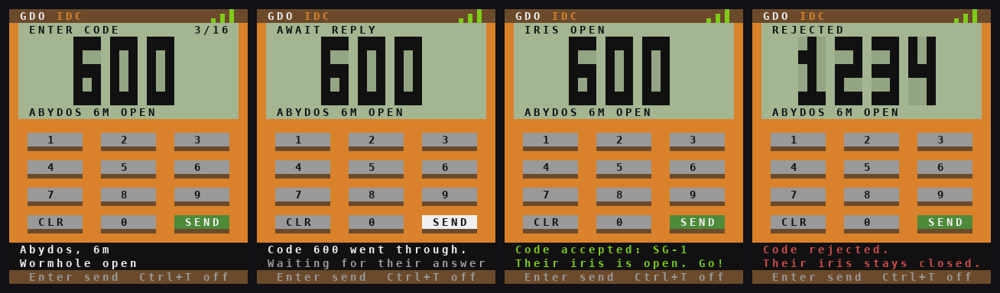
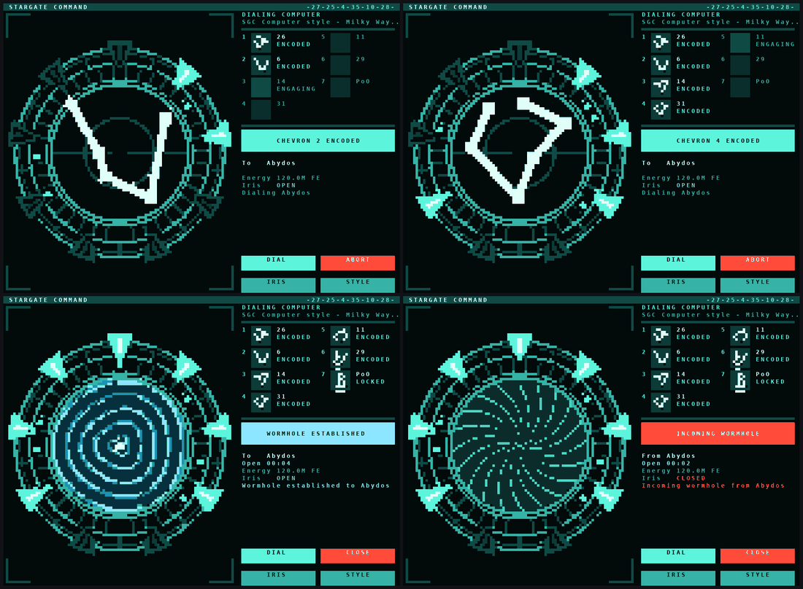

# The GDO for pocket computers, and the SGC Computer look for the Gate Room

This release is for the ComputerCraft programs. A pocket computer can now be a **GDO** that sends your iris code home through the wormhole, like the team's GDO in the show. The Gate Room has a new **SGC Computer** look, after the SGC's dialing computer screen. The mods and packs haven't changed since v1.4.0; they are attached again so everything is in one place.

## New: the GDO



The `gdo` program turns an advanced pocket computer into the team's iris code transmitter, with an orange case, an LCD with big digits and a keypad. Stand by the gate you dialed home from, type your code and press **SEND**. The code goes through the wormhole to the Gate Room at home, which opens its iris if it trusts the code. The GDO then shows `IRIS OPEN`, or `REJECTED` if their iris stays shut.

A pocket computer can't reach through a wormhole, so the GDO radios the computer at the gate you're standing by. That computer sends the code through the open wormhole as a gate message, the same way the dialing computer sends an address book entry's code.

What you need:

- **The GDO**: an advanced pocket computer with a wireless or ender modem.
- **The gate you dial home from**: a computer with the gate interface and a wireless or ender modem, running the Gate Room (it passes codes on by itself) or `gdo relay`. On Stargate Journey that's a crystal or advanced crystal interface; a basic interface can't send messages. Next to the Personal Dialer, run the relay in a second tab: `bg gdo relay`.
- **At home**: the Gate Room, with your code trusted (`idc add 600 SG-1`) and `autoIris = true`, so the iris is shut when you call.

```
gdo                 the GDO
gdo send 600        send a code from the command line and print the answer
gdo relay           pass GDO codes through the gate at this computer
```

The GDO remembers the last code it sent, so next time SEND alone does it. It talks to the nearest gate with an open wormhole, so at a gate field, stand by the one you dialed from. It doesn't reach gates in another dimension, even with an ender modem: the code has to go through the wormhole.

Codes go through wherever iris codes work: Stargate Journey crystal interfaces, SGCraft and Chevron Seven. LanteaCraft gates take codes only from LanteaCraft's own GDO item, and Lantea and JSG 1.20.1 gates can't send messages. On those the GDO says the gate can't send codes.

## New: the SGC Computer look for the Gate Room



Press **STYLE** in the Gate Room until it shows "SGC Computer". It works with any gate.

- The gate is drawn in teal lines on a dark screen, with corner brackets and a crosshair. The symbol track turns with the ring, and the chevrons fill in as they lock.
- As each chevron is encoded, its symbol comes up big across the gate. It then shrinks away into its numbered box beside the gate and stays there until the gate closes.
- The wormhole is rings of light running out from the middle, and the iris is a line drawing of its blades.
- The symbols are line figures the program draws, like constellations. A symbol always gets the same figure, and the point of origin is a pyramid under a sun. They aren't the mod's glyphs or the show's. Numbers, SGCraft letters and JSG's symbol names all get figures.
- On a monitor four blocks high the boxes stand in one numbered column. On one three blocks high they are in two columns. Smaller screens list the chevrons as text, as the other looks do.

## Other changes

- The Gate Room has a new `gdoRelay` setting, on by default: with a wireless or ender modem on its computer, it passes travellers' GDO codes through the wormhole and logs them.
- The installer downloads `gdo.lua`, `sgc/gdo.lua` and `sgc/glyphs.lua`. The Gate Room now needs `sgc/glyphs.lua`, so run the installer again rather than copying only `gateroom.lua`.
- `install gdo` starts the GDO when the pocket computer is switched on, and `install relay` starts `gdo relay` when a computer boots.
- For your own programs: `sgc.gate` has `canSendMessages()`, which says whether a gate can send codes and why not. `sgc.gdo` has the GDO's radio messages and the relay, on modem channel 2427. `sgc.glyphs` draws a symbol's figure on a pixel canvas.

To update, run the installer again on each computer (on the pocket computer, add `gdo` at the end):

```
wget run https://raw.githubusercontent.com/jarae1205-cpu/StargateJourney-ComputerCraft-Programs/main/StargateCommand/install.lua
```

Your address book, iris codes and gate log are kept.

## Downloads

| File | What it is | Needs |
|---|---|---|
| `jsginfinity-1.4.0.jar` | **Infinity Stargate for JSG**: an add-on with its own Infinity gate and DHDs. Same as in v1.4.0. | Forge 47 (Minecraft 1.20.1), Just Stargate Mod 5.1.2.0 or newer |
| `chevron7-1.6.0.jar` | **Chevron Seven**, a stargate mod built from scratch. Same as in v1.3.0. | Forge 47 (Minecraft 1.20.1). CC: Tweaked and Ad Astra are optional. |
| `JSGInfinity-1.20.1.zip` | **Stargate Infinity look for JSG**: a resource pack that restyles every JSG Milky Way gate. Same as in v1.3.0. | Just Stargate Mod 1.20.1 (made for 5.1.2.0) |
| `sginfinity-1.0.0.jar` | **Infinity Stargate for SGCraft**. Same as in v1.2.0. | Forge 1.12.2 (14.23.5.2838 or newer), SGCraft 2.3.0 or newer |
| `sgcaddon-1.0.0.jar` | **Stargate Command Addon** for Stargate Journey. Same as in 1.0.0. | Forge 47 (Minecraft 1.20.1), Stargate Journey 0.6.40 or newer |
| `StargateJourneyVariants-1.20.1.zip` | **Stargate Journey Variants**: four looks for the Milky Way gate. Same as in 1.0.0. | Stargate Journey |

How to use each one: [the GDO and the Gate Room](https://github.com/jarae1205-cpu/StargateJourney-ComputerCraft-Programs/tree/main/StargateCommand), [Infinity Stargate for JSG](https://github.com/jarae1205-cpu/StargateJourney-ComputerCraft-Programs/tree/main/JSGInfinityGate), [Chevron Seven](https://github.com/jarae1205-cpu/StargateJourney-ComputerCraft-Programs/tree/main/ChevronSeven), [the JSG Infinity pack](https://github.com/jarae1205-cpu/StargateJourney-ComputerCraft-Programs/tree/main/JSGInfinity), [Infinity Stargate for SGCraft](https://github.com/jarae1205-cpu/StargateJourney-ComputerCraft-Programs/tree/main/SGCraftInfinityGate), [Stargate Command Addon](https://github.com/jarae1205-cpu/StargateJourney-ComputerCraft-Programs/tree/main/StargateCommandAddon), [Stargate Journey Variants](https://github.com/jarae1205-cpu/StargateJourney-ComputerCraft-Programs/tree/main/StargateJourneyVariants).

The computer programs aren't attached; install them with the command above.

## Tested

Both features have only been tried in a headless CC: Tweaked test harness, with simulated computers, modems (with their range and dimensions) and Stargate Journey gates with crystal interfaces.

- **The GDO**. These worked:
  - a trusted code through `gdo relay`: the home Gate Room opened its iris, and the GDO showed the answer and remembered the code
  - the same through a Gate Room at the far gate instead of `gdo relay`
  - an unknown code rejected, with the iris left shut
  - `gdo send 600` on the command line
  - a basic interface ("Codes need a crystal interface")
  - a GDO on another world, with a wireless or an ender modem, finding no gate
  - the wormhole closing while the GDO waited for an answer
- **The SGC Computer look**, on screens of 80x39 (a 4x3 monitor), 80x53, 57x24 and 51x19. These worked:
  - dialing Abydos, with each symbol coming up and filling its box
  - the wormhole established
  - an incoming wormhole against the closed iris
  - STYLE cycling through every look without an error
- **Neither has been tried in a game yet.** A GDO's code travels as the same `IDC:` gate message the dialers send. Those messages were tested in-game with gatedial on SGCraft and JSG 1.12.2, but not yet with the ComputerCraft programs on Stargate Journey gates. If the new look misbehaves, STYLE switches back to any other look.

## License

The programs, the mods, the add-ons and the JSG pack are MIT. The add-ons' textures are drawn by their own scripts. Just Stargate Mod and SGCraft aren't included and keep their own licenses. The gate variant textures, in the variant pack and in the Stargate Command Addon, are recoloured from Stargate Journey's textures and are CC BY-NC-SA 4.0.

## SHA-256

```
a7e4de443f007534a759c49b0caa20ea31d6791e64e05d425ee8c0a7e8f9e976  jsginfinity-1.4.0.jar
bdba8411e4eda0faf93372bb8f9f36e17cb1ec3cb2c8b1cd49dfc74058ef26de  chevron7-1.6.0.jar
4abebc9ba35ed96e0b45954ac6bdc740dfbb56aac71d93ab4405415140952487  JSGInfinity-1.20.1.zip
7449e60402fb5b620bdbf3c4ff54ba65469e71cb0836fccc83cc53573262e832  sginfinity-1.0.0.jar
773fe317b9ffa455150d9d764720d453a5429ffc5981872ba5c15ba6b26ed996  sgcaddon-1.0.0.jar
3c90a5c96429b414df1438f24365934edfc1d6313c0cf29c972e5121f7b2b549  StargateJourneyVariants-1.20.1.zip
```
