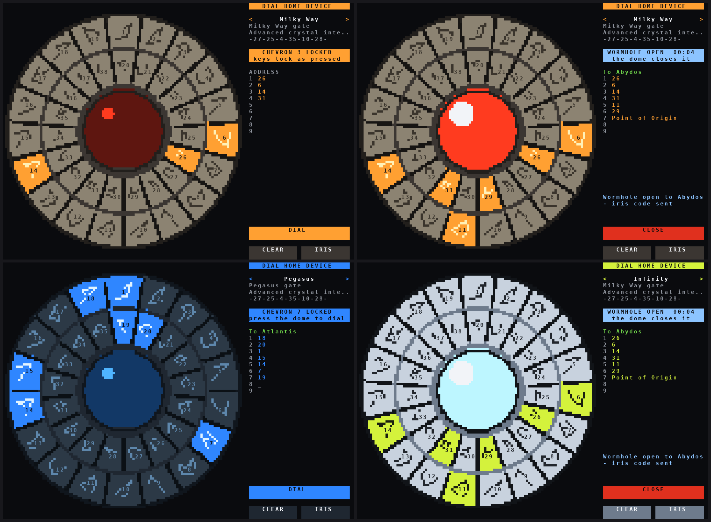
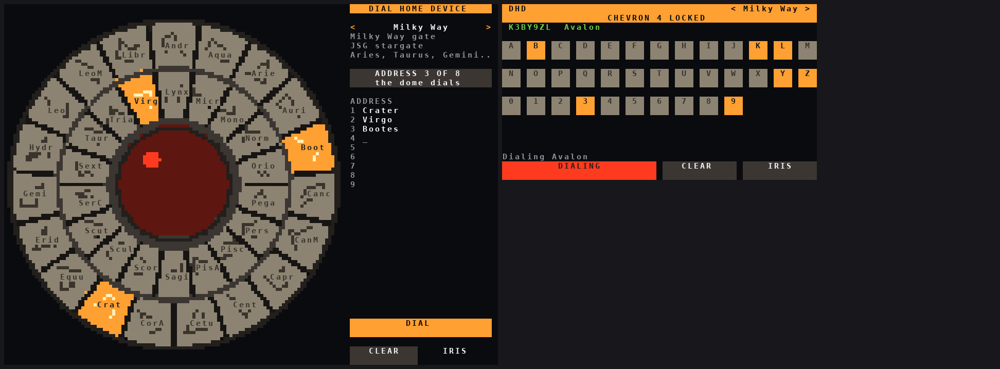

# The Dial Home Device

This release adds a new ComputerCraft program, the **Dial Home Device**. It is the DHD from the show on a touch screen: two rings of symbol keys around a big dome. Press the symbols of an address, then the dome. The mods and packs haven't changed since v1.4.0; they are attached again so everything is in one place.

## New: the Dial Home Device



Run `dhd` on a computer next to the gate interface, with an advanced monitor 4 blocks wide and 3 high or bigger. Smaller monitors, and the computer's own screen, show the keys as a keypad with a DIAL button for the dome.

- **Stargate Journey, Chevron Seven and Lantea: Stargates**: each key locks its chevron as soon as you press it, like a real DHD, and the dome engages the point of origin. On a Stargate Journey basic interface the ring turns to each symbol first, so a key takes a few seconds.
- **SGCraft, LanteaCraft and Just Stargate Mod**: a computer can only dial a whole address on these gates. The keys light up as you press them, and the dome dials the address. Touch the last key again to take it back. While the gate dials, the keys it hasn't locked yet blink.
- **When the wormhole is open**, the dome is lit, and pressing it closes the wormhole. **CLEAR** stops dialing and drops the chevrons. **IRIS** opens or closes the iris.

The keys match the gate:

- 38 keys for a Milky Way gate, and 35 for a Pegasus or Universe gate. The point of origin is the dome.
- SGCraft's 36 letters and digits, and LanteaCraft's 38 glyphs.
- JSG's symbol names, shortened on the keys: the constellations on Milky Way gates (`Crat` for Crater, `LeoM` for Leo Minor), the Pegasus names (`Roeh` for Roehi, `CaP` for Ca Po), and `Glyph 1` to `Glyph 36` on Universe gates (`G5` on the key). They are copied from JSG 5.1.2.0's own symbol lists.

Each key has a line figure drawn by the program, as in the Gate Room's SGC Computer look. The figures aren't the mod's glyphs, so go by the numbers and names on the keys.

The panel beside the DHD shows:

- the gate and what it's doing, and what pressing the dome will do next
- the address so far, one chevron per line
- the address book's name for it, such as "To Abydos"

An incoming wormhole lights the caller's symbols, names the caller and locks the keys. If someone dials at the gate's own DHD block, or from another computer, the keys light up with it, and you can carry on from the screen.

The arrows at the top of the panel change the look: **Milky Way**, **Pegasus**, **Universe**, **Carter Addon Pack** and **Infinity**. It starts in the gate's own look and remembers your choice.



You can type on the computer's keyboard too:

- **Numbers, letters or names** press that key. A name goes in after Enter or a comma.
- **Enter** is the dome.
- **Backspace** takes back a typed character, or the last key on an SGCraft, LanteaCraft or JSG gate.
- **Delete** is CLEAR, and **Tab** changes the look.

When the wormhole opens to an address book entry with an iris code, the DHD sends the code, as the Gate Room does. With a wireless or ender modem it also passes travellers' GDO codes through the gate. It leaves checking incoming codes to the Gate Room.

As on a real DHD, a locked chevron can't be taken back on its own. CLEAR drops them all.

To install it, or to update, run the installer again. Add `dhd` at the end to start the DHD when the computer boots:

```
wget run https://raw.githubusercontent.com/jarae1205-cpu/StargateJourney-ComputerCraft-Programs/main/StargateCommand/install.lua dhd
```

The installer now also downloads `dhd.lua` and `sgc/dhd.lua`. Your address book, iris codes and gate log are kept.

## Downloads

| File | What it is | Needs |
|---|---|---|
| `jsginfinity-1.4.0.jar` | **Infinity Stargate for JSG**: an add-on with its own Infinity gate and DHDs. Same as in v1.4.0. | Forge 47 (Minecraft 1.20.1), Just Stargate Mod 5.1.2.0 or newer |
| `chevron7-1.6.0.jar` | **Chevron Seven**, a stargate mod built from scratch. Same as in v1.3.0. | Forge 47 (Minecraft 1.20.1). CC: Tweaked and Ad Astra are optional. |
| `JSGInfinity-1.20.1.zip` | **Stargate Infinity look for JSG**: a resource pack that restyles every JSG Milky Way gate. Same as in v1.3.0. | Just Stargate Mod 1.20.1 (made for 5.1.2.0) |
| `sginfinity-1.0.0.jar` | **Infinity Stargate for SGCraft**. Same as in v1.2.0. | Forge 1.12.2 (14.23.5.2838 or newer), SGCraft 2.3.0 or newer |
| `sgcaddon-1.0.0.jar` | **Stargate Command Addon** for Stargate Journey. Same as in 1.0.0. | Forge 47 (Minecraft 1.20.1), Stargate Journey 0.6.40 or newer |
| `StargateJourneyVariants-1.20.1.zip` | **Stargate Journey Variants**: four looks for the Milky Way gate. Same as in 1.0.0. | Stargate Journey |

How to use each one: [the Dial Home Device](https://github.com/jarae1205-cpu/StargateJourney-ComputerCraft-Programs/tree/main/StargateCommand#dial-home-device), [Infinity Stargate for JSG](https://github.com/jarae1205-cpu/StargateJourney-ComputerCraft-Programs/tree/main/JSGInfinityGate), [Chevron Seven](https://github.com/jarae1205-cpu/StargateJourney-ComputerCraft-Programs/tree/main/ChevronSeven), [the JSG Infinity pack](https://github.com/jarae1205-cpu/StargateJourney-ComputerCraft-Programs/tree/main/JSGInfinity), [Infinity Stargate for SGCraft](https://github.com/jarae1205-cpu/StargateJourney-ComputerCraft-Programs/tree/main/SGCraftInfinityGate), [Stargate Command Addon](https://github.com/jarae1205-cpu/StargateJourney-ComputerCraft-Programs/tree/main/StargateCommandAddon), [Stargate Journey Variants](https://github.com/jarae1205-cpu/StargateJourney-ComputerCraft-Programs/tree/main/StargateJourneyVariants).

The computer programs aren't attached; install them with the command above.

## Tested

Only in the headless CC: Tweaked test harness, with simulated computers, monitors, a speaker, a wireless modem and gates. 105 checks passed:

- **Dialing by touch and by keyboard** on Stargate Journey gates (advanced crystal, crystal and basic interfaces), and on Lantea and SGCraft gates, and on JSG's Milky Way, Pegasus and Universe gates.
- **Mistakes**: an address with no gate, the dome pressed before the address was finished, and a symbol pressed twice.
- **Interruptions**: CLEAR in the middle of a key, an incoming wormhole, and the interface removed and put back.
- **Following the gate**: dialing started at the gate's own DHD block and finished on the screen.
- **Every look**, and screens from 26x20 to 165x81. A 4x3 monitor is 79x38.

**Not tried in a game yet.** The JSG key names were checked letter for letter against the symbol lists in JSG 5.1.2.0's jar, and against how its computer methods look names up. Dialing a real JSG gate from the DHD hasn't been tried.

## License

The programs, the mods, the add-ons and the JSG pack are MIT. The add-ons' textures are drawn by their own scripts. Just Stargate Mod and SGCraft aren't included and keep their own licenses. The gate variant textures, in the variant pack and in the Stargate Command Addon, are recoloured from Stargate Journey's textures and are CC BY-NC-SA 4.0.

## SHA-256

```
a7e4de443f007534a759c49b0caa20ea31d6791e64e05d425ee8c0a7e8f9e976  jsginfinity-1.4.0.jar
bdba8411e4eda0faf93372bb8f9f36e17cb1ec3cb2c8b1cd49dfc74058ef26de  chevron7-1.6.0.jar
4abebc9ba35ed96e0b45954ac6bdc740dfbb56aac71d93ab4405415140952487  JSGInfinity-1.20.1.zip
7449e60402fb5b620bdbf3c4ff54ba65469e71cb0836fccc83cc53573262e832  sginfinity-1.0.0.jar
773fe317b9ffa455150d9d764720d453a5429ffc5981872ba5c15ba6b26ed996  sgcaddon-1.0.0.jar
3c90a5c96429b414df1438f24365934edfc1d6313c0cf29c972e5121f7b2b549  StargateJourneyVariants-1.20.1.zip
```
