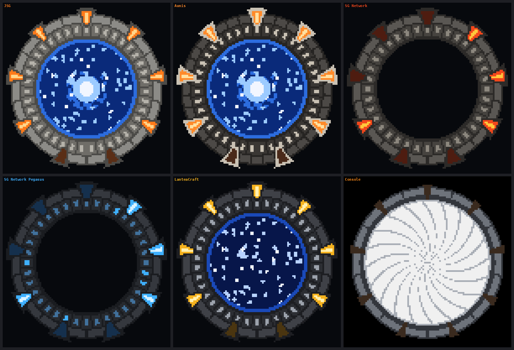
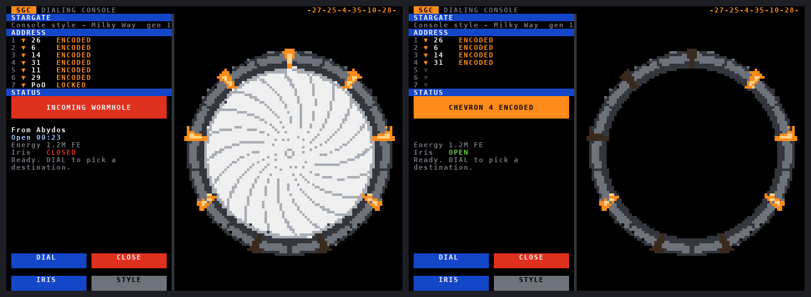
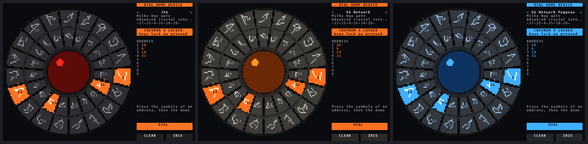

# Looks after the other stargate mods

This release gives the Gate Room and the Dial Home Device looks after the other stargate mods: Just Stargate Mod, Aunis, SGCraft 2.x (the "Stargate Network" mod) and LanteaCraft. It also adds the **Console**, a new way to lay out the Gate Room. The mods and packs haven't changed since v1.4.0; they are attached again so everything is in one place.

## New: Gate Room looks for other mods



- **JSG**: smooth grey stone and orange chevrons. The wormhole is deep blue, flecked with white specks that drift outwards around a bright core.
- **Aunis**: the mod JSG grew out of. A dark ribbed ring with pale chevron housings, and the same flecked wormhole.
- **SG Network**: SGCraft 2.x's gate, dark stone carved with symbols and red-orange chevrons that glow yellow at the heart.
- **SG Network Pegasus**: its Pegasus gate. Near-black stone, with symbols and chevrons that light blue as the gate dials.
- **LanteaCraft**: a dark slate ring of glyphs with amber chevrons, and a deep navy wormhole flecked with white.

Gates pick their mod's look by themselves:

- JSG Milky Way gates get the JSG look, or the Aunis look on Minecraft 1.12.2.
- SGCraft 2.x gates get SG Network.
- LanteaCraft gates get LanteaCraft.

Before, these gates started in the Milky Way or SGCraft look. **STYLE** goes back to those, and the Gate Room remembers your choice. A computer can't tell an SGCraft 2.x Pegasus gate from a Milky Way one, so pick SG Network Pegasus with STYLE.

The looks are drawn after screenshots of the mods, in the Gate Room's own pixel style. They aren't the mods' textures. The OpenComputers dialer, gatedial, picks the same looks for its gate picture. So does the Network Hub, for the gate's name in its title bar.

## New: the Console



The Console lays the Gate Room out like a control room computer. An orange **SGC** badge sits in the title bar. Down the left side are blue-titled panels for the gate, the address chevron by chevron, and the status, with blue **DIAL** and **IRIS** buttons. The gate is on the right, a plain grey ring with slim chevrons. When the iris closes, it fills the ring as a white disc.

Pick it with **STYLE**; it works with every gate.

## New: DHD looks



- **JSG**: a black DHD with orange light and a deep red dome.
- **SG Network**: dark stone, pale symbols and an orange dome.
- **SG Network Pegasus**: the same, with blue light and a blue dome.

JSG Milky Way gates start in the JSG look, and SGCraft 2.x gates in SG Network. The arrows at the top of the panel, or Tab, change the look. In `dhd.lua`, the `look` setting also takes `"jsg"`, `"sgnet"` and `"sgnet_pegasus"`.

## Install or update

Run the installer again. It downloads the changed files, `gateroom.lua`, `dhd.lua`, `sgc/ring.lua` and `sgc/styles.lua`, with the rest. Your address book, iris codes and gate log are kept.

```
wget run https://raw.githubusercontent.com/jarae1205-cpu/StargateJourney-ComputerCraft-Programs/main/StargateCommand/install.lua
```

On OpenComputers, run gatedial's installer again for the new looks.

## Downloads

| File | What it is | Needs |
|---|---|---|
| `jsginfinity-1.4.0.jar` | **Infinity Stargate for JSG**: an add-on with its own Infinity gate and DHDs. Same as in v1.4.0. | Forge 47 (Minecraft 1.20.1), Just Stargate Mod 5.1.2.0 or newer |
| `chevron7-1.6.0.jar` | **Chevron Seven**, a stargate mod built from scratch. Same as in v1.3.0. | Forge 47 (Minecraft 1.20.1). CC: Tweaked and Ad Astra are optional. |
| `JSGInfinity-1.20.1.zip` | **Stargate Infinity look for JSG**: a resource pack that restyles every JSG Milky Way gate. Same as in v1.3.0. | Just Stargate Mod 1.20.1 (made for 5.1.2.0) |
| `sginfinity-1.0.0.jar` | **Infinity Stargate for SGCraft**. Same as in v1.2.0. | Forge 1.12.2 (14.23.5.2838 or newer), SGCraft 2.3.0 or newer |
| `sgcaddon-1.0.0.jar` | **Stargate Command Addon** for Stargate Journey. Same as in 1.0.0. | Forge 47 (Minecraft 1.20.1), Stargate Journey 0.6.40 or newer |
| `StargateJourneyVariants-1.20.1.zip` | **Stargate Journey Variants**: four looks for the Milky Way gate. Same as in 1.0.0. | Stargate Journey |

How to use each one: [the Gate Room's looks](https://github.com/jarae1205-cpu/StargateJourney-ComputerCraft-Programs/tree/main/StargateCommand#gate-looks), [the Console](https://github.com/jarae1205-cpu/StargateJourney-ComputerCraft-Programs/tree/main/StargateCommand#console), [the Dial Home Device](https://github.com/jarae1205-cpu/StargateJourney-ComputerCraft-Programs/tree/main/StargateCommand#dial-home-device), [Infinity Stargate for JSG](https://github.com/jarae1205-cpu/StargateJourney-ComputerCraft-Programs/tree/main/JSGInfinityGate), [Chevron Seven](https://github.com/jarae1205-cpu/StargateJourney-ComputerCraft-Programs/tree/main/ChevronSeven), [the JSG Infinity pack](https://github.com/jarae1205-cpu/StargateJourney-ComputerCraft-Programs/tree/main/JSGInfinity), [Infinity Stargate for SGCraft](https://github.com/jarae1205-cpu/StargateJourney-ComputerCraft-Programs/tree/main/SGCraftInfinityGate), [Stargate Command Addon](https://github.com/jarae1205-cpu/StargateJourney-ComputerCraft-Programs/tree/main/StargateCommandAddon), [Stargate Journey Variants](https://github.com/jarae1205-cpu/StargateJourney-ComputerCraft-Programs/tree/main/StargateJourneyVariants).

The computer programs aren't attached; install them with the command above.

## Tested

Only in the headless CC: Tweaked test harness, with simulated computers, monitors and Stargate Journey gates. **Not tried in a game yet.**

- **The Gate Room** in every new look, and in the Milky Way, SGC Computer and Carter Addon Pack looks, while idle, dialing, with the wormhole open and with the iris closed. It ran on a 4x3 monitor (79x38) and on a small 39x19 screen.
- **STYLE**, switching to the Console and back: the panel moves to the left and back to the right.
- **The DHD** in the new looks and in the gate's own look, while idle, dialing and with the wormhole open.
- **The look each gate starts in**, in the Gate Room and the DHD. This was checked for JSG gates (1.20.1 and 1.12.2: Milky Way, Pegasus, Universe and Movie), SGCraft gates (Greg's and 2.x), LanteaCraft gates, and Stargate Journey, Chevron Seven and Lantea gates, as the programs see them.
- **The new looks on an OpenComputers screen**: they draw without errors. gatedial itself wasn't run.

## License

The programs, the mods, the add-ons and the JSG pack are MIT. The add-ons' textures are drawn by their own scripts. Just Stargate Mod and SGCraft aren't included and keep their own licenses. The gate variant textures, in the variant pack and in the Stargate Command Addon, are recoloured from Stargate Journey's textures and are CC BY-NC-SA 4.0.

## SHA-256

```
a7e4de443f007534a759c49b0caa20ea31d6791e64e05d425ee8c0a7e8f9e976  jsginfinity-1.4.0.jar
bdba8411e4eda0faf93372bb8f9f36e17cb1ec3cb2c8b1cd49dfc74058ef26de  chevron7-1.6.0.jar
4abebc9ba35ed96e0b45954ac6bdc740dfbb56aac71d93ab4405415140952487  JSGInfinity-1.20.1.zip
7449e60402fb5b620bdbf3c4ff54ba65469e71cb0836fccc83cc53573262e832  sginfinity-1.0.0.jar
773fe317b9ffa455150d9d764720d453a5429ffc5981872ba5c15ba6b26ed996  sgcaddon-1.0.0.jar
3c90a5c96429b414df1438f24365934edfc1d6313c0cf29c972e5121f7b2b549  StargateJourneyVariants-1.20.1.zip
```
