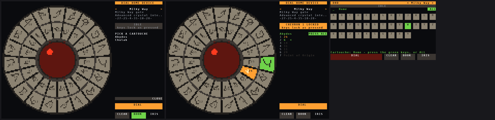

# The DHD's cartouche, and SGCraft addresses with repeated letters

This release is for the **Dial Home Device**. It fixes SGCraft and LanteaCraft addresses that repeat a letter, and adds a **cartouche**: an address from the address book shown on the DHD's keys. The mods and packs haven't changed since v1.4.0; they are attached again so everything is in one place.

## Fixed: addresses that repeat a letter

SGCraft and LanteaCraft addresses can use a letter twice, like `WLDQ-DQB-MT`. Until now the DHD refused a key that was already in the address, so those addresses couldn't be dialed from its keys. Now a key on those gates can be pressed again.

Touching the last key again used to take it back. On those gates it now adds the letter again, so taking back works differently:

- **On the monitor**: touch a symbol's line in the address beside the DHD. That symbol and the ones after it go.
- **On the keypad**: touch the address at the top to take back the last symbol.
- **Backspace** still takes back the last symbol.
- On JSG gates, touching the last key again still takes it back too.

## New: the cartouche



Like the glyph sheet of an address you carry to a DHD:

1. Touch **BOOK** (or Ctrl+B). It lists the address book entries this gate can dial from its keys.
2. Pick one. It becomes the cartouche: its symbols fill the address lines in order, and the next key to press glows green.
3. Press the keys yourself, or touch **PRESS ALL** (**ALL** on the keypad, or Ctrl+A). The rest are pressed for you, then the dome.

A key off the cartouche still works. The panel says which symbol the cartouche has there, and CLEAR takes you back to its start. Once the trip is over, the cartouche goes back in the book.

The book leaves out entries the gate can't dial from its keys: those tied to another gate, those with no address yet, and those in another mod's format.

To update, run the installer again on the DHD's computer:

```
wget run https://raw.githubusercontent.com/jarae1205-cpu/StargateJourney-ComputerCraft-Programs/main/StargateCommand/install.lua dhd
```

Your address book, iris codes and gate log are kept.

## Downloads

| File | What it is | Needs |
|---|---|---|
| `jsginfinity-1.4.0.jar` | **Infinity Stargate for JSG**: an add-on with its own Infinity gate and DHDs. Same as in v1.4.0. | Forge 47 (Minecraft 1.20.1), Just Stargate Mod 5.1.2.0 or newer |
| `chevron7-1.6.0.jar` | **Chevron Seven**, a stargate mod built from scratch. Same as in v1.3.0. | Forge 47 (Minecraft 1.20.1). CC: Tweaked and Ad Astra are optional. |
| `JSGInfinity-1.20.1.zip` | **Stargate Infinity look for JSG**: a resource pack that restyles every JSG Milky Way gate. Same as in v1.3.0. | Just Stargate Mod 1.20.1 (made for 5.1.2.0) |
| `sginfinity-1.0.0.jar` | **Infinity Stargate for SGCraft**. Same as in v1.2.0. | Forge 1.12.2 (14.23.5.2838 or newer), SGCraft 2.3.0 or newer |
| `sgcaddon-1.0.0.jar` | **Stargate Command Addon** for Stargate Journey. Same as in 1.0.0. | Forge 47 (Minecraft 1.20.1), Stargate Journey 0.6.40 or newer |
| `StargateJourneyVariants-1.20.1.zip` | **Stargate Journey Variants**: four looks for the Milky Way gate. Same as in 1.0.0. | Stargate Journey |

How to use each one: [the Dial Home Device and its cartouche](https://github.com/jarae1205-cpu/StargateJourney-ComputerCraft-Programs/tree/main/StargateCommand#the-cartouche), [Infinity Stargate for JSG](https://github.com/jarae1205-cpu/StargateJourney-ComputerCraft-Programs/tree/main/JSGInfinityGate), [Chevron Seven](https://github.com/jarae1205-cpu/StargateJourney-ComputerCraft-Programs/tree/main/ChevronSeven), [the JSG Infinity pack](https://github.com/jarae1205-cpu/StargateJourney-ComputerCraft-Programs/tree/main/JSGInfinity), [Infinity Stargate for SGCraft](https://github.com/jarae1205-cpu/StargateJourney-ComputerCraft-Programs/tree/main/SGCraftInfinityGate), [Stargate Command Addon](https://github.com/jarae1205-cpu/StargateJourney-ComputerCraft-Programs/tree/main/StargateCommandAddon), [Stargate Journey Variants](https://github.com/jarae1205-cpu/StargateJourney-ComputerCraft-Programs/tree/main/StargateJourneyVariants).

The computer programs aren't attached; install them with the command above.

## Tested

Only in the headless CC: Tweaked test harness, with simulated computers, monitors and gates. 146 checks passed. **Not tried in a game yet.**

- **Repeated letters**: an SGCraft address with D and Q twice, dialed from the keypad. A letter pressed twice, then taken back from its address line on the monitor, and from the address at the top of the keypad.
- **The cartouche** on a Stargate Journey gate:
  - the book listing only the entries that gate can dial
  - the green key moving on as the keys are pressed
  - a wrong key, then CLEAR back to the start
  - PRESS ALL opening the wormhole and sending the entry's iris code
  - the cartouche put away after the trip
  - Ctrl+B and Ctrl+A
- **The cartouche** on an SGCraft gate, on the computer's screen.
- **Everything from v1.6.0 and v1.7.0 still passes**: dialing on Stargate Journey, Chevron Seven, Lantea, SGCraft, LanteaCraft and JSG gates, every look, and screens from 26x20 to 165x81.

## License

The programs, the mods, the add-ons and the JSG pack are MIT. The add-ons' textures are drawn by their own scripts. Just Stargate Mod and SGCraft aren't included and keep their own licenses. The gate variant textures, in the variant pack and in the Stargate Command Addon, are recoloured from Stargate Journey's textures and are CC BY-NC-SA 4.0.

## SHA-256

```
a7e4de443f007534a759c49b0caa20ea31d6791e64e05d425ee8c0a7e8f9e976  jsginfinity-1.4.0.jar
bdba8411e4eda0faf93372bb8f9f36e17cb1ec3cb2c8b1cd49dfc74058ef26de  chevron7-1.6.0.jar
4abebc9ba35ed96e0b45954ac6bdc740dfbb56aac71d93ab4405415140952487  JSGInfinity-1.20.1.zip
7449e60402fb5b620bdbf3c4ff54ba65469e71cb0836fccc83cc53573262e832  sginfinity-1.0.0.jar
773fe317b9ffa455150d9d764720d453a5429ffc5981872ba5c15ba6b26ed996  sgcaddon-1.0.0.jar
3c90a5c96429b414df1438f24365934edfc1d6313c0cf29c972e5121f7b2b549  StargateJourneyVariants-1.20.1.zip
```
