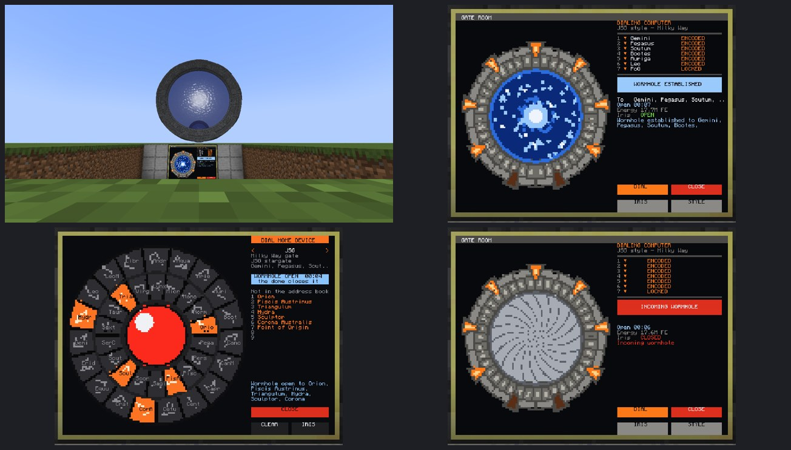
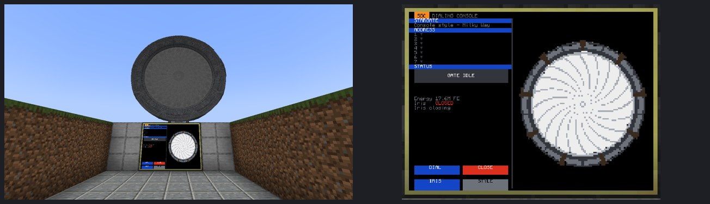

# JSG addresses typed in full, and the new looks tried in a game

The new looks from v1.7.0 have now been tried in a Minecraft 1.20.1 game with Just Stargate Mod. The test turned up a bug: a JSG address typed on the Gate Room's computer was cut short. This release fixes it. The mods and packs haven't changed since v1.4.0; they are attached again so everything is in one place.

## Fixed: typing a JSG address

The Gate Room's typing line held only 40 characters. A JSG address typed as names, such as `Gemini, Pegasus, Scutum, Bootes, Auriga, Leo`, is longer than that. The last name was cut off, and the Gate Room said "Address needs 6 to 8 symbol names". The line now holds 160 characters, enough for 8 long names. While you type, the screen shows the end of the line.

The Network Hub's address field had the same 40-character limit, and holds 160 characters now too.

## Tried in a game



The test ran on a Forge 1.20.1 server with JSG 5.1.2.0 and CC: Tweaked 1.120.2, with a game client joined to it. It had two JSG gates, each with an advanced computer under its base and a 4x3 advanced monitor.

- **The Gate Room** started in the JSG look by itself. Its panel read "JSG style - Milky Way". It dialed the other gate from a typed address, chevron by chevron. It drew the open wormhole as the flecked blue pool with a bright core, next to JSG's own.
- **The DHD** at the other gate started in its JSG look, the black DHD with the red dome. It showed the incoming wormhole, then dialed back from typed names. Locked keys lit orange while the rest blinked.
- **The Console** worked on the same gate. IRIS closed the gate's iris, and the console filled the ring with the white disc. JSG only lets a computer move the iris when the gate's iris mode is set to OC.



The Aunis, SG Network and LanteaCraft looks haven't been tried in a game yet, only in the test harness.

## Install or update

Run the installer again. It downloads the fixed `gateroom.lua` and `hub.lua` with the rest. Your address book, iris codes and gate log are kept.

```
wget run https://raw.githubusercontent.com/jarae1205-cpu/StargateJourney-ComputerCraft-Programs/main/StargateCommand/install.lua
```

## Downloads

| File | What it is | Needs |
|---|---|---|
| `jsginfinity-1.4.0.jar` | **Infinity Stargate for JSG**: an add-on with its own Infinity gate and DHDs. Same as in v1.4.0. | Forge 47 (Minecraft 1.20.1), Just Stargate Mod 5.1.2.0 or newer |
| `chevron7-1.6.0.jar` | **Chevron Seven**, a stargate mod built from scratch. Same as in v1.3.0. | Forge 47 (Minecraft 1.20.1). CC: Tweaked and Ad Astra are optional. |
| `JSGInfinity-1.20.1.zip` | **Stargate Infinity look for JSG**: a resource pack that restyles every JSG Milky Way gate. Same as in v1.3.0. | Just Stargate Mod 1.20.1 (made for 5.1.2.0) |
| `sginfinity-1.0.0.jar` | **Infinity Stargate for SGCraft**. Same as in v1.2.0. | Forge 1.12.2 (14.23.5.2838 or newer), SGCraft 2.3.0 or newer |
| `sgcaddon-1.0.0.jar` | **Stargate Command Addon** for Stargate Journey. Same as in 1.0.0. | Forge 47 (Minecraft 1.20.1), Stargate Journey 0.6.40 or newer |
| `StargateJourneyVariants-1.20.1.zip` | **Stargate Journey Variants**: four looks for the Milky Way gate. Same as in 1.0.0. | Stargate Journey |

How to use each one: [the Gate Room's looks](https://github.com/jarae1205-cpu/StargateJourney-ComputerCraft-Programs/tree/main/StargateCommand#gate-looks), [the Dial Home Device](https://github.com/jarae1205-cpu/StargateJourney-ComputerCraft-Programs/tree/main/StargateCommand#dial-home-device), [Infinity Stargate for JSG](https://github.com/jarae1205-cpu/StargateJourney-ComputerCraft-Programs/tree/main/JSGInfinityGate), [Chevron Seven](https://github.com/jarae1205-cpu/StargateJourney-ComputerCraft-Programs/tree/main/ChevronSeven), [the JSG Infinity pack](https://github.com/jarae1205-cpu/StargateJourney-ComputerCraft-Programs/tree/main/JSGInfinity), [Infinity Stargate for SGCraft](https://github.com/jarae1205-cpu/StargateJourney-ComputerCraft-Programs/tree/main/SGCraftInfinityGate), [Stargate Command Addon](https://github.com/jarae1205-cpu/StargateJourney-ComputerCraft-Programs/tree/main/StargateCommandAddon), [Stargate Journey Variants](https://github.com/jarae1205-cpu/StargateJourney-ComputerCraft-Programs/tree/main/StargateJourneyVariants).

The computer programs aren't attached; install them with the command above.

## License

The programs, the mods, the add-ons and the JSG pack are MIT. The add-ons' textures are drawn by their own scripts. Just Stargate Mod and SGCraft aren't included and keep their own licenses. The gate variant textures, in the variant pack and in the Stargate Command Addon, are recoloured from Stargate Journey's textures and are CC BY-NC-SA 4.0.

## SHA-256

```
a7e4de443f007534a759c49b0caa20ea31d6791e64e05d425ee8c0a7e8f9e976  jsginfinity-1.4.0.jar
bdba8411e4eda0faf93372bb8f9f36e17cb1ec3cb2c8b1cd49dfc74058ef26de  chevron7-1.6.0.jar
4abebc9ba35ed96e0b45954ac6bdc740dfbb56aac71d93ab4405415140952487  JSGInfinity-1.20.1.zip
7449e60402fb5b620bdbf3c4ff54ba65469e71cb0836fccc83cc53573262e832  sginfinity-1.0.0.jar
773fe317b9ffa455150d9d764720d453a5429ffc5981872ba5c15ba6b26ed996  sgcaddon-1.0.0.jar
3c90a5c96429b414df1438f24365934edfc1d6313c0cf29c972e5121f7b2b549  StargateJourneyVariants-1.20.1.zip
```
