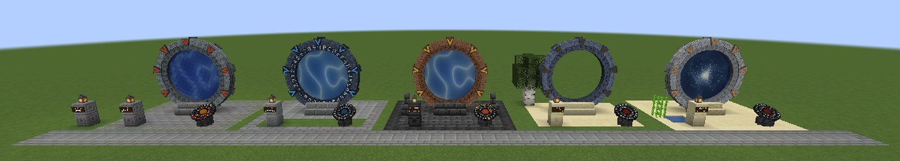
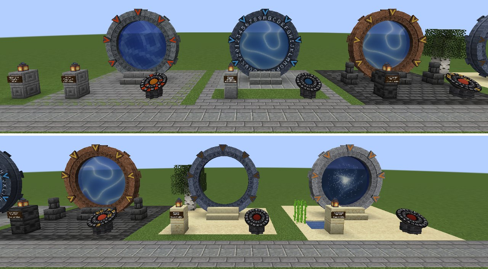

# The stargate mods of Minecraft in a row

This release brings **Chevron Seven 1.7.0**. Its new command, `/chevron7 history`, builds the stargate mods of Minecraft side by side, each gate in the look of its mod. It also adds four gate looks after those mods. The Gate Room, the DHD and the Personal Dialer pick a matching look for them. The other mods and packs haven't changed; they are attached again so everything is in one place.

## New: the history row





`/chevron7 history <pos> [direction]` builds five gates in a row, oldest on the left as you face them:

| | Gate | Look | Ground |
|---|---|---|---|
| **SGCraft** (Greg's original, Minecraft 1.7.10 to 1.12.2) | a ring of letters | `sgcraft` | stone bricks gone mossy at the edges |
| **Stargate Network** (SGCraft 2.x, 1.12.2) | a ring of letters | `network` | grass, with a stone pad under the gate |
| **Just Stargate Mod** (1.12.2) | the classic gate | `jsg112` | dark stone bricks, with a pillar on each side of the step |
| **Stargate Journey** (1.20.1) | the classic gate | `journey` | sand and grass, with a birch tree |
| **Just Stargate Mod** (1.20.1) | the classic gate | `jsg120` | a beach, with a pool and sugar cane |

- Each gate has a step, its own DHD, and a plaque saying which mod it is and for which Minecraft. The plaque is a post with a lantern and a glowing sign. The signs are waxed, so nobody edits them by accident.
- A path runs along the front, with a plaque at its start.
- The gates are real gates. Each has its own address and dials the others; the two letter gates take letters or symbols.
- The looks and the ground are drawn and built by Chevron Seven itself. Nothing is taken from the other mods, and none of them need to be installed.

## New: four gate looks

| Look | |
|---|---|
| `sgcraft` | after Greg's SGCraft: cool grey stone, red-orange chevrons, deep blue water in big square pixels |
| `jsg112` | after Just Stargate Mod on 1.12.2, in evening light: copper-brown stone, gold chevrons |
| `journey` | after Stargate Journey: slate blue-grey stone, orange chevrons |
| `jsg120` | after Just Stargate Mod on 1.20: pale grey stone, amber chevrons, a dark blue wormhole with a white glow in the middle |

Any gate can wear them, through the Gate Look Crystal or `/chevron7 look <pos> <look>`. `/chevron7 look <pos> sgcraft` used to give the Stargate Network look; it now gives the new SGCraft one.

The dark DHD's dome now takes its gate's look into account: orange by an `sgcraft` gate and blue by a `network` gate, like those mods' DHDs. By every other gate it is red as before.

## The programs

Computers see a gate's look as its variant, such as `chevron7:jsg120`. For the new looks:

| Look | Gate Room | DHD | Personal Dialer |
|---|---|---|---|
| `sgcraft` | SGCraft | SG Network | SGCraft |
| `jsg112` | Aunis | JSG | Milky Way |
| `jsg120` | JSG | JSG | Milky Way |
| `journey` | Milky Way | Milky Way | Milky Way |

Without this, `jsg112` and `jsg120` would have been taken for SG-1, because they contain "sg1".

## Install or update

**Chevron Seven**: put `chevron7-1.7.0.jar` in the `mods` folder of the client and the server, in place of `chevron7-1.6.0.jar`. Worlds and gates carry over.

**The programs**: run the installer again. It downloads the changed files, `dhd.lua`, `dialer.lua` and `sgc/styles.lua`, with the rest. Your address book, iris codes and gate log are kept.

```
wget run https://raw.githubusercontent.com/jarae1205-cpu/StargateJourney-ComputerCraft-Programs/main/StargateCommand/install.lua
```

## Downloads

| File | What it is | Needs |
|---|---|---|
| `chevron7-1.7.0.jar` | **Chevron Seven**, a stargate mod built from scratch. New in this release: the history row and four looks. | Forge 47 (Minecraft 1.20.1). CC: Tweaked and Ad Astra are optional. |
| `jsginfinity-1.4.0.jar` | **Infinity Stargate for JSG**: an add-on with its own Infinity gate and DHDs. Same as in v1.4.0. | Forge 47 (Minecraft 1.20.1), Just Stargate Mod 5.1.2.0 or newer |
| `JSGInfinity-1.20.1.zip` | **Stargate Infinity look for JSG**: a resource pack that restyles every JSG Milky Way gate. Same as in v1.3.0. | Just Stargate Mod 1.20.1 (made for 5.1.2.0) |
| `sginfinity-1.0.0.jar` | **Infinity Stargate for SGCraft**. Same as in v1.2.0. | Forge 1.12.2 (14.23.5.2838 or newer), SGCraft 2.3.0 or newer |
| `sgcaddon-1.0.0.jar` | **Stargate Command Addon** for Stargate Journey. Same as in 1.0.0. | Forge 47 (Minecraft 1.20.1), Stargate Journey 0.6.40 or newer |
| `StargateJourneyVariants-1.20.1.zip` | **Stargate Journey Variants**: four looks for the Milky Way gate. Same as in 1.0.0. | Stargate Journey |

How to use each one: [Chevron Seven and the history row](https://github.com/jarae1205-cpu/StargateJourney-ComputerCraft-Programs/tree/main/ChevronSeven#the-stargate-mods-of-minecraft), [Infinity Stargate for JSG](https://github.com/jarae1205-cpu/StargateJourney-ComputerCraft-Programs/tree/main/JSGInfinityGate), [the JSG Infinity pack](https://github.com/jarae1205-cpu/StargateJourney-ComputerCraft-Programs/tree/main/JSGInfinity), [Infinity Stargate for SGCraft](https://github.com/jarae1205-cpu/StargateJourney-ComputerCraft-Programs/tree/main/SGCraftInfinityGate), [Stargate Command Addon](https://github.com/jarae1205-cpu/StargateJourney-ComputerCraft-Programs/tree/main/StargateCommandAddon), [Stargate Journey Variants](https://github.com/jarae1205-cpu/StargateJourney-ComputerCraft-Programs/tree/main/StargateJourneyVariants).

The computer programs aren't attached; install them with the command above.

## Tested

**Chevron Seven 1.7.0** ran on a dedicated Forge 1.20.1 server (47.4.29) and in a Minecraft 1.20.1 client on the same Forge, in a flat world. The pictures above are from that client.

- **The row:** the command, run from a data pack, built the five gates where they belong, with their looks, steps, DHDs and plaques. The signs read as above, glowing and waxed, and the pool, sugar cane, birch tree and pillars were in place.
- **Dialing between mods:**
  - The SGCraft gate dialed the JSG 1.20 gate by its letters, and the wormhole opened.
  - The JSG 1.12.2 gate dialed the Stargate Network gate by its symbols, and the wormhole opened.
- **In the client:** every look showed as in the pictures. The SGCraft gate's DHD had an orange dome and the Stargate Network one blue; the others stayed red.

**The programs:** the Gate Room's look-up was run in Lua 5.2 for each new look and gave the styles in the table above. The DHD's and Personal Dialer's changes were only checked for syntax. **None of the three was run on a computer in the game.**

## License

The programs, the mods, the add-ons and the JSG pack are MIT. The add-ons' textures are drawn by their own scripts. Just Stargate Mod and SGCraft aren't included and keep their own licenses. The gate variant textures, in the variant pack and in the Stargate Command Addon, are recoloured from Stargate Journey's textures and are CC BY-NC-SA 4.0.

## SHA-256

```
1fa6c5860e75b28a89709526354559ee268b375f6efa892a451294905484bebc  chevron7-1.7.0.jar
a7e4de443f007534a759c49b0caa20ea31d6791e64e05d425ee8c0a7e8f9e976  jsginfinity-1.4.0.jar
4abebc9ba35ed96e0b45954ac6bdc740dfbb56aac71d93ab4405415140952487  JSGInfinity-1.20.1.zip
7449e60402fb5b620bdbf3c4ff54ba65469e71cb0836fccc83cc53573262e832  sginfinity-1.0.0.jar
773fe317b9ffa455150d9d764720d453a5429ffc5981872ba5c15ba6b26ed996  sgcaddon-1.0.0.jar
3c90a5c96429b414df1438f24365934edfc1d6313c0cf29c972e5121f7b2b549  StargateJourneyVariants-1.20.1.zip
```
