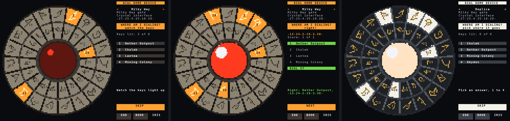

# Where am I dialing?

This release is for the **Dial Home Device**. It adds **Where am I dialing?**, a guessing game, and **Replica**, a new look. Both come from a fan's 3D-printed DHD that lights up an address and asks where it goes. The mods and packs haven't changed since v1.4.0; they are attached again so everything is in one place.

## New: Where am I dialing?



1. Touch **BOOK**, then **? Where am I dialing?** at the top of the list, or press **Ctrl+G**.
2. The keys of an address book entry light up one at a time, then the dome.
3. Pick where it goes from up to four names, by touch or by typing 1 to 4. The right one turns green, a wrong pick red, and its address is shown.
4. **NEXT** (or Enter) plays another round. **SKIP**, before you guess, moves on without counting the round.
5. **DIAL IT** makes the answer the cartouche, so you can dial it straight away. **END** stops the game and shows your score.

Only the screen lights up, and the gate is left alone. The game waits for an idle gate and stops if someone dials in or out. It plays with no gate at all, too.

The answers come from your address book: the entries whose addresses this DHD's keys can spell. That means numbers on Stargate Journey, Chevron Seven and Lantea gates, letters on SGCraft and LanteaCraft gates, and names on JSG gates. It needs at least two.

## New: the Replica look

Slate keys with gold symbols that light up white, pale ridges between the keys, and a copper dome that glows warm white. Pick it with the arrows at the top of the panel, or Tab. In `dhd.lua`, the `look` setting also takes `"replica"`.

## Install or update

Run the installer again on the DHD's computer:

```
wget run https://raw.githubusercontent.com/jarae1205-cpu/StargateJourney-ComputerCraft-Programs/main/StargateCommand/install.lua dhd
```

Only `dhd.lua` has changed. Your address book, iris codes and gate log are kept.

## Downloads

| File | What it is | Needs |
|---|---|---|
| `jsginfinity-1.4.0.jar` | **Infinity Stargate for JSG**: an add-on with its own Infinity gate and DHDs. Same as in v1.4.0. | Forge 47 (Minecraft 1.20.1), Just Stargate Mod 5.1.2.0 or newer |
| `chevron7-1.6.0.jar` | **Chevron Seven**, a stargate mod built from scratch. Same as in v1.3.0. | Forge 47 (Minecraft 1.20.1). CC: Tweaked and Ad Astra are optional. |
| `JSGInfinity-1.20.1.zip` | **Stargate Infinity look for JSG**: a resource pack that restyles every JSG Milky Way gate. Same as in v1.3.0. | Just Stargate Mod 1.20.1 (made for 5.1.2.0) |
| `sginfinity-1.0.0.jar` | **Infinity Stargate for SGCraft**. Same as in v1.2.0. | Forge 1.12.2 (14.23.5.2838 or newer), SGCraft 2.3.0 or newer |
| `sgcaddon-1.0.0.jar` | **Stargate Command Addon** for Stargate Journey. Same as in 1.0.0. | Forge 47 (Minecraft 1.20.1), Stargate Journey 0.6.40 or newer |
| `StargateJourneyVariants-1.20.1.zip` | **Stargate Journey Variants**: four looks for the Milky Way gate. Same as in 1.0.0. | Stargate Journey |

How to use each one: [Where am I dialing?](https://github.com/jarae1205-cpu/StargateJourney-ComputerCraft-Programs/tree/main/StargateCommand#where-am-i-dialing), [Infinity Stargate for JSG](https://github.com/jarae1205-cpu/StargateJourney-ComputerCraft-Programs/tree/main/JSGInfinityGate), [Chevron Seven](https://github.com/jarae1205-cpu/StargateJourney-ComputerCraft-Programs/tree/main/ChevronSeven), [the JSG Infinity pack](https://github.com/jarae1205-cpu/StargateJourney-ComputerCraft-Programs/tree/main/JSGInfinity), [Infinity Stargate for SGCraft](https://github.com/jarae1205-cpu/StargateJourney-ComputerCraft-Programs/tree/main/SGCraftInfinityGate), [Stargate Command Addon](https://github.com/jarae1205-cpu/StargateJourney-ComputerCraft-Programs/tree/main/StargateCommandAddon), [Stargate Journey Variants](https://github.com/jarae1205-cpu/StargateJourney-ComputerCraft-Programs/tree/main/StargateJourneyVariants).

The computer programs aren't attached; install them with the command above.

## Tested

Only in a headless CC: Tweaked test harness, with simulated computers, monitors and gates. **Not tried in a game yet.**

- **Where am I dialing?** on a round DHD with a Stargate Journey gate, played by touch and by keyboard (41 checks, run with 12 different shuffles):
  - starting from the book and with Ctrl+G
  - the keys lighting one by one, then the dome
  - right and wrong guesses, with the score
  - NEXT, Enter and SKIP, never the same answer twice in a row
  - a key touched during the game, which leaves the gate alone
  - DIAL IT, then PRESS ALL, opening the wormhole to the answer
  - no game while the wormhole is open, or with a chevron locked
  - an incoming wormhole stopping the game
  - END and Ctrl+G stopping it, and the keys working again afterwards
- **On the keypad**, on the computer's screen with an SGCraft gate: only letter addresses offered, answers typed, NEXT, DIAL IT, and the cartouche dialing the answer.
- **With no gate**: the default address book's three entries as the choices, and no DIAL IT.
- **A book with one usable address**: the game says it needs two.
- **Every look**, the Replica look included, while the keys light up.
- **Screens** from 26x20 to 165x81.
- **Dialing by touch and keyboard** on a Stargate Journey gate, as before.

## License

The programs, the mods, the add-ons and the JSG pack are MIT. The add-ons' textures are drawn by their own scripts. Just Stargate Mod and SGCraft aren't included and keep their own licenses. The gate variant textures, in the variant pack and in the Stargate Command Addon, are recoloured from Stargate Journey's textures and are CC BY-NC-SA 4.0.

## SHA-256

```
a7e4de443f007534a759c49b0caa20ea31d6791e64e05d425ee8c0a7e8f9e976  jsginfinity-1.4.0.jar
bdba8411e4eda0faf93372bb8f9f36e17cb1ec3cb2c8b1cd49dfc74058ef26de  chevron7-1.6.0.jar
4abebc9ba35ed96e0b45954ac6bdc740dfbb56aac71d93ab4405415140952487  JSGInfinity-1.20.1.zip
7449e60402fb5b620bdbf3c4ff54ba65469e71cb0836fccc83cc53573262e832  sginfinity-1.0.0.jar
773fe317b9ffa455150d9d764720d453a5429ffc5981872ba5c15ba6b26ed996  sgcaddon-1.0.0.jar
3c90a5c96429b414df1438f24365934edfc1d6313c0cf29c972e5121f7b2b549  StargateJourneyVariants-1.20.1.zip
```
