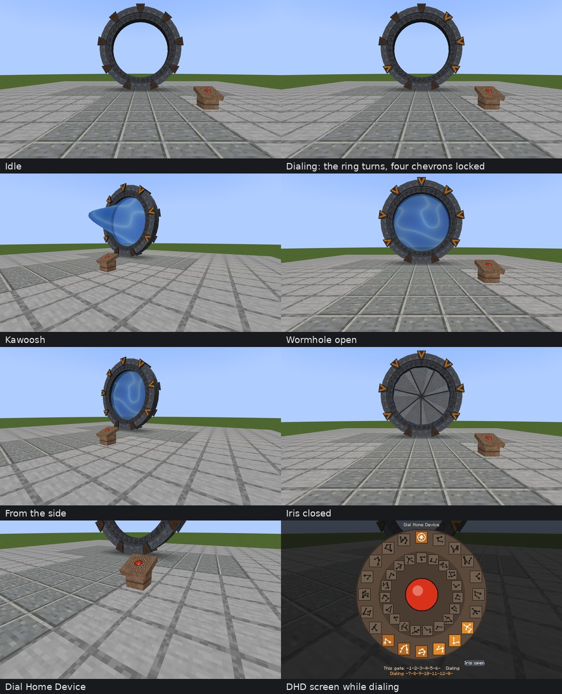
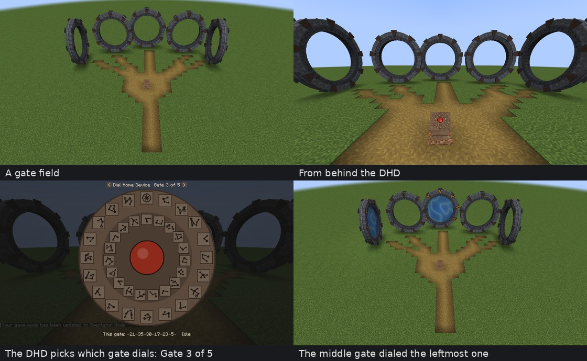
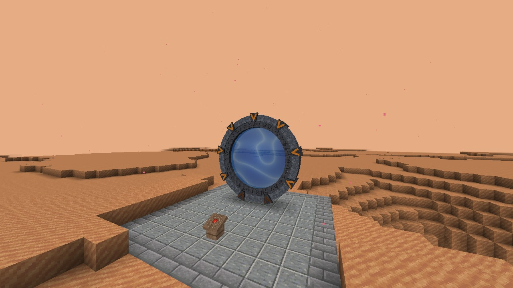

# Chevron Seven

A stargate mod for **Minecraft 1.20.1 (Forge)**, written from scratch: its own gate, Dial Home Device and iris, with all textures and symbols drawn by its own script. It needs no other stargate mod. With [CC: Tweaked](https://modrinth.com/mod/cc-tweaked) installed, the gate is a computer peripheral that the [Gate Room, Network Hub](../StargateCommand/) and [Personal Dialer](../PersonalDialer/) drive just as they drive Stargate Journey.



## The gate

- A ring seven blocks across, with a symbol track that turns to each symbol, nine chevrons, and an event horizon that ripples and swirls.
- Dialing locks seven chevrons: six symbols, then the point of origin. The ring turns one way, then the other, and the top chevron engages each symbol.
- The wormhole opens with a kawoosh. The vortex vaporises anything standing in front of the gate (you can turn this off).
- Step into the event horizon of the gate you dialed from and you come out of the other gate, facing out, at the same height and side, even in another dimension. Travel is one way, from the dialing gate. The receiving gate's horizon doesn't send you back. The bottom of the ring is a solid block, so jump in, or build a step up to the gate.
- The wormhole closes by itself after five minutes (configurable, up to 38 minutes). Only the dialing gate can close it, unless you allow it in the config.
- Both gates keep their chunks loaded while they are connected.
- The ring lights up its surroundings while a wormhole is open.
- A comparator next to the stargate block reads how many chevrons are locked.

Right-click any part of the ring to see the gate's address. Every gate gets its own random address of six different symbols from 1 to 38; the point of origin, symbol 0, is the same for every gate and is dialed last.

## Blocks and items

| | What it does | Recipe |
|---|---|---|
| **Stargate** | Place it on the ground, facing you: it needs a clear 7 × 7 space. You place the bottom middle block; the rest of the ring builds itself. Break any part to pick the whole gate up again. | iron blocks in the corners, eyes of ender on the sides, a lodestone in the middle |
| **Dial Home Device** | Right-click it to dial the nearest gate within 16 blocks. Press six symbols, then the big red button (or the point of origin). Press the red button again to close the wormhole; while dialing, it cancels the dial. With several gates in range, the arrows by the title pick which one it dials from. | redstone block on top, gold ingot, compass, gold ingot in the middle, smooth sandstone along the bottom |
| **Gate Iris** | Use it on a gate to fit an iris. Close it from the DHD, a computer or a command. Travelers from the other side hit a closed iris and bounce back, and it stops the kawoosh. | iron ingots around an iron trapdoor |
| **Gate Address Book** | Use it to read the address of every planet's gate (see [planet gates](#planet-gates)). | a book and an eye of ender |

## Gate fields



*A gate field in a Minecraft 1.20.1 client: five gates around a clearing, with the DHD in the middle choosing which gate dials. Bottom right: the middle gate has dialed the leftmost one.*

A gate field is five gates on an arc around a clearing, each at the end of a dirt path, with one DHD in the middle that can dial from any of them. The outer gates turn towards the middle as far as a gate can (gates face north, east, south or west).

- They appear by themselves, rarely, in plains, sunflower plains, meadows and savannas, on flat dry ground. Every gate has its own address.
- An operator can build one anywhere: `/chevron7 field <pos> [direction] [gates]`, e.g. `/chevron7 field ~ ~ ~ north 5`. The gates stand 13 blocks from `<pos>` in that direction; 1 to 7 gates.
- Turn the natural ones off with `gate_fields = false` in the config.

## Planet gates



*Mars in a Minecraft 1.20.1 client with Ad Astra 1.15.21: the planet's gate on its paved pad, with a wormhole open from a gate on Earth.*

With [Ad Astra](https://modrinth.com/mod/ad-astra) installed, the Moon, Mars, Venus, Mercury and Glacio each have a gate: a paved pad near 8, 6 with the gate and a DHD.

- Every planet's gate has its own address, fixed for the world. The **Gate Address Book** (or `/chevron7 planets`) lists them.
- You can dial a planet before anyone has been there: the first wormhole to it generates the planet's gate. A gate on Earth can dial Mars directly.
- Ad Astra's planets have no air to breathe, except Glacio. Wear a space suit before you step through.
- Turn planet gates off with `planet_gates = false` in the config.

Galacticraft isn't available for Forge 1.20.1 (only the 1.12.2 Galacticraft Legacy is), so it has no planet gates. Other mods' planets can get gates with a data pack that adds their biomes to the `#chevron7:has_planet_gate` biome tag.

## Computers (CC: Tweaked)

Put a computer against any block of the ring, or connect one with a wired modem. The peripheral type is `chevron7_stargate`.

| Method | |
|---|---|
| `getLocalAddress()` | this gate's address, e.g. `{12, 5, 30, 21, 7, 1}` |
| `engageSymbol(symbol)` | turns the ring to the symbol and locks a chevron; dial 0 last to open the wormhole |
| `dialAddress(address)` | dials a whole address, e.g. `dialAddress({12, 5, 30, 21, 7, 1})` |
| `disconnectStargate()` | closes the wormhole, or stops a dial |
| `getChevronsEngaged()`, `getDialedAddress()`, `getConnectedAddress()` | chevrons locked, symbols dialed, the address on the other side |
| `isStargateConnected()`, `isStargateDialingOut()`, `isWormholeOpen()`, `getOpenTime()` | the connection |
| `getGateState()` | `idle`, `dialing`, `opening`, `open`, `closing` or `resetting` |
| `getRotationDegrees()`, `getCurrentSymbol()`, `isCurrentSymbol(symbol)` | the symbol ring |
| `getIris()`, `openIris()`, `closeIris()`, `getIrisProgressPercentage()` | the iris |
| `getRecentFeedback()` | the last result as a code and a name, e.g. `-5, "invalid_address"` |
| `sendStargateMessage(text)` | the other gate gets a `stargate_message_received` event |
| `getStargateType()` | `"chevron7:stargate"` |

Events (the first argument is the peripheral's name): `stargate_chevron_engaged` (chevrons, chevron, incoming, symbol), `stargate_rotation_started`, `stargate_rotation_stopped`, `stargate_outgoing_wormhole` (address), `stargate_incoming_wormhole` (address), `stargate_disconnected` (code, reason), `stargate_reset` (code, reason), `stargate_deconstructing_entity` and `stargate_reconstructing_entity` (type, name, uuid), `iris_thud` (type, name, uuid) and `stargate_message_received` (text).

The names, the feedback codes and the events follow Stargate Journey's crystal interface, so programs written for that mostly work here as they are.

## Commands

For operators:

```
/chevron7 list                          every gate and its address
/chevron7 address <pos>                 the address and state of a gate
/chevron7 dial <pos> <address>          dial, e.g. /chevron7 dial ~ ~ ~5 12-5-30-21-7-1
/chevron7 close <pos>
/chevron7 iris <pos> open|close
/chevron7 field <pos> [direction] [gates]   build a gate field (see above)
/chevron7 planets                       the planets' gate addresses
```

`<pos>` can be any block of the ring.

## Config

`config/chevron7-common.toml`:

| Option | Default | |
|---|---|---|
| `max_open_seconds` | 300 | how long a wormhole stays open (10 to 2280) |
| `kawoosh_kills` | true | the kawoosh destroys what stands in front of the gate |
| `incoming_can_close` | false | the receiving gate can close the wormhole too |
| `gate_fields` | true | gate fields appear in plains, meadows and savannas |
| `planet_gates` | true | planets (Ad Astra) get a gate near 8, 6 |

## Install

Put [`dist/chevron7-1.1.0.jar`](dist/chevron7-1.1.0.jar) in the `mods` folder (client and server) of a Forge 47 / Minecraft 1.20.1 game. CC: Tweaked is optional.

## Tested

- **Dedicated Forge 1.20.1 server (47.4.29) with CC: Tweaked 1.120.2**: three gates, one of them in the Nether.
  - The `sgc.gate` adapter of the Stargate Command programs found the gate, dialed it and closed it, and read its errors. Its events arrived in order.
  - The kawoosh killed a pig standing in front of the receiving gate.
  - A pig walked through to the other gate, and another came out at the gate in the Nether.
  - A closed iris bounced a traveler back.
  - Breaking the stargate block, or any block of the ring, removed the whole gate.
- **Minecraft 1.20.1 client** with software rendering (no graphics card): the screenshots on this page come from it. The gate was dialed with `/chevron7 dial`, and then by clicking six symbol keys and the big button on the DHD screen, which opened the wormhole to the other gate.

- **Gate fields**:
  - Built with `/chevron7 field` and with `/place feature chevron7:gate_field` on the server.
  - In a newly generated normal world, with a test data pack that put a field in every eligible chunk: 237 gates around spawn, with no errors and no world-generation warnings.
  - In the client, the DHD's arrows picked the middle gate, and clicking an address on the DHD opened its wormhole to the leftmost gate.

- **Planet gates**, on a server with Ad Astra 1.15.21:
  - The address book listed the five planets and left out the orbits.
  - A gate on Earth dialed Mars before anyone had been there. The wormhole generated Mars's gate site (gate facing south, DHD on the paved pad), and a pig walked from Earth to Mars.
  - Without Ad Astra, the mod loads and the address book says there are no planets.
  - In a Minecraft 1.20.1 client, on a server set up the same way, a gate on Earth dialed Mars, and the Mars gate opened its end of the wormhole. The picture above is from that client.

- **Two players**, each in a Minecraft 1.20.1 client, on a server with Ad Astra:
  - One player jumped into the gate on Earth and came out of the gate on Mars, then jumped back through a wormhole dialed from Mars.
  - The other player, beside the Earth gate, saw the wormhole and the first player.
  - Walking straight at the gate doesn't take you through: the bottom of the ring is a block, so you have to jump.

Not tested: the sounds (all of them are Minecraft's own sounds; the test machine had no sound device).

## Build

```
python3 tools/make_resources.py   # only after changing it: textures, symbols, models, recipes
./gradlew build
```

The jar is `build/libs/chevron7-1.1.0.jar`.

## License

MIT, see [LICENSE](../LICENSE). That covers the textures and symbols too: they are original, drawn by `tools/make_resources.py`.
