# Chevron Seven

A stargate mod for **Minecraft 1.20.1 (Forge)**, written from scratch: its own gates, Dial Home Device and iris, with all textures and symbols drawn by its own script. It needs no other stargate mod. With [CC: Tweaked](https://modrinth.com/mod/cc-tweaked) installed, the gate is a computer peripheral that the [Gate Room, Network Hub](../StargateCommand/) and [Personal Dialer](../PersonalDialer/) drive just as they drive Stargate Journey, and the SG Computer Interface lets programs written for SGCraft drive it too.

Besides the classic gate there is a **Stargate Network** gate in the style of SGCraft, with a ring of letters and nine chevrons. Both kinds share one network and can dial each other, and both can wear any of the [gate looks](#gate-looks), the *Stargate Infinity* cartoon look among them.


## The gate

- A ring seven blocks across, with a symbol track that turns to each symbol, nine chevrons, and an event horizon that ripples and swirls.
- Dialing locks seven chevrons: six symbols, then the point of origin. The ring turns one way, then the other, and the top chevron engages each symbol.
- The wormhole opens with a kawoosh. The vortex vaporises anything standing in front of the gate (you can turn this off).
- Step into the event horizon of the gate you dialed from and you come out of the other gate, facing out, at the same height and side, even in another dimension. Travel is one way, from the dialing gate. The receiving gate's horizon doesn't send you back. The bottom of the ring is a solid block. Gates in gate fields and at the planet sites have a step in front, so you can walk in; for a gate you place yourself, put stairs in front of it, or jump in.
- The wormhole closes by itself after five minutes (configurable, up to 38 minutes). Only the dialing gate can close it, unless you allow it in the config.
- Both gates keep their chunks loaded while they are connected, so a wormhole to a planet nobody is on still opens and closes, and an open wormhole survives a server restart.
- The ring lights up its surroundings while a wormhole is open.
- A comparator next to the stargate block reads how many chevrons are locked.

Right-click any part of the ring to see the gate's address. Every gate gets its own random address of six different symbols from 1 to 38; the point of origin, symbol 0, is the same for every gate and is dialed last. Every gate also has a [letter address](#letter-addresses).

## The Stargate Network gate


*In a Minecraft 1.20.1 client. Left: a gate in the `infinity` look with a wormhole open from the Stargate Network gate. Right: the Stargate Network gate, its nine chevrons lit. The SG Computer Interface shows through its wormhole.*

In the style of SGCraft's Stargate Network gate. Its ring carries the 26 letters and 10 digits instead of symbols, and it dials nine of them, such as `1KA0-9KT-HY`: all nine chevrons lock, one letter each, and the ninth opens the wormhole. Its DHD has 36 letter keys.

It starts with its own look, `network`: dark steel-blue stone, blue chevrons and pale letters. A Gate Look Crystal changes it like any other gate's; the ring keeps its letters.

Craft it from a stargate and a block of lapis lazuli. On its own in the crafting grid it turns back into a plain stargate.

## Letter addresses

Every gate has a letter address as well as its symbol address, written the way SGCraft writes them: nine letters and digits, such as `1KA0-9KT-HY`. Right-clicking a gate shows both. Both name the same gate, so:

- a Stargate Network gate dials any gate by its letters, and
- any other gate, or a DHD, dials a Stargate Network gate by its symbols.

The first six characters carry the six symbols; the last three are a check. A mistyped letter address fails as "no stargate has that address" instead of reaching some other gate: in a test of 200,000 addresses, 99.997% of one-character typos were caught.

Dashes, spaces and case don't matter: `1ka09kthy` is the same address.

## Blocks and items

| | What it does | Recipe |
|---|---|---|
| **Stargate** | Place it on the ground, facing you: it needs a clear 7 × 7 space. You place the bottom middle block; the rest of the ring builds itself. Break any part to pick the whole gate up again. | iron blocks in the corners, eyes of ender on the sides, a lodestone in the middle |
| **Stargate (Stargate Network)** (1.6.0) | The [Stargate Network gate](#the-stargate-network-gate), placed the same way. | a stargate with a block of lapis lazuli |
| **Stargate Base Block**, **Stargate Ring Block**, **Stargate Chevron Block** (1.5.0) | Build a gate block by block, as in SGCraft: see [building a gate from blocks](#building-a-gate-from-blocks). | base: an iron ingot in each corner, eyes of ender on three sides, a lodestone in the middle, a Ring Block at the bottom. Ring Blocks (4): stone bricks in the corners, iron ingots on the sides, the middle empty. Chevron Block: a Ring Block, a gold ingot and glowstone dust |
| **Gate Computer Interface** (1.5.0) | Like SGCraft's computer interface: put it against any block of a gate, and a computer against it (see [computers](#computers-cc-tweaked)). | iron ingots in the corners, redstone on the sides, a comparator in the middle |
| **SG Computer Interface** (1.6.0) | Speaks SGCraft's computer language: place it within 6 blocks of a gate and put a computer next to it, and the computer gets an SGCraft-style `stargate` peripheral for the nearest gate, with letter addresses (see [the SG Computer Interface](#the-sg-computer-interface)). Right-click it to see which gate it controls. | a Gate Computer Interface and lapis lazuli |
| **Dial Home Device** | Right-click it to dial the nearest gate within 16 blocks. Press six symbols, then the big red button (or the point of origin). Press the red button again to close the wormhole; while dialing, it cancels the dial. With several gates in range, the arrows by the title pick which one it dials from. Since 1.3.0 it has a round top about two blocks across, with two rings of glyph keys and a dome in the middle. Since 1.4.0 it is dark with a red dome, like the DHD of JSG and the show; the one on a CAP pedestal is the Carter Addon Pack's orange one with a blue dome, and a Gate Look Crystal used on a DHD swaps the two. As its gate dials, the keys of the locked symbols light up one by one in the gate look's chevron colour, and the dome glows while the wormhole is open. | redstone block on top, gold ingot, compass, gold ingot in the middle, smooth sandstone along the bottom |
| **Gate Iris** | Use it on a gate to fit an iris: curved blades that spiral shut. Close it from the DHD, a computer or a command. Travelers from the other side hit a closed iris and bounce back, and it stops the kawoosh. | iron ingots around an iron trapdoor |
| **Gate Look Crystal** | Use it on a gate to change how it looks (see [gate looks](#gate-looks)): each use gives the next look, sneak to go back. It isn't used up. | an amethyst shard, nether quartz and glowstone dust |
| **Gate Address Book** | Use it to read the address of every planet's gate (see [planet gates](#planet-gates)). | a book and an eye of ender |

## Building a gate from blocks

Since 1.5.0 a gate can also be built the way SGCraft builds one: from a **Stargate Base Block**, 14 **Stargate Ring Blocks** and 9 **Stargate Chevron Blocks**, in any order.

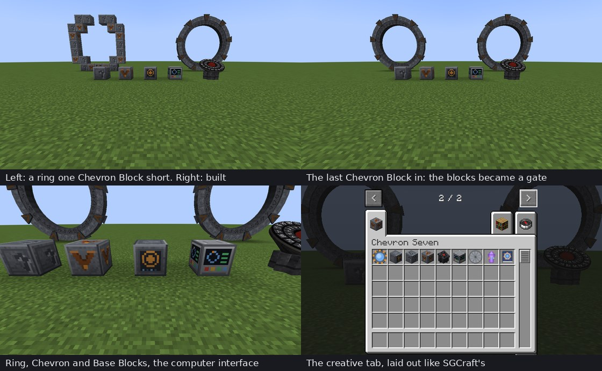

*In a Minecraft 1.20.1 client (1.5.0).*

```
  R R C R R        C  Chevron Block (9)
R C . . . C R      R  Ring Block (14)
C . . . . . C      B  Stargate Base Block
R . . . . . R      .  empty: the inside must be clear
R . . . . . R
C R . . . R C
  R C B C R
```

- The ring is the same seven-block ring the Stargate item builds. The base goes in the bottom middle and faces you when you place it: that side is the front, where the gate opens.
- When the last block is in place, and nothing is inside the ring, the blocks become a gate. Right-click the base to see how many Ring and Chevron Blocks are still missing.
- Breaking any block of a gate built this way gives that block back and turns the rest of the gate into its blocks again, as in SGCraft. Put the block back and the gate forms again, with the same address and look: the base keeps them, and so does the base's item if you break it.
- The Stargate item still builds a whole gate in one go, as before.

The creative tab is laid out like SGCraft's: the gate, its base, Ring and Chevron Blocks, the DHD and the computer interface, then the iris, the Look Crystal and the Address Book.

## Gate looks

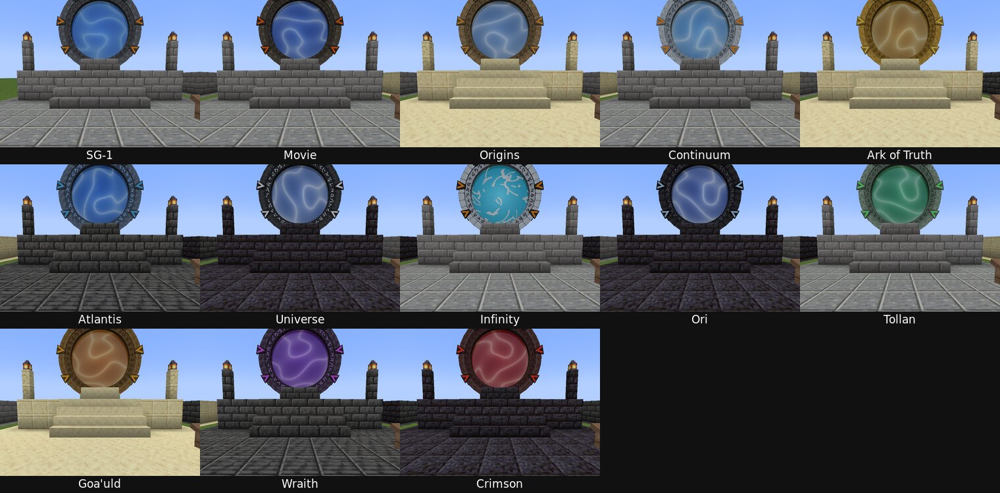

*Every look, each on a gate platform with its wormhole open, in a Minecraft 1.20.1 client.*

Every gate can have its own look: its ring and symbol track, the colour of its chevrons and symbols, its event horizon and its iris all change with it. A new gate starts with the SG-1 look, and a Stargate Network gate with the `network` look. Change it with the **Gate Look Crystal** or `/chevron7 look <pos> <look>`.

| Look | |
|---|---|
| `sg1` | grey stone, orange chevrons, blue water |
| `movie` | darker, browner stone, deep orange chevrons |
| `origins` | the weathered 1939 gate: chipped sandstone-coloured stone |
| `continuum` | the frozen gate: pale stone with frost |
| `ark` | gold, with a golden wormhole (Ark of Truth) |
| `atlantis` | blue-grey stone, blue chevrons (Pegasus) |
| `universe` | dark grey, white chevrons, a starry-white horizon (Destiny) |
| `infinity` | the animated series: a pale ring with black ink outlines, orange chevrons, a flat bright cyan wormhole with white streaks |
| `ori` | nearly black, pale blue chevrons |
| `tollan` | grey-green, green chevrons, a green wormhole |
| `goauld` | bronze, amber chevrons, an orange wormhole |
| `wraith` | purple-grey, violet chevrons, a violet wormhole |
| `crimson` | dark red, red chevrons, a red wormhole |
| `network` | the Stargate Network gate's look: dark steel-blue, blue chevrons, pale symbols or letters |
| `lanteacraft` | the gate of LanteaCraft, the stargate mod for Minecraft 1.7.10: charcoal stone with a toothed rim, small amber triangle chevrons, a deep navy wormhole flecked with white (1.7.0) |

`/chevron7 looks` lists them. Computers see the look as the gate's variant (`chevron7:infinity`, for example), so the [Gate Room and Personal Dialer](../StargateCommand/) pick their matching style by themselves. Looks are only colours and textures: the gate works the same in every one.

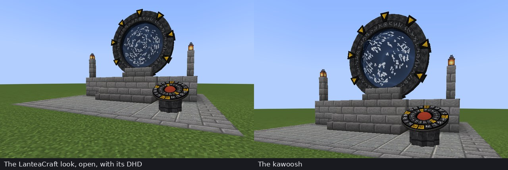

*The `lanteacraft` look on a gate platform, in a Minecraft 1.20.1 client. The DHD's keys light amber as the gate dials.*

## Gate platforms and the gate room

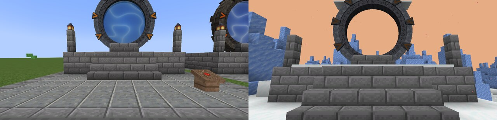

*Left: `/chevron7 platform` on flat ground. Right: the gate on Mars, which now stands on a platform too. Both from a Minecraft 1.20.1 client.*

`/chevron7 platform <pos> [direction] [look] [style]` builds a gate on a raised stone dais: two steps up the front, the gate's own step on top, a lantern on a post at each corner and a DHD in front, on a paved plaza. The style is the stone it's made of: `stone`, `deepslate`, `sandstone` or `blackstone`. Without a direction the gate faces whoever runs the command. Planet sites are built this way now.

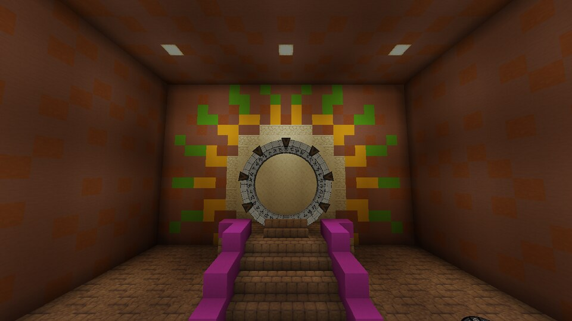

*`/chevron7 gateroom` (1.4.0), in a Minecraft 1.20.1 client.*

### The Carter Addon Pack pedestal

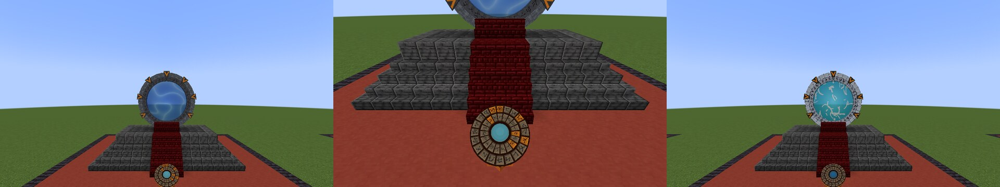

*Left: an SG-1 gate on a CAP pedestal with its wormhole open. Middle: its DHD, with the keys of the dialed symbols lit and the dome glowing. Right: the Infinity gate it reached, on a pedestal of its own. In a Minecraft 1.20.1 client.*

After the dial sequence of the Carter Addon Pack for Garry's Mod: `/chevron7 platform <pos> [direction] [look] cap` builds the gate on a sloped stone pedestal (three layers that step in towards the top, stairs down every side) with a red carpet up the middle to the gate's step, the round DHD at the foot of the carpet, and a red floor around it all.

`/chevron7 pedestal <pos> [direction] [small|large]` builds the same pedestal and carpet with no gate, so a gate of another mod can stand on it. `small` fits the 7-wide gates of Chevron Seven, Stargate Journey and Lantea: Stargates; `large` fits JSG's bigger ones. It answers with where the gate's base (the bottom middle of the ring) goes; place your gate there, facing the way the carpet comes up.

`/chevron7 gateroom <pos> [direction]` builds a gate room after the animated series: an Infinity-look gate on a base at the top of a brown ramp with hot pink rails, warm golden-brown walls with a pale halo behind the gate, and yellow and lime light bars fanned out around it. The room is lit and open at the front, and has a DHD by the ramp.

## The Ori supergate and the gate row

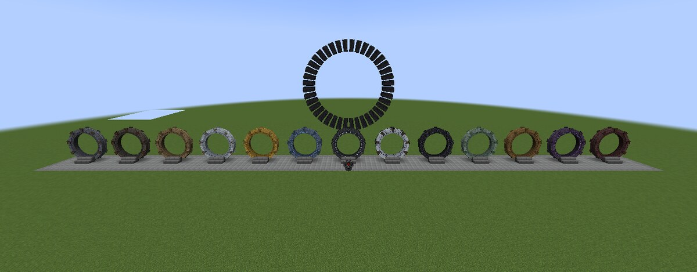

*`/chevron7 gaterow`: a gate in every look, an Ori supergate behind them and a DHD in front. In a Minecraft 1.20.1 client.*

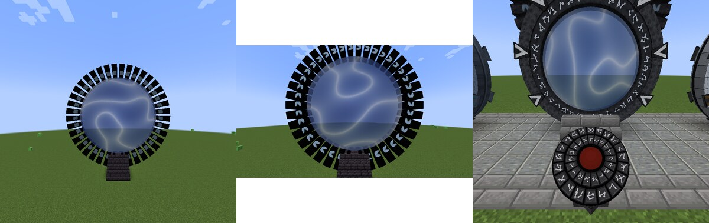

*Left: the supergate with a wormhole open. Middle: the stairs up to its horizon. Right: the dark DHD (1.4.0).*

`/chevron7 supergate <pos> [direction]` builds an Ori supergate, four times the size of a gate: a ring of 40 separate dark segments about 27 blocks across, with no symbols or chevrons. Its segments light one after another as it dials out, and they all glow while the wormhole is open. It dials and is dialed like any other gate (the DHD, the commands and computers all work), and you can travel through it both ways. Only its base, at the bottom middle of the ring, is solid. The bottom of its horizon is four blocks up, so it comes with a landing and stairs up the front. A supergate can't have an iris. Computers see it as the variant `chevron7:supergate`, so the Gate Room draws it as the Ori Supergate.

`/chevron7 gaterow <pos> [direction]` builds one gate in every look side by side, each on its step, with a DHD in front of the middle gate and a supergate behind the row.

## Gate fields


*A gate field in a Minecraft 1.20.1 client: five gates around a clearing, with the DHD in the middle choosing which gate dials. Bottom right: the middle gate has dialed the leftmost one.*

A gate field is five gates on an arc around a clearing, each at the end of a dirt path with a step up to it, with one DHD in the middle that can dial from any of them. The outer gates turn towards the middle as far as a gate can (gates face north, east, south or west).

- They appear by themselves, rarely, in plains, sunflower plains, meadows and savannas, on flat dry ground. Every gate has its own address.
- An operator can build one anywhere: `/chevron7 field <pos> [direction] [gates]`, e.g. `/chevron7 field ~ ~ ~ north 5`. The gates stand 13 blocks from `<pos>` in that direction; 1 to 7 gates.
- Turn the natural ones off with `gate_fields = false` in the config.

## Planet gates

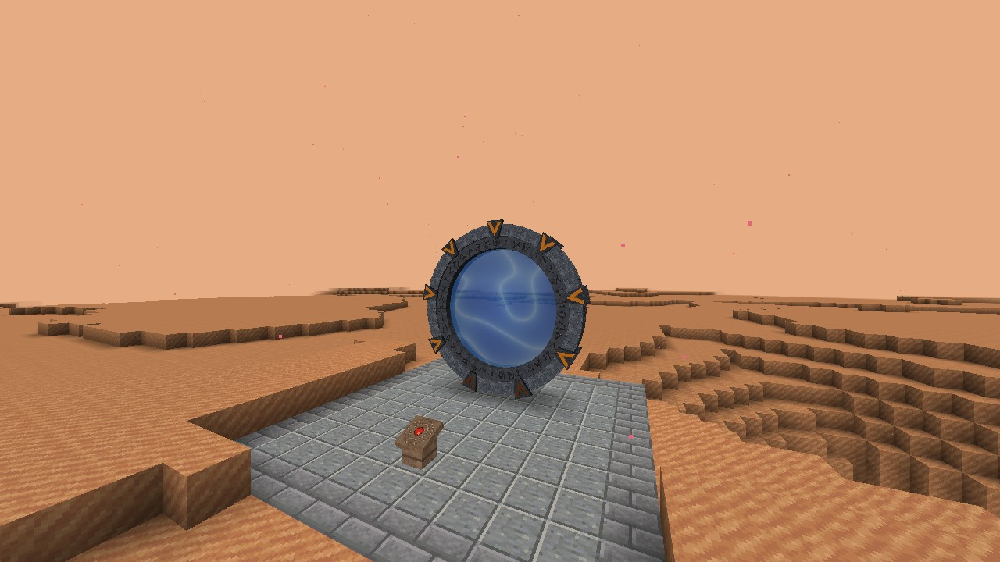

*Mars in a Minecraft 1.20.1 client with Ad Astra 1.15.21: the planet's gate on its paved pad (1.1), with a wormhole open from a gate on Earth. Since 1.2.0 the gate stands on a [platform](#gate-platforms-and-the-gate-room).*

With [Ad Astra](https://modrinth.com/mod/ad-astra) installed, the Moon, Mars, Venus, Mercury and Glacio each have a gate: a stone platform near 8, 6 with the gate on top, stairs up to it and a DHD. Planets visited before 1.2.0 keep their paved pad.

- Every planet's gate has its own address, fixed for the world. The **Gate Address Book** (or `/chevron7 planets`) lists them.
- You can dial a planet before anyone has been there: the first wormhole to it generates the planet's gate. A gate on Earth can dial Mars directly.
- Ad Astra's planets have no air to breathe, except Glacio. Wear a space suit before you step through.
- Turn planet gates off with `planet_gates = false` in the config.

Galacticraft isn't available for Forge 1.20.1 (only the 1.12.2 Galacticraft Legacy is), so it has no planet gates. Other mods' planets can get gates with a data pack that adds their biomes to the `#chevron7:has_planet_gate` biome tag.

## Computers (CC: Tweaked)

Put a computer against any block of the ring, or connect one with a wired modem. The peripheral type is `chevron7_stargate`.

Or do it the SGCraft way (1.5.0): put a **Gate Computer Interface** against any block of the ring and the computer against the interface. The computer sees the same `chevron7_stargate` peripheral. It finds a gate that forms after the computer was placed, too.

| Method | |
|---|---|
| `getLocalAddress()` | this gate's address, e.g. `{12, 5, 30, 21, 7, 1}` |
| `engageSymbol(symbol)` | turns the ring to the symbol and locks a chevron; dial 0 last to open the wormhole |
| `dialAddress(address)` | dials a whole address, e.g. `dialAddress({12, 5, 30, 21, 7, 1})` |
| `disconnectStargate()` | closes the wormhole, or stops a dial |
| `getChevronsEngaged()`, `getDialedAddress()`, `getConnectedAddress()` | chevrons locked, symbols dialed, the address on the other side |
| `isStargateConnected()`, `isStargateDialingOut()`, `isWormholeOpen()`, `getOpenTime()` | the connection |
| `getGateState()` | `idle`, `dialing`, `opening`, `open`, `closing` or `resetting` |
| `getRotationDegrees()`, `getCurrentSymbol()`, `isCurrentSymbol(symbol)` | the symbol ring |
| `getIris()`, `openIris()`, `closeIris()`, `getIrisProgressPercentage()` | the iris |
| `getRecentFeedback()` | the last result as a code and a name, e.g. `-5, "invalid_address"` |
| `sendStargateMessage(text)` | the other gate gets a `stargate_message_received` event |
| `getStargateType()` | `"chevron7:stargate"`, or `"chevron7:network_stargate"` for a Stargate Network gate |
| `getStargateVariant()` | the gate's look: `""` for SG-1, otherwise e.g. `"chevron7:infinity"` or `"chevron7:network"`; the Gate Room and Personal Dialer pick their look from it |
| `getLocalLetters()`, `dialLetters(address)` | the gate's letter address, and dialing one, e.g. `dialLetters("1KA0-9KT-HY")` |

On a Stargate Network gate, `engageSymbol` takes the positions of the letters on its ring, 0 for A to 35 for 9, nine of them with no point of origin; `dialAddress` still takes a symbol address and dials its letters.

Events (the first argument is the peripheral's name): `stargate_chevron_engaged` (chevrons, chevron, incoming, symbol), `stargate_rotation_started`, `stargate_rotation_stopped`, `stargate_outgoing_wormhole` (address), `stargate_incoming_wormhole` (address), `stargate_disconnected` (code, reason), `stargate_reset` (code, reason), `stargate_deconstructing_entity` and `stargate_reconstructing_entity` (type, name, uuid), `iris_thud` (type, name, uuid) and `stargate_message_received` (text).

The names, the feedback codes and the events follow Stargate Journey's crystal interface, so programs written for that mostly work here as they are.

### The SG Computer Interface

A computer next to the SG Computer Interface (or on a wired modem) gets a peripheral of type `stargate` that speaks like SGCraft's computer interface, with letter addresses. (The Gate Computer Interface gives the gate's own `chevron7_stargate` peripheral instead.) It controls the nearest gate within 6 blocks, of any kind. The Gate Room, Network Hub and Personal Dialer treat it as an SGCraft gate; on a Stargate Network gate they use the Stargate Network look, with blue chevrons.

| Method | |
|---|---|
| `stargateState()` | `"Idle"`, `"Dialling"`, `"Opening"`, `"Connected"` or `"Closing"`; the chevrons locked; `"Outgoing"`, `"Incoming"` or `""` |
| `localAddress()`, `remoteAddress()`, `dialledAddress()` | letter addresses, e.g. `"1KA09KTHY"` |
| `dial(address)` | dials a letter address. Errors are SGCraft's: `selfBusy`, `malformedAddress`, `unknownAddress`, `diallingItself` |
| `disconnect()`, `isInitiator()` | |
| `irisState()`, `openIris()`, `closeIris()` | `"Offline"` without an iris, otherwise `"Open"`, `"Opening"`, `"Closing"` or `"Closed"` |
| `sendMessage(...)` | the other side gets `sgMessageReceived` |
| `energyAvailable()`, `energyToDial(address)` | always 0: Chevron Seven gates need no power |
| `getStargateVariant()` | as on the gate itself (not in SGCraft) |

Events: `sgDialOut` and `sgDialIn` (address), `sgChevronEngaged` (number, symbol), `sgStargateStateChange` (new, old), `sgIrisStateChange` (new, old) and `sgMessageReceived`.

## Commands

For operators:

```
/chevron7 list                          every gate and its address
/chevron7 address <pos>                 the addresses and state of a gate
/chevron7 dial <pos> <address>          dial, e.g. /chevron7 dial ~ ~ ~5 12-5-30-21-7-1 or 1KA0-9KT-HY
/chevron7 close <pos>
/chevron7 iris <pos> open|close
/chevron7 field <pos> [direction] [gates]   build a gate field (see above)
/chevron7 planets                       the planets' gate addresses
/chevron7 look <pos> <look>             change a gate's look
/chevron7 looks                         list the looks
/chevron7 platform <pos> [direction] [look] [style]   build a gate on a platform
/chevron7 gateroom <pos> [direction]    build an Infinity gate room
/chevron7 pedestal <pos> [direction] [small|large]   build a CAP pedestal for any mod's gate
/chevron7 supergate <pos> [direction]   build an Ori supergate
/chevron7 gaterow <pos> [direction]     build a gate in every look, and a supergate
```

`<pos>` can be any block of the ring.

## Config

`config/chevron7-common.toml`:

| Option | Default | |
|---|---|---|
| `max_open_seconds` | 300 | how long a wormhole stays open (10 to 2280) |
| `kawoosh_kills` | true | the kawoosh destroys what stands in front of the gate |
| `incoming_can_close` | false | the receiving gate can close the wormhole too |
| `gate_fields` | true | gate fields appear in plains, meadows and savannas |
| `planet_gates` | true | planets (Ad Astra) get a gate near 8, 6 |

## Install

Put [`dist/chevron7-1.7.0.jar`](dist/chevron7-1.7.0.jar) in the `mods` folder (client and server) of a Forge 47 / Minecraft 1.20.1 game. CC: Tweaked is optional.

## Tested

- **1.7.0 (the LanteaCraft look)**, in a Minecraft 1.20.1 client joined to a dedicated Forge 1.20.1 server (47.4.29), in a world made with 1.5.0:
  - `/chevron7 looks` listed `lanteacraft`, and `/chevron7 platform … lanteacraft stone` built two gates in it.
  - Each gate dialed the other with `/chevron7 dial`: the amber triangle chevrons lit one by one, the DHD's keys lit amber, the kawoosh came out and the wormhole settled navy with white flecks, as in the picture above. `/chevron7 close` closed it.
- **1.6.0 (the Stargate Network gate, letter addresses and the SG Computer Interface)**, on a dedicated Forge 1.20.1 server (47.4.29) with CC: Tweaked 1.120.2. There was a classic gate, a classic gate in the `infinity` look and a Stargate Network gate, with computers on the rings and on two SG Computer Interfaces.
  - `/chevron7 list` and `/chevron7 address` showed each gate's symbols and letters. `/chevron7 dial` dialed by letters, and refused a letter address with one character wrong.
  - **The SG Computer Interface** on the Stargate Network gate read its state, letter address, look (`chevron7:network`) and iris. It gave SGCraft's errors for a malformed address, a mistyped one (`unknownAddress`), its own address and a missing iris, and `selfBusy` while dialing.
  - **The Stargate Network gate dialed the other gates by their letters**: nine chevrons locked, one letter each, then `sgDialOut`, Opening and Connected. A message reached the other gate's computer, and the wormhole closed from the dialing side.
  - **The classic gate dialed the Stargate Network gate by its letters, and the gate in the Infinity look dialed it by its symbols.** Each time, the Network gate's interface reported `sgDialIn` with the caller's letters.
  - **The programs' `sgc.gate` library:**
    - It found the Network gate through the interface as a Chevron Seven gate with the Stargate Network look, and dialed by letters.
    - It found the Infinity-look gate on the ring with the Infinity look, and dialed by symbols.
    - It found the classic gate through an interface as an SGCraft gate.
    - All three dials opened a wormhole, and all three closed again.
  - In a Minecraft 1.20.1 client with software rendering, the gates looked as in the picture above, dialing and open.
  - In an earlier build of this work, before it was merged with the gate looks, the same tests passed, a pig travelled through a Network gate's wormhole, and the iris closed and opened through the interface with `sgIrisStateChange` events.
  - Not tested yet: the DHD's letter keys (they need clicks in the game).
  - The letter addresses were also tested on their own: 200,000 random gate addresses turned into letters and back, and 99.997% of one-character typos were caught.

- **Dedicated Forge 1.20.1 server (47.4.29) with CC: Tweaked 1.120.2**: three gates, one of them in the Nether.
  - The `sgc.gate` adapter of the Stargate Command programs found the gate, dialed it and closed it, and read its errors. Its events arrived in order.
  - The kawoosh killed a pig standing in front of the receiving gate.
  - A pig walked through to the other gate, and another came out at the gate in the Nether.
  - A closed iris bounced a traveler back.
  - Breaking the stargate block, or any block of the ring, removed the whole gate.
- **Minecraft 1.20.1 client** with software rendering (no graphics card): the screenshots on this page come from it. The gate was dialed with `/chevron7 dial`, and then by clicking six symbol keys and the big button on the DHD screen, which opened the wormhole to the other gate.

- **Gate fields**:
  - Built with `/chevron7 field` and with `/place feature chevron7:gate_field` on the server.
  - In a newly generated normal world, with a test data pack that put a field in every eligible chunk: 237 gates around spawn, with no errors and no world-generation warnings.
  - In the client, the DHD's arrows picked the middle gate, and clicking an address on the DHD opened its wormhole to the leftmost gate.

- **Planet gates**, on a server with Ad Astra 1.15.21:
  - The address book listed the five planets and left out the orbits.
  - A gate on Earth dialed Mars before anyone had been there. The wormhole generated Mars's gate site (gate facing south, DHD on the paved pad), and a pig walked from Earth to Mars.
  - Without Ad Astra, the mod loads and the address book says there are no planets.
  - In a Minecraft 1.20.1 client, on a server set up the same way, a gate on Earth dialed Mars, and the Mars gate opened its end of the wormhole. The picture above is from that client.

- **Two players**, each in a Minecraft 1.20.1 client, on a server with Ad Astra:
  - One player jumped into the gate on Earth and came out of the gate on Mars, then jumped back through a wormhole dialed from Mars.
  - The other player, beside the Earth gate, saw the wormhole and the first player.
  - Walking straight at the gate didn't take you through, because the bottom of the ring is a block; you had to jump. 1.1.1 adds the steps below.

- **Steps (1.1.1)**, in a Minecraft 1.20.1 client on a server with Ad Astra:
  - `/chevron7 field` put stairs in front of all five gates, and Mars's gate site got a step in front of its gate.
  - A player walked, without jumping, up the step of a field gate into the wormhole and came out on Mars, then walked up the step on Mars's pad and came back.

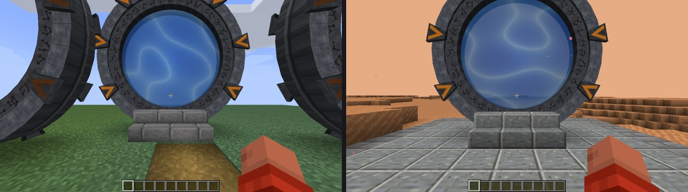

*Left: a gate in a gate field, with the path leading up to its step. Right: the gate on Mars, with its step on the paved pad. Both from a Minecraft 1.20.1 client.*

- **Sounds (1.1.2)**, in a Minecraft 1.20.1 client whose audio was recorded to a file:
  - Dialing plays a sound as the ring turns and each chevron locks, the kawoosh is the loudest, and closing plays a sound that fades out.
  - The hum of an open wormhole was silent beyond 7 blocks, because Minecraft's beacon hum only carries that far. 1.1.2 plays it louder so it carries about 17 blocks; it was heard at 10, 15 and 20 blocks.

- **Forests, planets and restarts (1.1.3)**, in a Minecraft 1.20.1 client on a server with Ad Astra and CC: Tweaked, starting in a dark forest. 1.1.2 had these problems, all fixed:
  - **Gate fields in a forest** went by the treetops. `/chevron7 field` set gates down on the canopy, left trunks and giant mushrooms in front of them, put the DHD on a bump and left the path too steep to walk. 1.1.3 finds the real ground under the trees, clears trees and mushrooms around each gate and along the paths (whole trees, so no trunk is left hanging), and levels the clearing and the ground in front of each step. In the same forest, a player walked from the DHD up the path into the middle gate and came out at the gate it had dialed. Natural gate fields now generate after trees; on a test world with them made very common, they generated in plains with no errors.
  - **A closed iris didn't stop a player.** The gate couldn't tell which side a player had come from (the server moves players between ticks, so where they were and where they are looked the same), so a player walked straight through the open wormhole and out behind the gate they had dialed from, with the iris at the other end shut. 1.1.3 remembers which side each player is on. A player who kept walking into the gate was held in front of it, and with the iris open the same walk took them through.
  - **A gate on a planet nobody was on never finished opening or closing.** A dimension without players stops running its gates, so the Moon's gate stayed "opening" after its wormhole closed, and every later dial to the Moon failed with "target busy". Connected gates now force-load their chunks, so both ends keep running, and a gate that was left like that is set right the next time it is dialed.
  - **An open wormhole was lost when the server restarted.** It now carries on: both gates were still open after a restart, and their open time kept counting with no player online.
  - `/chevron7 iris` now says what it is doing, and `/chevron7 address` shows whether the gate's iris is open or closed.

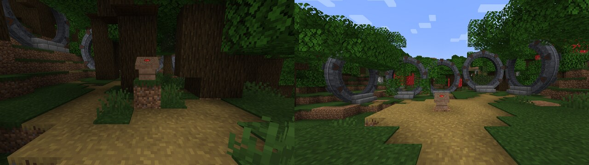

*Gate fields built with `/chevron7 field` in a dark forest, in a Minecraft 1.20.1 client. Left: 1.1.2, with gates up the hillside among the trunks and the DHD on a block of grass. Right: 1.1.3, with the trees cleared and the clearing level, the DHD on the path and every gate on its step.*

- **Looks, iris, platforms and the gate room (1.2.0)**, in a Minecraft 1.20.1 client on a flat test world with Ad Astra:
  - `/chevron7 platform` built 14 gates in every look and all four stone styles. Seven pairs dialed each other at once, and every look's ring, chevrons and wormhole showed as in the picture above.
  - The Gate Look Crystal stepped a gate forward through the looks with each use, and back with a sneak-use. The look is kept when the server restarts.
  - Fitted to an SG-1 and an Infinity gate, the iris closed as a spiral of curved blades, grey on the one and light blue with black ink lines on the other.
  - `/chevron7 gateroom` built the room. Dialed from it, a player walked up the copper ramp into the gate and came out at the gate on the other platform.
  - Dialing Mars generated its site as a platform, with the gate and stairs in place.

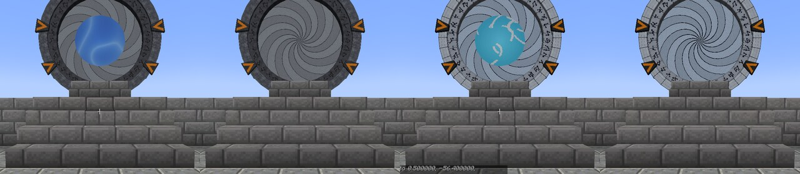

*The iris closing and shut on an SG-1 gate (left two) and an Infinity gate (right two).*

- **The CAP pedestal and DHD (1.3.0)**, in a Minecraft 1.20.1 client:
  - `/chevron7 platform … cap` built an SG-1 and an Infinity gate on pedestals, and `/chevron7 pedestal` built a small and a large one with no gate.
  - Dialing from the SG-1 gate lit the DHD's keys for the dialed symbols and made the dome glow once the wormhole was open (the middle picture above).
- **The supergate, the gate row, the dark DHD and the room (1.4.0)**, in a Minecraft 1.20.1 client:
  - `/chevron7 gaterow` built all 13 looks in a row with a supergate behind them.
  - A gate dialed the supergate and the supergate dialed a gate: the wormhole opened both ways, and the supergate's segments lit while it dialed out.
  - A player walked up the supergate's stairs into its horizon and came out at the other gate.
  - The DHD in front of the row is the dark one with the red dome; the CAP pedestal's stays orange.
  - `/chevron7 gateroom` built the reworked room.
- **Gates built from blocks and the computer interface (1.5.0)**, on a dedicated Forge 47.4.29 server with CC: Tweaked 1.120.2, Stargate Journey 0.6.54 and JSG 5.1.2.0, in the world the 1.4.0 tests had used. The blocks were placed and broken with commands; 16 checks passed:
  - The 1.4.0 gates loaded unchanged and still dialed.
  - A ring built first and the base placed last became a gate, all 23 ring blocks part of it. So did a base placed first, once its last Chevron Block went in.
  - A Ring Block in a chevron's place, or stone inside the ring, kept the blocks from forming a gate; with them fixed, the gate formed.
  - Breaking one Ring Block of a built gate dropped that block and turned the other 22 and the base back into blocks, the base keeping the address. Putting the block back formed the gate again with the same address.
  - Breaking the stargate block of a built gate dropped a Stargate Base Block carrying the address, and left the 23 blocks standing.
  - A computer behind a Gate Computer Interface, set down before the gate was finished, found the gate when its last Chevron Block went in. Through the interface it dialed a 1.4.0 gate with the Stargate Command `sgc` library: the ring turned, seven chevrons locked, the wormhole opened and then closed.
  - In a Minecraft 1.20.1 client joined to a server with 1.5.0 (the picture above): the new blocks' textures, a ring one Chevron Block short staying as blocks, the last Chevron Block turning the blocks into a gate in front of the player, and the creative tab with its SGCraft-style order. The blocks were placed with commands there too; placing them by hand hasn't been tried.

## Build

```
python3 tools/make_resources.py   # only after changing it: textures, symbols, models, recipes
./gradlew build
```

The jar is `build/libs/chevron7-1.7.0.jar`.

## License

MIT, see [LICENSE](../LICENSE). That covers the textures and symbols too: they are original, drawn by `tools/make_resources.py`.
