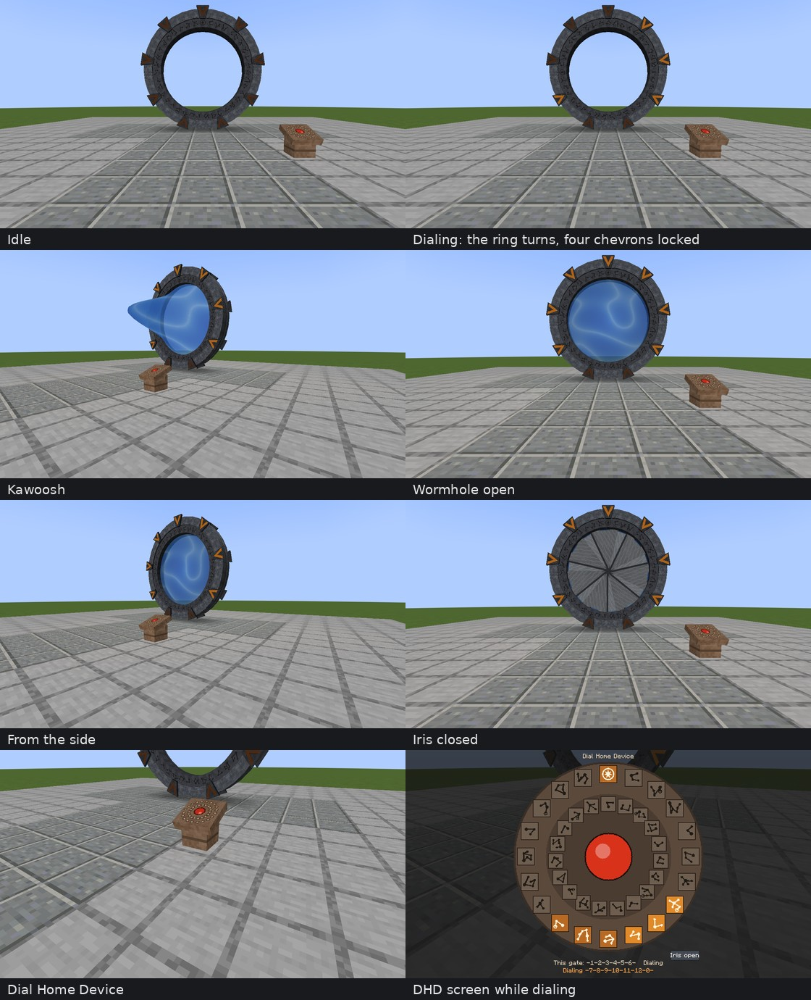
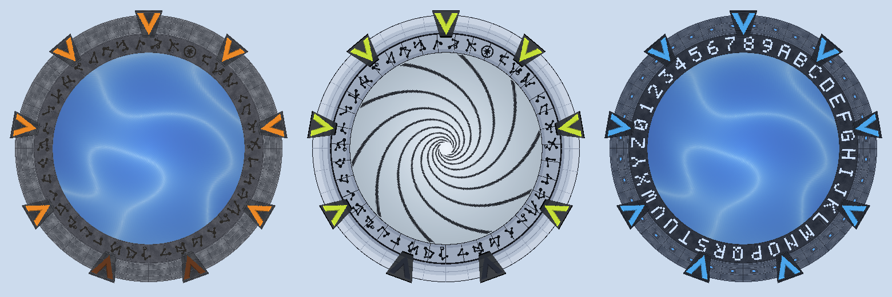
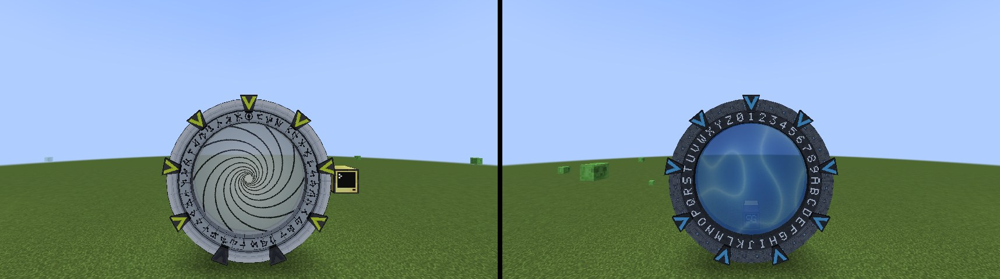
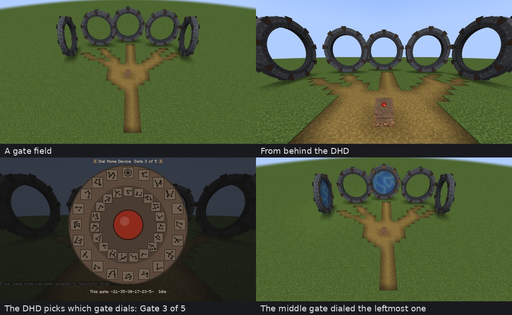

# Chevron Seven

A stargate mod for **Minecraft 1.20.1 (Forge)**, written from scratch: its own gates, Dial Home Device and iris, with all textures and symbols drawn by its own script. It needs no other stargate mod. With [CC: Tweaked](https://modrinth.com/mod/cc-tweaked) installed, the gate is a computer peripheral that the [Gate Room, Network Hub](../StargateCommand/) and [Personal Dialer](../PersonalDialer/) drive just as they drive Stargate Journey, and the SG Computer Interface lets programs written for SGCraft drive it too.

There are three kinds of gate: the classic gate, a **Stargate Infinity** gate in the look of the animated series, and a **Stargate Network** gate in the style of SGCraft, with a ring of letters and nine chevrons. They all share one network and can dial each other.



## The gate

- A ring seven blocks across, with a symbol track that turns to each symbol, nine chevrons, and an event horizon that ripples and swirls.
- Dialing locks seven chevrons: six symbols, then the point of origin. The ring turns one way, then the other, and the top chevron engages each symbol.
- The wormhole opens with a kawoosh. The vortex vaporises anything standing in front of the gate (you can turn this off).
- Step into the event horizon of the gate you dialed from and you come out of the other gate, facing out, at the same height and side, even in another dimension. Travel is one way, from the dialing gate. The receiving gate's horizon doesn't send you back. The bottom of the ring is a solid block. Gates in gate fields and at the planet sites have a step in front, so you can walk in; for a gate you place yourself, put stairs in front of it, or jump in.
- The wormhole closes by itself after five minutes (configurable, up to 38 minutes). Only the dialing gate can close it, unless you allow it in the config.
- Both gates keep their chunks loaded while they are connected.
- The ring lights up its surroundings while a wormhole is open.
- A comparator next to the stargate block reads how many chevrons are locked.

Right-click any part of the ring to see the gate's address. Every gate gets its own random address of six different symbols from 1 to 38; the point of origin, symbol 0, is the same for every gate and is dialed last. Every gate also has a [letter address](#letter-addresses).

## Kinds of gate



*Drawn front-on from the mod's textures by `tools/preview_styles.py`. Left to right: the classic gate, the Infinity gate and the Stargate Network gate, each with a wormhole open.*



*In a Minecraft 1.20.1 client: the Infinity gate with a wormhole open from the Stargate Network gate (left), and the Stargate Network gate with its nine chevrons lit (right). The SG Computer Interface shows through the wormhole.*

| Gate | Looks | Dials |
|---|---|---|
| **Stargate** | grey stone, orange chevrons, a blue wormhole | six symbols, then the point of origin: seven chevrons |
| **Stargate (Infinity)** | the cartoon gate of *Stargate Infinity*: pale stone drawn with ink, black glyphs, dark chevrons that light lime-yellow, a pale whirlpool with ink spiral lines, and pale iris blades | the same as the classic gate |
| **Stargate (Stargate Network)** | in the style of SGCraft's Stargate Network gate: dark steel-blue stone, a ring of the 26 letters and 10 digits, blue chevrons | nine letters or digits, e.g. `1KA0-9KT-HY`: all nine chevrons lock. Its DHD has 36 letter keys. |

Craft the Infinity gate from a stargate, lime dye and an ink sac, and the Stargate Network gate from a stargate and a block of lapis lazuli. Either one on its own in the crafting grid turns back into a plain stargate.

## Letter addresses

Every gate has a letter address as well as its symbol address, written the way SGCraft writes them: nine letters and digits, such as `1KA0-9KT-HY`. Right-clicking a gate shows both. Both name the same gate, so:

- a Stargate Network gate dials any gate by its letters, and
- any other gate, or a DHD, dials a Stargate Network gate by its symbols.

The first six characters carry the six symbols; the last three are a check. A mistyped letter address fails as "no stargate has that address" instead of reaching some other gate: in a test of 200,000 addresses, 99.997% of one-character typos were caught.

Dashes, spaces and case don't matter: `1ka09kthy` is the same address.

## Blocks and items

| | What it does | Recipe |
|---|---|---|
| **Stargate** | Place it on the ground, facing you: it needs a clear 7 × 7 space. You place the bottom middle block; the rest of the ring builds itself. Break any part to pick the whole gate up again. | iron blocks in the corners, eyes of ender on the sides, a lodestone in the middle |
| **Stargate (Infinity)**, **Stargate (Stargate Network)** | The other [kinds of gate](#kinds-of-gate), placed the same way. | a stargate with lime dye and an ink sac; a stargate with a block of lapis lazuli |
| **SG Computer Interface** | Place it within 6 blocks of a gate and put a computer next to it: the computer gets an SGCraft-style `stargate` peripheral for the nearest gate (see [computers](#computers-cc-tweaked)). Right-click it to see which gate it controls. | iron ingots in the corners, redstone on the sides, a comparator in the middle |
| **Dial Home Device** | Right-click it to dial the nearest gate within 16 blocks. Press six symbols, then the big red button (or the point of origin). Press the red button again to close the wormhole; while dialing, it cancels the dial. With several gates in range, the arrows by the title pick which one it dials from. | redstone block on top, gold ingot, compass, gold ingot in the middle, smooth sandstone along the bottom |
| **Gate Iris** | Use it on a gate to fit an iris. Close it from the DHD, a computer or a command. Travelers from the other side hit a closed iris and bounce back, and it stops the kawoosh. | iron ingots around an iron trapdoor |
| **Gate Address Book** | Use it to read the address of every planet's gate (see [planet gates](#planet-gates)). | a book and an eye of ender |

## Gate fields



*A gate field in a Minecraft 1.20.1 client: five gates around a clearing, with the DHD in the middle choosing which gate dials. Bottom right: the middle gate has dialed the leftmost one.*

A gate field is five gates on an arc around a clearing, each at the end of a dirt path with a step up to it, with one DHD in the middle that can dial from any of them. The outer gates turn towards the middle as far as a gate can (gates face north, east, south or west).

- They appear by themselves, rarely, in plains, sunflower plains, meadows and savannas, on flat dry ground. Every gate has its own address.
- An operator can build one anywhere: `/chevron7 field <pos> [direction] [gates]`, e.g. `/chevron7 field ~ ~ ~ north 5`. The gates stand 13 blocks from `<pos>` in that direction; 1 to 7 gates.
- Turn the natural ones off with `gate_fields = false` in the config.

## Planet gates


*Mars in a Minecraft 1.20.1 client with Ad Astra 1.15.21: the planet's gate on its paved pad, with a wormhole open from a gate on Earth.*

With [Ad Astra](https://modrinth.com/mod/ad-astra) installed, the Moon, Mars, Venus, Mercury and Glacio each have a gate: a paved pad near 8, 6 with the gate, a step up to it and a DHD.

- Every planet's gate has its own address, fixed for the world. The **Gate Address Book** (or `/chevron7 planets`) lists them.
- You can dial a planet before anyone has been there: the first wormhole to it generates the planet's gate. A gate on Earth can dial Mars directly.
- Ad Astra's planets have no air to breathe, except Glacio. Wear a space suit before you step through.
- Turn planet gates off with `planet_gates = false` in the config.

Galacticraft isn't available for Forge 1.20.1 (only the 1.12.2 Galacticraft Legacy is), so it has no planet gates. Other mods' planets can get gates with a data pack that adds their biomes to the `#chevron7:has_planet_gate` biome tag.

## Computers (CC: Tweaked)

Put a computer against any block of the ring, or connect one with a wired modem. The peripheral type is `chevron7_stargate`.

| Method | |
|---|---|
| `getLocalAddress()` | this gate's address, e.g. `{12, 5, 30, 21, 7, 1}` |
| `engageSymbol(symbol)` | turns the ring to the symbol and locks a chevron; dial 0 last to open the wormhole |
| `dialAddress(address)` | dials a whole address, e.g. `dialAddress({12, 5, 30, 21, 7, 1})` |
| `disconnectStargate()` | closes the wormhole, or stops a dial |
| `getChevronsEngaged()`, `getDialedAddress()`, `getConnectedAddress()` | chevrons locked, symbols dialed, the address on the other side |
| `isStargateConnected()`, `isStargateDialingOut()`, `isWormholeOpen()`, `getOpenTime()` | the connection |
| `getGateState()` | `idle`, `dialing`, `opening`, `open`, `closing` or `resetting` |
| `getRotationDegrees()`, `getCurrentSymbol()`, `isCurrentSymbol(symbol)` | the symbol ring |
| `getIris()`, `openIris()`, `closeIris()`, `getIrisProgressPercentage()` | the iris |
| `getRecentFeedback()` | the last result as a code and a name, e.g. `-5, "invalid_address"` |
| `sendStargateMessage(text)` | the other gate gets a `stargate_message_received` event |
| `getStargateType()` | `"chevron7:stargate"`, or `"chevron7:network_stargate"` for a Stargate Network gate |
| `getStargateVariant()` | `""`, `"chevron7:infinity"` or `"chevron7:stargate_network"`: the Gate Room and Personal Dialer pick their look from it |
| `getLocalLetters()`, `dialLetters(address)` | the gate's letter address, and dialing one, e.g. `dialLetters("1KA0-9KT-HY")` |

On a Stargate Network gate, `engageSymbol` takes the positions of the letters on its ring, 0 for A to 35 for 9, nine of them with no point of origin; `dialAddress` still takes a symbol address and dials its letters.

Events (the first argument is the peripheral's name): `stargate_chevron_engaged` (chevrons, chevron, incoming, symbol), `stargate_rotation_started`, `stargate_rotation_stopped`, `stargate_outgoing_wormhole` (address), `stargate_incoming_wormhole` (address), `stargate_disconnected` (code, reason), `stargate_reset` (code, reason), `stargate_deconstructing_entity` and `stargate_reconstructing_entity` (type, name, uuid), `iris_thud` (type, name, uuid) and `stargate_message_received` (text).

The names, the feedback codes and the events follow Stargate Journey's crystal interface, so programs written for that mostly work here as they are.

### The SG Computer Interface

A computer next to the SG Computer Interface (or on a wired modem) gets a peripheral of type `stargate` that speaks like SGCraft's computer interface, with letter addresses. It controls the nearest gate within 6 blocks, of any kind. The Gate Room, Network Hub and Personal Dialer treat it as an SGCraft gate; on a Stargate Network gate they use the Stargate Network look, with blue chevrons.

| Method | |
|---|---|
| `stargateState()` | `"Idle"`, `"Dialling"`, `"Opening"`, `"Connected"` or `"Closing"`; the chevrons locked; `"Outgoing"`, `"Incoming"` or `""` |
| `localAddress()`, `remoteAddress()`, `dialledAddress()` | letter addresses, e.g. `"1KA09KTHY"` |
| `dial(address)` | dials a letter address. Errors are SGCraft's: `selfBusy`, `malformedAddress`, `unknownAddress`, `diallingItself` |
| `disconnect()`, `isInitiator()` | |
| `irisState()`, `openIris()`, `closeIris()` | `"Offline"` without an iris, otherwise `"Open"`, `"Opening"`, `"Closing"` or `"Closed"` |
| `sendMessage(...)` | the other side gets `sgMessageReceived` |
| `energyAvailable()`, `energyToDial(address)` | always 0: Chevron Seven gates need no power |
| `getStargateVariant()` | as on the gate itself (not in SGCraft) |

Events: `sgDialOut` and `sgDialIn` (address), `sgChevronEngaged` (number, symbol), `sgStargateStateChange` (new, old), `sgIrisStateChange` (new, old) and `sgMessageReceived`.

## Commands

For operators:

```
/chevron7 list                          every gate and its address
/chevron7 address <pos>                 the addresses and state of a gate
/chevron7 dial <pos> <address>          dial, e.g. /chevron7 dial ~ ~ ~5 12-5-30-21-7-1 or 1KA0-9KT-HY
/chevron7 close <pos>
/chevron7 iris <pos> open|close
/chevron7 field <pos> [direction] [gates]   build a gate field (see above)
/chevron7 planets                       the planets' gate addresses
```

`<pos>` can be any block of the ring.

## Config

`config/chevron7-common.toml`:

| Option | Default | |
|---|---|---|
| `max_open_seconds` | 300 | how long a wormhole stays open (10 to 2280) |
| `kawoosh_kills` | true | the kawoosh destroys what stands in front of the gate |
| `incoming_can_close` | false | the receiving gate can close the wormhole too |
| `gate_fields` | true | gate fields appear in plains, meadows and savannas |
| `planet_gates` | true | planets (Ad Astra) get a gate near 8, 6 |

## Install

Put [`dist/chevron7-1.2.0.jar`](dist/chevron7-1.2.0.jar) in the `mods` folder (client and server) of a Forge 47 / Minecraft 1.20.1 game. CC: Tweaked is optional.

## Tested

- **1.2.0**, on a dedicated Forge 1.20.1 server (47.4.29) with CC: Tweaked 1.120.2: one gate of each kind, with computers on the gates and on two SG Computer Interfaces.
  - `/chevron7 list` and `/chevron7 address` showed each gate's symbols and letters. `/chevron7 dial` dialed by letters, and refused a letter address with one character wrong.
  - **The SG Computer Interface** on the Stargate Network gate read its state, letter address, variant and iris. It gave SGCraft's errors for a malformed address, a mistyped one (`unknownAddress`), its own address and a missing iris.
  - **The Stargate Network gate dialed the classic gate by its letters**: nine chevrons locked, one letter each, then `sgDialOut`, Opening and Connected. A message reached the classic gate's computer, and the wormhole closed from the dialing side.
  - **The classic gate dialed the Stargate Network gate by its letters, and the Infinity gate dialed it by its symbols.** Each time, the Network gate's interface reported `sgDialIn` with the caller's letters and nine chevrons.
  - A pig at the Network gate's open wormhole came out of the Infinity gate.
  - The iris closed and opened through the interface, with `sgIrisStateChange` events.
  - **The programs' `sgc.gate` library:**
    - It found the Network gate through the interface as a Chevron Seven gate with the Stargate Network look, and dialed it by letters.
    - It found the Infinity gate on the ring as a Chevron Seven gate with the Infinity look, and dialed by symbols.
    - It found the classic gate through an interface as an SGCraft gate.
    - All three dials opened a wormhole, and all three closed again.
  - In a Minecraft 1.20.1 client with software rendering, the Infinity and Stargate Network gates looked as in the picture above, dialing and open.
  - Not tested yet: the DHD's letter keys (they need clicks in the game), and the look of the Infinity iris.
  - The letter addresses were also tested on their own: 200,000 random gate addresses turned into letters and back, and 99.997% of one-character typos were caught.

- **Dedicated Forge 1.20.1 server (47.4.29) with CC: Tweaked 1.120.2**: three gates, one of them in the Nether.
  - The `sgc.gate` adapter of the Stargate Command programs found the gate, dialed it and closed it, and read its errors. Its events arrived in order.
  - The kawoosh killed a pig standing in front of the receiving gate.
  - A pig walked through to the other gate, and another came out at the gate in the Nether.
  - A closed iris bounced a traveler back.
  - Breaking the stargate block, or any block of the ring, removed the whole gate.
- **Minecraft 1.20.1 client** with software rendering (no graphics card): the screenshots on this page come from it. The gate was dialed with `/chevron7 dial`, and then by clicking six symbol keys and the big button on the DHD screen, which opened the wormhole to the other gate.

- **Gate fields**:
  - Built with `/chevron7 field` and with `/place feature chevron7:gate_field` on the server.
  - In a newly generated normal world, with a test data pack that put a field in every eligible chunk: 237 gates around spawn, with no errors and no world-generation warnings.
  - In the client, the DHD's arrows picked the middle gate, and clicking an address on the DHD opened its wormhole to the leftmost gate.

- **Planet gates**, on a server with Ad Astra 1.15.21:
  - The address book listed the five planets and left out the orbits.
  - A gate on Earth dialed Mars before anyone had been there. The wormhole generated Mars's gate site (gate facing south, DHD on the paved pad), and a pig walked from Earth to Mars.
  - Without Ad Astra, the mod loads and the address book says there are no planets.
  - In a Minecraft 1.20.1 client, on a server set up the same way, a gate on Earth dialed Mars, and the Mars gate opened its end of the wormhole. The picture above is from that client.

- **Two players**, each in a Minecraft 1.20.1 client, on a server with Ad Astra:
  - One player jumped into the gate on Earth and came out of the gate on Mars, then jumped back through a wormhole dialed from Mars.
  - The other player, beside the Earth gate, saw the wormhole and the first player.
  - Walking straight at the gate didn't take you through, because the bottom of the ring is a block; you had to jump. 1.1.1 adds the steps below.

- **Steps (1.1.1)**, in a Minecraft 1.20.1 client on a server with Ad Astra:
  - `/chevron7 field` put stairs in front of all five gates, and Mars's gate site got a step in front of its gate.
  - A player walked, without jumping, up the step of a field gate into the wormhole and came out on Mars, then walked up the step on Mars's pad and came back.


*Left: a gate in a gate field, with the path leading up to its step. Right: the gate on Mars, with its step on the paved pad. Both from a Minecraft 1.20.1 client.*

- **Sounds (1.1.2)**, in a Minecraft 1.20.1 client whose audio was recorded to a file:
  - Dialing plays a sound as the ring turns and each chevron locks, the kawoosh is the loudest, and closing plays a sound that fades out.
  - The hum of an open wormhole was silent beyond 7 blocks, because Minecraft's beacon hum only carries that far. 1.1.2 plays it louder so it carries about 17 blocks; it was heard at 10, 15 and 20 blocks.

## Build

```
python3 tools/make_resources.py   # only after changing it: textures, symbols, models, recipes
./gradlew build
```

The jar is `build/libs/chevron7-1.2.0.jar`. `python3 tools/preview_styles.py styles.png` draws the three kinds of gate from their textures.

## License

MIT, see [LICENSE](../LICENSE). That covers the textures and symbols too: they are original, drawn by `tools/make_resources.py`.
