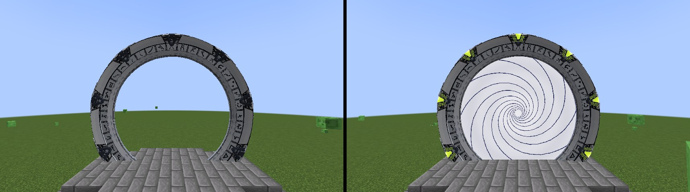
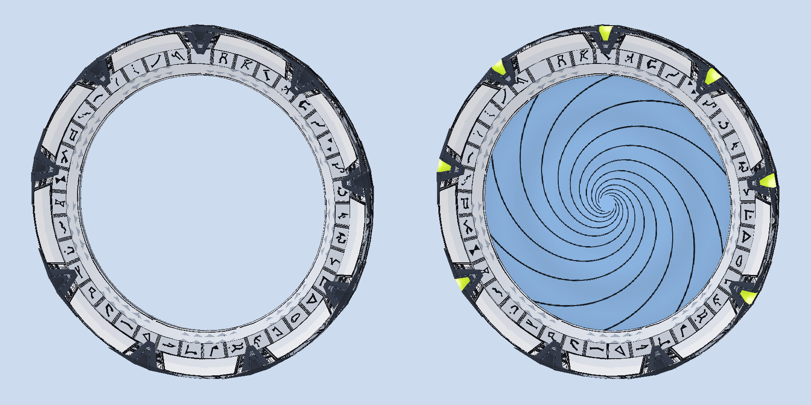

# Stargate Infinity look for Just Stargate Mod

A resource pack for **Just Stargate Mod (JSG) 1.20.1** that gives its Milky Way gate the look of the animated series *Stargate Infinity*:

- a pale cartoon ring with ink outlines along every edge
- black glyphs on the symbol track
- dark chevrons that light lime-yellow
- a pale whirlpool with ink spiral lines for the wormhole, and a cartoon kawoosh: the swirl spins up, flashes white with rings bursting outward, darkens, then settles
- pale iris blades with ink edges



*In a Minecraft 1.20.1 client with JSG 5.1.2.0 and the pack. Left: an idle gate. Right: the same gate with seven chevrons locked and its wormhole open.*



*Rendered from JSG's gate models with the pack's textures by `tools/preview.py`, with a stand-in blue for the wormhole.*

## Install

1. Put [`JSGInfinity-1.20.1.zip`](JSGInfinity-1.20.1.zip) in your `resourcepacks` folder. Don't unzip it.
2. In Minecraft: Options → Resource Packs, move **JSGInfinity-1.20.1.zip** to the right-hand side, above JSG's own resources, and press Done.

It's a client-side pack. A server doesn't need it, and players without it see JSG's normal gate.

It changes **every** JSG Milky Way gate in your game; JSG has no way to give one gate a different look. Pegasus, Universe, Tollan, Orlin and Movie gates keep their normal look. For a separate Infinity gate next to ordinary Milky Way gates, use the [Infinity Stargate add-on for JSG](../JSGInfinityGate/) instead.

JSG gives a gate a frosty, mossy, sooty or aged look in some biomes. With the pack those gates stay cartoon gates with a light tint: paler for frost, greener for moss, darker for soot, warmer for age.

## What it changes

| JSG texture | |
|---|---|
| `tesr/milkyway/gatering*.jpg` | the outer ring and the turning symbol ring, plain and for the four biome looks |
| `tesr/milkyway/chevron*.png` | the chevrons, and their lights lit and unlit |
| `tesr/event_horizon_animated_template.jpg` | the open wormhole, 185 frames |
| `tesr/event_horizon_animated_template_kawoosh.jpg` | the opening, 196 frames |
| `tesr/iris/iris_blade.jpg` | the iris blades |

The DHD, the glyphs on the DHD and in the GUI, and the other gate types are unchanged.

## Tested

In a Minecraft 1.20.1 client (Forge 47.4.29, software rendering) on a server with JSG 5.1.2.0, with the pack loaded:

- The ring, the black glyphs and the dark chevrons drew as in the picture above.
- JSG lights its gate dimly: it drew the ring at about 40% of the texture's brightness. So the ring's tones are close to white, to come out light grey like the show's gate. Light around the gate helps: a lit gate room makes it paler still.
- The chevrons lit lime-yellow one by one as the gate dialed, and the open wormhole was the white whirlpool with its ink spirals. JSG tints the ink lines a dark navy.
- The wormhole sheets are 7000 and 5600 pixels square, smaller than JSG's 15000 and 10800, to keep the pack small. JSG drew them correctly: one whole frame at a time. `--full` (below) still builds sheets at JSG's size.
- Not seen yet: the kawoosh (the screenshots were taken every 3 seconds and missed it), the iris blades, and the frost, moss, soot and age looks.

If something looks wrong in your game, a screenshot helps.

## Build

The pack is built by [`tools/make_pack.py`](tools/make_pack.py) (Python 3 with Pillow and numpy):

```
python3 tools/make_pack.py jsg-1.20.1-5.1.2.0.jar build JSGInfinity-1.20.1.zip
python3 tools/make_pack.py jsg-1.20.1-5.1.2.0.jar build JSGInfinity-1.20.1.zip --full   # wormhole sheets at JSG's size
python3 tools/preview.py jsg-1.20.1-5.1.2.0.jar build preview.png open                  # or idle
```

The script needs the JSG jar, but it takes no textures from it. It reads JSG's gate models only to find where each face of the gate lands on the texture, and paints that face itself: a flat tone chosen by which way the face points, ink where the surface folds, black on the tops of the glyphs. The wormhole frames are drawn from scratch.

## License

MIT, see [LICENSE](../LICENSE). All the textures are drawn by `tools/make_pack.py`; none are copied or recoloured from JSG. JSG itself is under its own license and isn't included.
