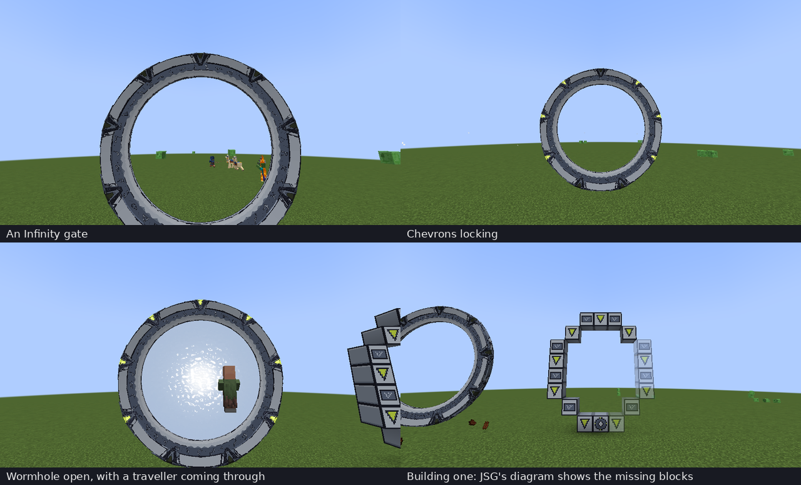

# Infinity Stargate for JSG

An add-on for **Just Stargate Mod (JSG) 1.20.1** (Forge): the gate from *Stargate Infinity*, which you build from its own blocks the same way you build JSG's gates.



*In a Minecraft 1.20.1 client with JSG 5.1.2.0 and the add-on. Top: an Infinity gate, and the chevrons locking for an incoming wormhole. Bottom: the wormhole open, with a traveller coming through; and a gate being built, where JSG's diagram shows the Infinity blocks still missing.*

## What you get

Three blocks, in their own **Infinity Stargate** creative tab:

| Block | Recipe (shapeless) |
|---|---|
| **Infinity Stargate Base** | JSG's Milky Way Stargate Base + lime dye |
| **Infinity Stargate Ring** | JSG's Milky Way Stargate Ring + lime dye |
| **Infinity Stargate Chevron** | JSG's Milky Way Stargate Chevron + lime dye |

Build them exactly like a JSG Milky Way gate: place the base first, and it shows you the diagram; then the ring and chevron blocks around it. When the ring is complete, the blocks form the gate.

The gate is JSG's Milky Way gate underneath. It has Milky Way addresses, and because its block entity is JSG's own Milky Way gate, it takes the Milky Way DHD, upgrades, the iris, energy and computers the same way. [Tested](#tested) says which of these have been tried. It is drawn with JSG's own models and animations: the turning symbol ring, the chevrons that lock and the kawoosh. Only the look changes:

- Pale stone with ink outlines.
- A slate symbol track with pale symbols.
- Lime-yellow chevrons that glow when locked.
- A pale blue-white event horizon.

The iris stays JSG's own metal one.

Breaking the base gives back an Infinity base, with the gate's upgrades, settings and energy kept, as JSG's own base does.

### Command

For operators, as JSG's `/jsg buildgate` does for its own gates:

```
/jsginfinity build <pos> [north|south|east|west]
```

This lays out a whole Infinity gate (base, rings and chevrons) at `<pos>` and forms it. The gate faces the way you give, or towards you.

## Install

1. Install [Just Stargate Mod](https://modrinth.com/mod/jsg) 5.1.2.0 or newer for Minecraft 1.20.1 (Forge 47).
2. Put [`dist/jsginfinity-1.0.0.jar`](dist/jsginfinity-1.0.0.jar) in the same `mods` folder, on the client and on the server.

## How it works

The add-on uses the same pattern as JSG's own Movie gate:

- **Blocks:** its base, ring and chevron blocks extend JSG's Milky Way ones.
- **Block entity:** the gate's block entity extends JSG's Milky Way gate, and its merge helper names the Infinity ring and chevron blocks.
- **Renderer:** it follows JSG's Milky Way renderer step for step, binding the Infinity textures where JSG binds its own.

`tools/make_resources.py` makes the textures, block states, models, recipes and loot tables. It paints every texture from scratch. From your JSG jar it reads only the shapes and UV layouts of the Milky Way models, so the textures line up with them; it never reads JSG's textures. Each texel is coloured from the point of the model it lands on, and sharp edges of the model get ink lines.

## Build

```
python3 tools/make_resources.py jsg-1.20.1-5.1.2.0.jar   # only after changing the look
./gradlew build
```

The jar is `build/libs/jsginfinity-1.0.0.jar`. Gradle fetches JSG from Modrinth's maven to compile against. `./gradlew runServer` and `./gradlew runClient` start Minecraft with JSG and the add-on installed.

## Tested

In Minecraft 1.20.1 with Forge 47.4.29 and JSG 5.1.2.0, in the development server and client that `./gradlew runServer` and `runClient` start.

**On the server:**
- JSG and the add-on loaded with no errors, recipes and loot tables included.
- `/jsginfinity build` built two gates, facing north and south, and both formed. JSG gave them Milky Way, Pegasus and Universe addresses, as it gives every gate, and each ring and chevron block linked to its base.
- JSG's `/jsg rig` opened an incoming wormhole on an Infinity gate. The gate dialled, opened, let JSG's travellers through and closed again by itself.

**In the client** (software rendering), joined to that server:
- The pictures above: the gate drawn with JSG's models in the Infinity colours.
- The chevrons lighting up as they lock, and the pale wormhole.
- The blocks before the gate forms, with JSG's diagram.

**Not tested yet:**
- Dialling one Infinity gate from another with a DHD or a computer.
- Crafting the blocks in survival.
- Placing the blocks by hand.
- The iris.
- Breaking the base.

## License

MIT, see [LICENSE](../LICENSE): the code, and the textures, which are drawn by `tools/make_resources.py`. Just Stargate Mod isn't included and keeps its own license; you need it installed.
