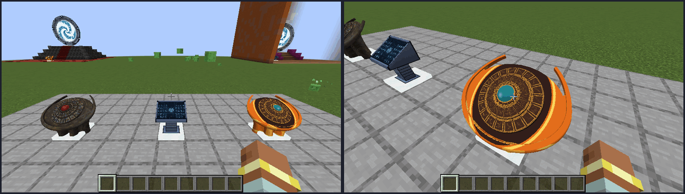

# Infinity Stargate for JSG

An add-on for **Just Stargate Mod (JSG) 1.20.1** (Forge): the gate from *Stargate Infinity*, which you build from its own blocks the same way you build JSG's gates.


*In a Minecraft 1.20.1 client with JSG 5.1.2.0 and the add-on. Top: an Infinity gate, and the chevrons locking for an incoming wormhole. Bottom: the wormhole open, with a traveller coming through; and a gate being built, where JSG's diagram shows the Infinity blocks still missing.*

## What you get

Five blocks, in their own **Infinity Stargate** creative tab:

| Block | Recipe (shapeless) |
|---|---|
| **Infinity Stargate Base** | JSG's Milky Way Stargate Base + lime dye |
| **Infinity Stargate Ring** | JSG's Milky Way Stargate Ring + lime dye |
| **Infinity Stargate Chevron** | JSG's Milky Way Stargate Chevron + lime dye |
| **Infinity DHD** | JSG's Milky Way DHD + lime dye |
| **Orange DHD** | JSG's Milky Way DHD + orange dye |

Build them exactly like a JSG Milky Way gate: place the base first, and it shows you the diagram; then the ring and chevron blocks around it. When the ring is complete, the blocks form the gate.

The gate is JSG's Milky Way gate underneath. It has Milky Way addresses, and because its block entity is JSG's own Milky Way gate, it takes the Milky Way DHD, upgrades, the iris, energy and computers the same way. [Tested](#tested) says which of these have been tried. It is drawn with JSG's own models and animations: the turning symbol ring, the chevrons that lock and the kawoosh. Only the look changes:

- Pale stone with ink outlines.
- A slate symbol track with pale symbols.
- Lime-yellow chevrons that glow when locked.
- A pale blue-white event horizon. Once the wormhole settles, the cartoon's whirlpool of ink lines turns slowly over it.
- A pale iris that closes into a spiral. It is JSG's iris, with its blades and animation; only its texture changes.

Breaking the base gives back an Infinity base, with the gate's upgrades, settings and energy kept, as JSG's own base does.

### Infinity DHD


*In a Minecraft 1.20.1 client: JSG's own DHD beside the Infinity DHD, linked to an Infinity gate.*

JSG's Milky Way DHD in the gate's colours:
- A pale pedestal with ink outlines.
- A slate console and keys.
- Keys and dome that light lime-yellow.

Underneath it is JSG's own DHD, so it works the same way: place it within a few blocks of the gate and they link. It dials with the same keys and screen, takes the same control crystal, upgrades and fuel, and links to Infinity gates and JSG's Milky Way, Movie and Tollan gates alike. An ordinary JSG DHD also links to an Infinity gate.

### Orange DHD



*In a Minecraft 1.20.1 client: JSG's own DHD, the Infinity DHD and the orange DHD, and the orange DHD up close.*

The DHD in the style of Carter's Addon Pack:
- An orange pedestal with amber panels and yellow bands.
- A dark console with gold-edged keys that light orange.
- A turquoise dome.

It is JSG's Milky Way DHD underneath too, and works just like the Infinity DHD.

### Commands


*In a Minecraft 1.20.1 client: Carter's platform with the orange DHD, the Infinity gate room, the whirlpool wormhole and the spiral iris.*

For operators. Each builds facing the way you give, or towards you:

```
/jsginfinity build <pos> [north|south|east|west]
/jsginfinity platform <pos> [north|south|east|west]
/jsginfinity room <pos> [north|south|east|west]
```

- **`build`** lays out a whole Infinity gate (base, rings and chevrons) with its base at `<pos>` and forms it, as JSG's `/jsg buildgate` does for its own gates.
- **`platform`** builds the gate on the stone pyramid from the dial sequence of Carter's Addon Pack:
  - a four-step pyramid of dark deepslate on red ground;
  - a red carpet up its front steps to the gate;
  - the orange DHD at the foot of the steps, linked to the gate.
- **`room`** builds the gate room of *Stargate Infinity*:
  - the gate on a base at the top of a brown ramp with hot-pink rails;
  - orange-brown walls, with a pale halo round the gate and yellow and lime light bars fanned out round that;
  - a lit ceiling, open at the front;
  - the Infinity DHD beside the ramp, linked to the gate.

For `platform` and `room`, `<pos>` is the ground under the middle of the gate, where you'd stand. They clear the space they need first (`platform` about 23 × 21 blocks, `room` 27 × 19), so build them somewhere open.

## Install

1. Install [Just Stargate Mod](https://modrinth.com/mod/jsg) 5.1.2.0 or newer for Minecraft 1.20.1 (Forge 47).
2. Put [`dist/jsginfinity-1.3.0.jar`](dist/jsginfinity-1.3.0.jar) in the same `mods` folder, on the client and on the server. Take out any older `jsginfinity` jar.

## How it works

The add-on uses the same pattern as JSG's own Movie gate:

- **Blocks:** its base, ring and chevron blocks extend JSG's Milky Way ones.
- **Block entity:** the gate's block entity extends JSG's Milky Way gate, and its merge helper names the Infinity ring and chevron blocks.
- **Renderer:** it follows JSG's Milky Way renderer step for step, binding the Infinity textures where JSG binds its own.
  - The whirlpool is one more see-through layer, drawn just in front of JSG's horizon once the kawoosh is over, turning with the game's clock.
  - For the iris, the Infinity texture stands in for JSG's under JSG's own key while an Infinity gate draws its iris, and JSG's is put back straight after.
- **Tags:** JSG finds gates, their parts and DHDs by block tags, and links a gate and a DHD only when each is in the other's tag. The add-on adds its blocks to the tags their Milky Way twins are in, without replacing JSG's entries.

The Infinity and orange DHDs are JSG's Milky Way DHD block entity on blocks of their own:
- At startup the add-on adds those blocks to the list of blocks JSG's DHD block entity may stand in; without it Minecraft wouldn't tick the DHDs.
- Its renderer takes over JSG's DHD renderer. It leaves every JSG DHD to JSG's own drawing.
- For the add-on's DHDs it follows JSG's steps with each DHD's own textures: each key's light at the brightness JSG chose.

`tools/make_resources.py` makes the textures, block states, models, recipes, loot tables and tags. It paints every texture from scratch. From your JSG jar it reads only the shapes and UV layouts of the Milky Way gate and DHD models, so the textures line up with them; it never reads JSG's textures. Each texel is coloured from the point of the model it lands on, and sharp edges of the model get ink lines.

## Build

```
python3 tools/make_resources.py jsg-1.20.1-5.1.2.0.jar   # only after changing the look
./gradlew build
```

The jar is `build/libs/jsginfinity-1.3.0.jar`. Gradle fetches JSG from Modrinth's maven to compile against. `./gradlew runServer` and `./gradlew runClient` start Minecraft with JSG and the add-on installed.

## Tested

In Minecraft 1.20.1 with Forge 47.4.29 and JSG 5.1.2.0, in the development server and client that `./gradlew runServer` and `runClient` start.

**On the server:**
- JSG and the add-on loaded with no errors, recipes and loot tables included.
- `/jsginfinity build` built two gates, facing north and south, and both formed. JSG gave them Milky Way, Pegasus and Universe addresses, as it gives every gate, and each ring and chevron block linked to its base.
- JSG's `/jsg rig` opened an incoming wormhole on an Infinity gate. The gate dialled, opened, let JSG's travellers through and closed again by itself.

**In the client** (software rendering), joined to that server:
- The pictures above: the gate drawn with JSG's models in the Infinity colours.
- The chevrons lighting up as they lock, and the pale wormhole.
- The blocks before the gate forms, with JSG's diagram.

**The Infinity DHD (1.1.0)**, on the same server and client:
- Placed in front of an Infinity gate, it linked both ways: the DHD to the gate and the gate to the DHD. JSG's own DHD linked to an Infinity gate the same way.
- After a restart it loaded and ticked like a JSG DHD.
- In the client it drew in the Infinity colours, and a JSG DHD beside it still drew as JSG's own.
- In a player's own game, 1.1.0 showed the gate and the Infinity DHD, and the DHD's keys lit as they dialled.

**The orange DHD (1.2.0)**, on the dev server and client:
- Placed in front of an Infinity gate, it linked both ways.
- The DHDs placed before the update loaded and ticked as before.
- In the client the three DHDs drew side by side, each in its own look (picture above).
- In a player's own game, 1.2.0 with the orange DHD worked.

**The whirlpool, the iris and the buildings (1.3.0)**, on the dev server and client:
- With a wormhole open (from `/jsg rig`), the whirlpool turned over the settled horizon, and not over the kawoosh.
- With a titanium iris closed (set in the gate's data), the iris drew in the Infinity texture, and other gates kept JSG's iris.
- `/jsginfinity platform` and `/jsginfinity room` built facing south, the gates formed, and each DHD linked to its gate. JSG's `/jsg rig` then opened a wormhole on each gate, and JSG's travellers came through onto the pyramid and down the ramp.

**On a dedicated server, with 1.0.0** (Forge 47.4.29, JSG 5.1.2.0, CC: Tweaked 1.120.2, with Stargate Journey 0.6.54, Chevron Seven and the Stargate Command Addon in the same world):
- Everything loaded together without errors from these mods.
- Two Infinity gates, each powered by a JSG creative capacitor, with an advanced computer under each base. The computers ran this repository's `sgc` library.
  - The library found the gate and read it as a JSG Milky Way gate with its 8-symbol address.
  - One gate dialled the other: the ring turned to each of the six symbols, seven chevrons locked, and the wormhole opened. The computer at the other gate saw it come in, and then saw it close when the first computer closed it.
- Breaking a base dropped an Infinity base that kept the gate's 17.8 million FE and its upgrade slots.

**Not tested yet:**
- A dial from a DHD all the way to an open wormhole. The player saw the keys light as they dialled; whether the gate then opened wasn't reported.
- Crafting the blocks in survival.
- Placing the blocks by hand.
- Closing the iris from a DHD, a remote or a computer. The test closed it by setting the gate's data.
- A player breaking the base. The test broke it with `/setblock … destroy`, which never calls the code that turns the ring back into separate blocks, in JSG's own gates as well. The Infinity base inherits that code from JSG's Milky Way base unchanged.

## License

MIT, see [LICENSE](../LICENSE): the code, and the textures, which are drawn by `tools/make_resources.py`. Just Stargate Mod isn't included and keeps its own license; you need it installed.
