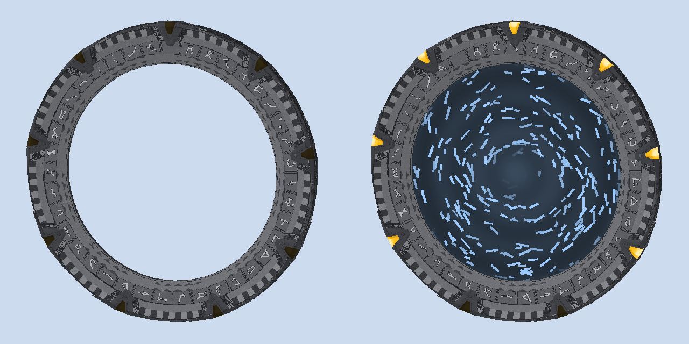
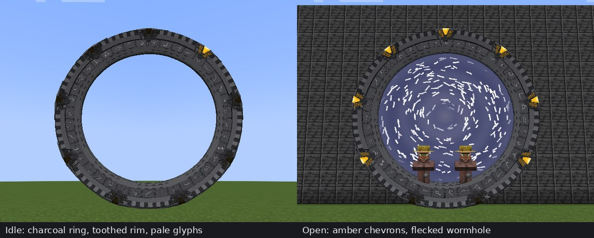

# LanteaCraft look for Just Stargate Mod

A resource pack for **Just Stargate Mod (JSG) 1.20.1** that gives its Milky Way gate the look of the gate in **LanteaCraft**, the stargate mod for Minecraft 1.7.10:

- a charcoal ring with a toothed rim, dark grooves along every edge and pale carved glyphs
- chevrons that light amber, their left face brighter than the right
- a deep wormhole flecked with white foam that drifts slowly outwards
- a kawoosh that flashes white with a ring bursting outwards, churns with foam, then calms and darkens



*Rendered from JSG's gate models with the pack's textures by the Infinity pack's `preview.py`, with a stand-in blue for the wormhole. In the game JSG tints the wormhole itself.*



*In a Minecraft 1.20.1 client with JSG 5.1.2.0 and the pack. Left: an idle gate. Right: the same gate open, with a dark wall behind it.*

## Install

1. Put [`JSGLanteaCraft-1.20.1.zip`](JSGLanteaCraft-1.20.1.zip) in your `resourcepacks` folder. Don't unzip it.
2. In Minecraft: Options → Resource Packs, move **JSGLanteaCraft-1.20.1.zip** to the right-hand side, above JSG's own resources, and press Done.

It's a client-side pack. A server doesn't need it, and players without it see JSG's normal gate.

It changes **every** JSG Milky Way gate in your game; JSG has no way to give one gate a different look. Pegasus, Universe, Tollan, Orlin and Movie gates keep their normal look, and so do the DHD and the iris. JSG's DHD is already dark with a red dome, like LanteaCraft's.

JSG gives a gate a frosty, mossy, sooty or aged look in some biomes. With the pack those gates keep the charcoal look with a light tint: paler for frost, greener for moss, darker for soot, browner for age.

Don't use it together with the [Infinity pack](../JSGInfinity/): both replace the same textures, and the one higher in the list wins.

## What it changes

| JSG texture | |
|---|---|
| `tesr/milkyway/gatering*.jpg` | the outer ring and the turning symbol ring, plain and for the four biome looks |
| `tesr/milkyway/chevron*.png` | the chevrons, and their lights lit and unlit |
| `tesr/event_horizon_animated_template.jpg` | the open wormhole, 185 frames |
| `tesr/event_horizon_animated_template_kawoosh.jpg` | the opening, 196 frames |

## Tested

In a Minecraft 1.20.1 client (Forge 47.4.29, software rendering), joined to a server with JSG 5.1.2.0, with the pack loaded. A gate built with `/jsg buildgate milkyway` and opened with JSG's `/jsg rig`:

- The ring drew charcoal with its toothed rim and pale glyphs, as in the pictures.
- The chevrons lit amber one by one as the gate dialled.
- The kawoosh flashed white, JSG's vortex came out, and the wormhole settled with the white flecks drifting over it.
- **The water comes out lighter than LanteaCraft's.** JSG drew it a pale blue-grey rather than deep navy, both against the sky and against a dark wall. Making the texture much darker changed little, so JSG seems to lighten the wormhole itself.
- Not seen yet: the frost, moss, soot and age looks.

## Build

The pack is built by [`tools/make_pack.py`](tools/make_pack.py) (Python 3 with Pillow and numpy). It uses the model reader, baker and wormhole sheet layout of the [Infinity pack's script](../JSGInfinity/tools/make_pack.py), so keep the two folders side by side:

```
python3 tools/make_pack.py jsg-1.20.1-5.1.2.0.jar build JSGLanteaCraft-1.20.1.zip
python3 tools/make_pack.py jsg-1.20.1-5.1.2.0.jar build --small     # a quick low-resolution pack
```

Every texture is drawn by the script. It only reads JSG's gate models (the `.obj` files in the JSG jar) to learn where each part of the gate sits on its texture; nothing is copied or recoloured from JSG.

## License

MIT, see [LICENSE](../LICENSE): the script and the textures it draws. JSG isn't included and keeps its own license; you need it installed. LanteaCraft is only the inspiration: nothing of it is in the pack.
