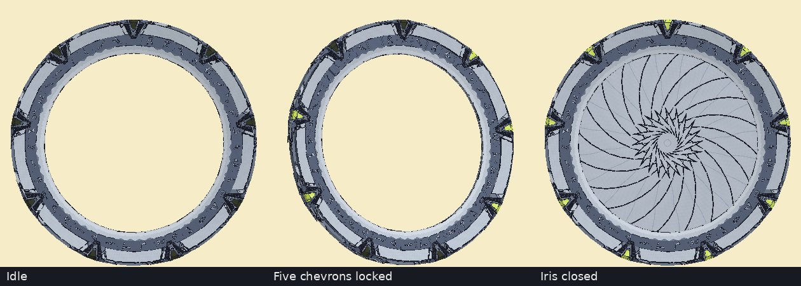
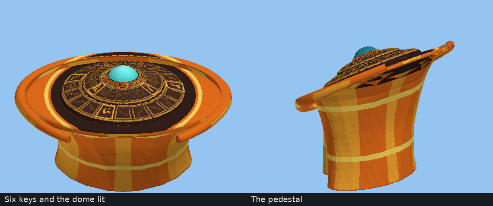

# Just Stargate Mod Looks

Two resource packs for **Just Stargate Mod (JSG) 1.20.1** that change how its Milky Way gate and DHD look. Use either one, or both.

| Pack | Changes | Look |
|---|---|---|
| [`JSG-Infinity-Gate-1.20.1.zip`](JSG-Infinity-Gate-1.20.1.zip) | the Milky Way gate, its chevrons and the iris | the gate as drawn in *Stargate Infinity*: pale stone with ink outlines, a slate symbol track with pale symbols, lime-yellow chevrons, pale iris blades whose ink edges make a spiral when closed |
| [`JSG-Orange-DHD-1.20.1.zip`](JSG-Orange-DHD-1.20.1.zip) | the Milky Way DHD | an orange pedestal in the style of Carter's Addon Pack: amber panels and yellow bands, a dark console with gold-edged symbol keys that light orange, a turquoise dome |



*JSG's own gate and iris models with the Infinity textures, drawn outside the game: idle, five chevrons locked, and the iris closed.*



*JSG's DHD model with the orange textures, drawn outside the game: the console with six keys and the dome lit, and the pedestal.*

## Install

1. Put the zip (or both) in `.minecraft/resourcepacks`.
2. In Minecraft: **Options → Resource Packs**, move the pack to the right-hand list, above JSG's own resources, and press **Done**.

Only the client needs it; a server needs nothing. JSG builds its textures as the game loads, so the change shows once the resource reload finishes.

The Infinity pack also replaces the textures JSG uses for gates in deserts, snow, jungles and the Nether (its *aged*, *frost*, *mossy* and *sooty* gates), with a light tint for each, so the look holds in every biome.

What the packs don't change:

- **The event horizon.** JSG sets its colour in code; a resource pack can only lay an animated overlay over it.
- **The Pegasus, Universe, Tollan, Orlin and Movie gates, and the Pegasus DHD.**
- **The symbols.** On the gate and the DHD they are part of JSG's 3D models, so they keep their shapes; the packs only colour them.

## How the textures are made

`tools/make_looks.py` paints every texture from scratch. It reads only the shapes and UV layouts of JSG's models from your JSG jar, so the new textures line up with JSG's gate, iris and DHD. It never reads JSG's textures.

For each texel it finds the point of the model it lands on, then colours it from where that point is, which way its face looks and how close it is to a sharp edge of the model. Sharp edges get ink lines; that is what gives the gate its cartoon outline.

JSG's gate texture is shared: the symbol track's face uses the same texels as the gate's outer rim and parts of the chevron housings. The track is painted in one even slate colour, so it suits all three; the symbols have texels of their own and stay pale.

## Rebuild

Needs Python 3 with NumPy and Pillow, and a JSG 1.20.1 jar (from [Modrinth](https://modrinth.com/mod/jsg) or CurseForge):

```
python3 tools/make_looks.py jsg-1.20.1-5.1.2.0.jar .
```

It writes both zips into the folder you name. The colours are named at the top of each section of the script, so another look is a few lines.

## Tested

- Built against **JSG 5.1.2.0** for Minecraft 1.20.1 (Forge). Every file in both packs replaces a file of the same path in that jar, and each image decodes.
- JSG loads these textures through Minecraft's resource manager (its `TextureLoader` and its chevron texture list), which is what lets a resource pack replace them.
- The pictures above were drawn by a small renderer of JSG's own models with the textures from the zips. The closed iris places the blades as JSG's renderer does: 20 blades, each swung 45 degrees about a pivot on the rim.
- **Not yet seen in a Minecraft client.**

## License

MIT, see [LICENSE](../LICENSE): the script and the textures it makes, which are original. Just Stargate Mod isn't included and keeps its own license; you need it installed to use these packs.
