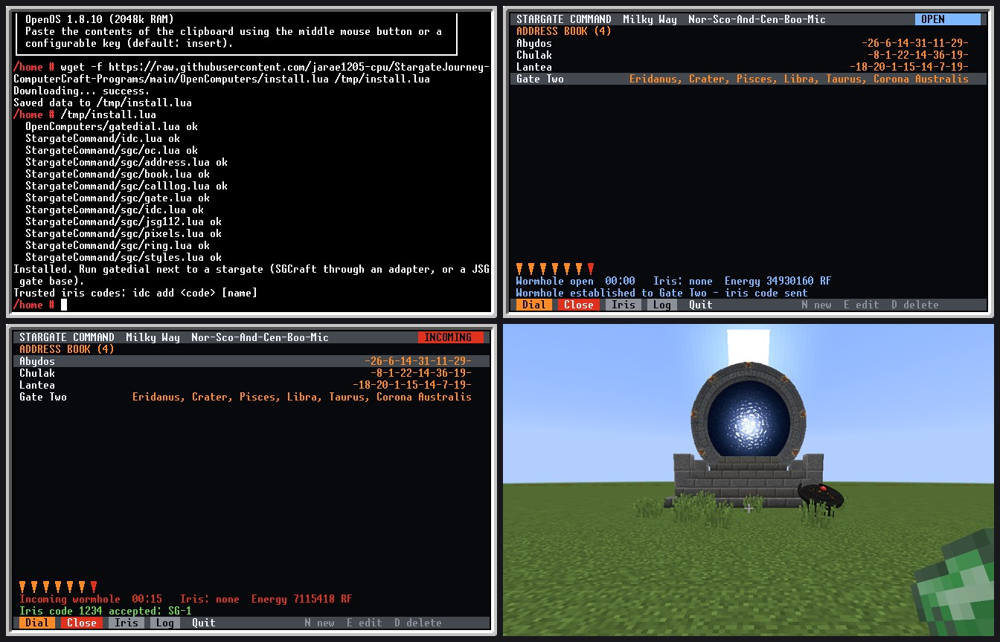
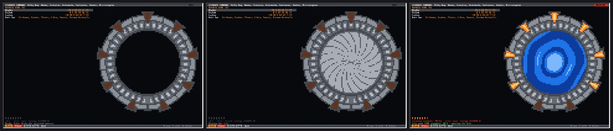
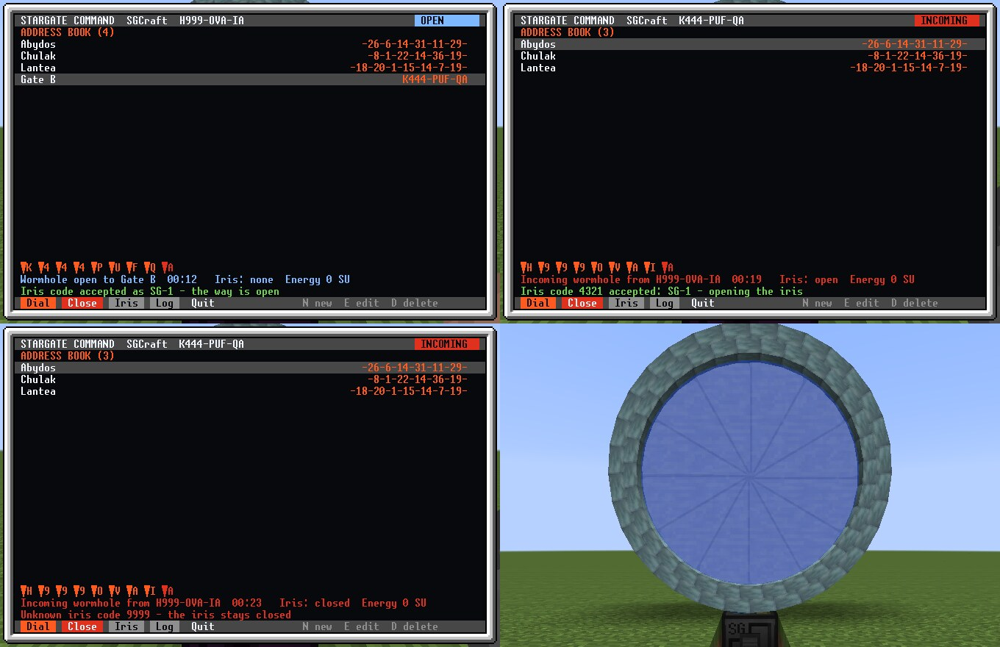

# gatedial for OpenComputers

A stargate dialing computer for **OpenComputers** (OpenOS), for the gate mods that talk to OpenComputers:

- **SGCraft**: Greg Ewing's original (1.7.10) and SGCraft 2.x (1.12.2)
- **Just Stargate Mod** for Minecraft 1.12.2 (JSG), Milky Way, Pegasus and Universe gates

It is the OpenComputers version of the [Personal Dialer](../PersonalDialer/) and the [Gate Room](../StargateCommand/). It keeps the same address book, trusted iris codes and gate log, so a book written on one computer works on the other. It does not need the Auspex Gate Systems programs.


*Left: dialing Abydos on an SGCraft gate, with a tier 3 screen and graphics card (160x50). Right: a JSG 1.12.2 gate on a tier 2 screen (80x25), with the wormhole open and the iris code sent, then a player coming through an incoming wormhole. These screens were rendered from a headless OpenOS test harness with simulated gates, not captured in-game.*



*In a Minecraft 1.12.2 world with OpenComputers 1.8.10 and Just Stargate Mod 4.11.2.8. Top left: the installer, downloaded with `wget` on an in-game computer. Top right: gatedial has dialed the other gate and sent its iris code. Bottom left: the computer at the other gate as that call comes in; the code 1234 is accepted. Bottom right: the gate with its wormhole open.*



*A tier 3 screen in the same world, cabled to a JSG gate with a creative iris set to OC mode. Left: the gate picture beside the address book. Middle: the iris closed with the I key. Right: another gate dials in and sends a trusted code, and gatedial opens the iris by itself.*



*SGCraft 1.13.3 and OpenComputers 1.8.10 in a Minecraft 1.7.10 world. Top left: one computer dials the other gate and sends the code 4321; the other side answers that it was accepted. Top right: at the other gate the iris was shut, so gatedial opens it for the trusted code. Bottom left: the same call with an unknown code; the iris stays shut. Bottom right: that gate with its iris closed over the wormhole.*

## Install

You need an internet card. In the OpenOS shell:

```
wget -f https://raw.githubusercontent.com/jarae1205-cpu/StargateJourney-ComputerCraft-Programs/main/OpenComputers/install.lua /tmp/install.lua
/tmp/install.lua
```

This puts `gatedial` and `idc` in `/home/bin` and the `sgc` library in `/home/lib/sgc`. Run the installer again to update; it downloads every file before it changes anything. Your address book, iris codes and gate log stay as they are. Then `reboot`: OpenOS keeps the libraries it has loaded in memory, so until a reboot the computer keeps using the old ones.

## Connect the gate

- **SGCraft**: place SGCraft's OpenComputers interface block against the gate's base and connect it to the computer with cable. It shows up as a `stargate` component.
- **JSG 1.12.2**: connect the gate's base block to the computer with cable. It is a `stargate` component too. To open and close the iris from the computer, set the iris mode to OC in the gate's GUI.

JSG closes a wormhole by itself when no player has been nearby for 5 seconds ("Autoclose" in JSG's `stargates.cfg`). gatedial logs that as a close with the reason Autoclose. Raise the time or turn it off in that config if your computers should keep wormholes open on their own.

Then run `gatedial`. Run `components` in the shell if the gate is not found.

## Screen

A tier 2 screen and graphics card is enough. With tier 3 (160x50), gatedial also draws the gate beside the address book: its chevrons light as they lock, the wormhole forms in the ring and the iris closes over it. On a smaller screen the picture is left out and the list gets the room.

## Keys

| Key | Does |
| --- | --- |
| Up / Down | pick an address |
| Enter | dial it |
| X | close the wormhole, or stop dialing |
| I | open or close the iris |
| N / E / D | new address, edit, delete |
| L | the gate log |
| Q | quit |

X and I also work while the gate log is open.

On a touch screen, tap an address to pick it and tap it again to dial. The buttons along the bottom do the same as the keys.

New and edit ask for a name, an address and the iris code to send when you dial it. When you edit, each question shows the current value in [brackets]: press Enter to keep it, or type `-` to clear it. Addresses are typed the way the gate shows them: SGCraft letters such as `WLDQ-DQB-MT`, or JSG symbol names separated by commas such as `Aquila, Cetus, Gemini, Leo, Scorpius, Orion`. An entry with the wrong kind of address for the gate is shown but not dialed.

## Iris codes

Iris codes work the same as in the [Gate Room](../StargateCommand/README.md#iris-codes-and-the-gate-log):

- When you dial an entry that has an iris code, gatedial sends it as soon as the wormhole opens.
- When another gate dials in and sends a code, gatedial opens the iris if the code is trusted and answers "accepted". An unknown code gets "rejected", and the iris stays shut.
- Trust codes with `idc add 1234 SG-1`. `idc` lists them, `idc remove 1234` stops trusting one and `idc log` prints the gate log.

With SGCraft the codes go as gate messages, the same as from the ComputerCraft programs. JSG 1.12.2 has its own iris code system (the GDO), so gatedial uses that: the code arrives as JSG's `received_code` signal and the answer goes to the traveller's GDO.

Set `autoIris = true` at the top of `gatedial.lua` to close the iris whenever another gate dials in.

## Shared files

| File | What |
| --- | --- |
| `/home/dialer_addresses.db` | the address book |
| `/home/iris_codes.db` | trusted iris codes |
| `/home/gate_log.db` | the gate log |

These are the same files the ComputerCraft programs keep at the root of a computer, in the same format. Copy them across to move an address book between the two.

## Settings

At the top of `gatedial.lua`:

- `irisCodes`: check iris codes from the gate that dialed in (on by default)
- `autoIris`: close the iris when another gate dials in (off by default)
- `alarm`: beep while another gate is dialing in
- `gatePicture`: draw the gate on a tier 3 screen
- `pollInterval`: seconds between gate checks

## Tested

**In a Minecraft 1.12.2 world** (Forge 14.23.5.2860) with OpenComputers 1.8.10 and Just Stargate Mod 4.11.2.8. Computers were cabled to the bases of two JSG Milky Way gates:

- The installer, typed into OpenOS on a computer with an internet card, downloaded all 12 files from GitHub.
- gatedial found the gate and showed its address, state and energy. It dialed the other gate one symbol at a time; the wormhole opened and the iris code was sent.
- At the other gate, gatedial showed the incoming wormhole. The code arrived through JSG's GDO and was accepted, after `idc add 1234 SG-1`.
- Closing worked from either computer, and both gate logs recorded the calls.
- On a tier 3 screen the gate picture showed the chevrons locking, the wormhole and the iris.
- With a creative iris in OC mode, the I key closed and opened it. When a trusted code came in while it was shut, gatedial opened it.
- The test found two bugs, both fixed. JSG gives `dialedAddress` as a string, and a gate stays busy for a moment after each chevron locks. Before the fixes, every dial failed with "Chevron 1 did not lock".

**In a Minecraft 1.7.10 world** (Forge 10.13.4.1614) with SGCraft 1.13.3 and OpenComputers 1.8.10. Two gates each had an OpenComputers interface under the base, cabled to a computer with a tier 2 screen:

- The installer worked, and gatedial found each gate by its SGCraft address.
- It dialed the other gate's nine symbols, the wormhole opened and the iris code went across as a gate message.
- The other computer accepted the code and answered, and the dialing side showed "Iris code accepted".
- With an iris upgrade on the gate, the I key closed the iris. A trusted code opened it; an unknown code was rejected and the iris stayed shut, and both sides said so.
- Closing worked from the receiving side, and the gate log recorded the call, the code and the close.
- The test found three bugs, all fixed:
  - gatedial showed a tenth chevron on SGCraft gates.
  - Editing an entry blanked the fields you didn't retype. Now each question shows the current value.
  - X and I did nothing while the gate log was open.

Please open an issue if a gate behaves differently.
