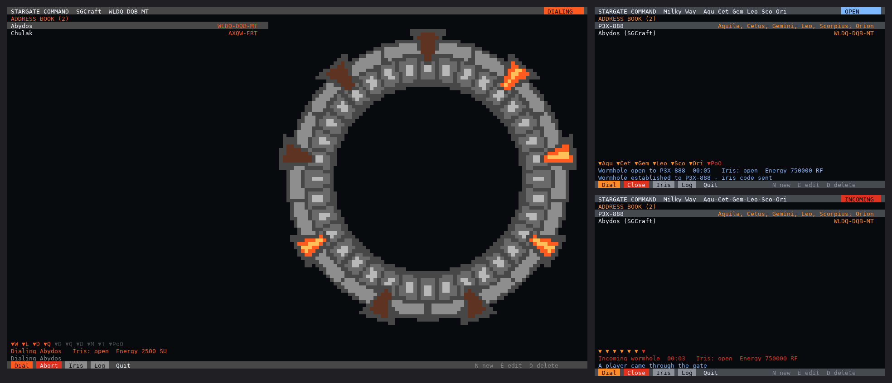

# gatedial for OpenComputers

A stargate dialing computer for **OpenComputers** (OpenOS), for the gate mods that talk to OpenComputers:

- **SGCraft**: Greg Ewing's original (1.7.10) and SGCraft 2.x (1.12.2)
- **Just Stargate Mod** for Minecraft 1.12.2 (JSG), Milky Way, Pegasus and Universe gates

It is the OpenComputers version of the [Personal Dialer](../PersonalDialer/) and the [Gate Room](../StargateCommand/). It keeps the same address book, trusted iris codes and gate log, so a book written on one computer works on the other. It does not need the Auspex Gate Systems programs.



*Left: dialing Abydos on an SGCraft gate, with a tier 3 screen and graphics card (160x50). Right: a JSG 1.12.2 gate on a tier 2 screen (80x25), with the wormhole open and the iris code sent, then a player coming through an incoming wormhole. These screens were rendered from a headless OpenOS test harness with simulated gates, not captured in-game.*

## Install

You need an internet card. In the OpenOS shell:

```
wget -f https://raw.githubusercontent.com/jarae1205-cpu/StargateJourney-ComputerCraft-Programs/main/OpenComputers/install.lua /tmp/install.lua
/tmp/install.lua
```

This puts `gatedial` and `idc` in `/home/bin` and the `sgc` library in `/home/lib/sgc`. Run the installer again to update; it downloads every file before it changes anything. Your address book, iris codes and gate log stay as they are.

## Connect the gate

- **SGCraft**: place SGCraft's OpenComputers interface block against the gate's base and connect it to the computer with cable. It shows up as a `stargate` component.
- **JSG 1.12.2**: connect the gate's base block to the computer with cable. It is a `stargate` component too. To open and close the iris from the computer, set the iris mode to OC in the gate's GUI.

Then run `gatedial`. Run `components` in the shell if the gate is not found.

## Screen

A tier 2 screen and graphics card is enough. With tier 3 (160x50), gatedial also draws the gate beside the address book: its chevrons light as they lock, the wormhole forms in the ring and the iris closes over it. On a smaller screen the picture is left out and the list gets the room.

## Keys

| Key | Does |
| --- | --- |
| Up / Down | pick an address |
| Enter | dial it |
| X | close the wormhole, or stop dialing |
| I | open or close the iris |
| N / E / D | new address, edit, delete |
| L | the gate log |
| Q | quit |

On a touch screen, tap an address to pick it and tap it again to dial. The buttons along the bottom do the same as the keys.

New and edit ask for a name, an address and the iris code to send when you dial it. Addresses are typed the way the gate shows them: SGCraft letters such as `WLDQ-DQB-MT`, or JSG symbol names separated by commas such as `Aquila, Cetus, Gemini, Leo, Scorpius, Orion`. An entry with the wrong kind of address for the gate is shown but not dialed.

## Iris codes

Iris codes work the same as in the [Gate Room](../StargateCommand/README.md#iris-codes-and-the-gate-log):

- When you dial an entry that has an iris code, gatedial sends it as soon as the wormhole opens.
- When another gate dials in and sends a code, gatedial opens the iris if the code is trusted and answers "accepted". An unknown code gets "rejected", and the iris stays shut.
- Trust codes with `idc add 1234 SG-1`. `idc` lists them, `idc remove 1234` stops trusting one and `idc log` prints the gate log.

With SGCraft the codes go as gate messages, the same as from the ComputerCraft programs. JSG 1.12.2 has its own iris code system (the GDO), so gatedial uses that: the code arrives as JSG's `received_code` signal and the answer goes to the traveller's GDO.

Set `autoIris = true` at the top of `gatedial.lua` to close the iris whenever another gate dials in.

## Shared files

| File | What |
| --- | --- |
| `/home/dialer_addresses.db` | the address book |
| `/home/iris_codes.db` | trusted iris codes |
| `/home/gate_log.db` | the gate log |

These are the same files the ComputerCraft programs keep at the root of a computer, in the same format. Copy them across to move an address book between the two.

## Settings

At the top of `gatedial.lua`:

- `irisCodes`: check iris codes from the gate that dialed in (on by default)
- `autoIris`: close the iris when another gate dials in (off by default)
- `alarm`: beep while another gate is dialing in
- `gatePicture`: draw the gate on a tier 3 screen
- `pollInterval`: seconds between gate checks

## Tested

gatedial was tested in a headless OpenOS emulator with simulated SGCraft and JSG 1.12.2 gates. The JSG side follows the OpenComputers methods and signals in JSG 4.11.2.8. It has not been run in a real Minecraft 1.12.2 or 1.7.10 world yet, so please open an issue if a gate behaves differently.
