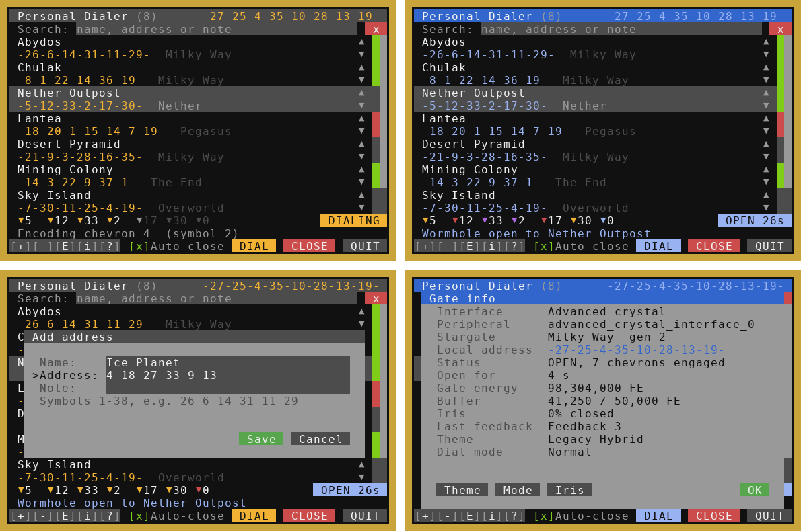
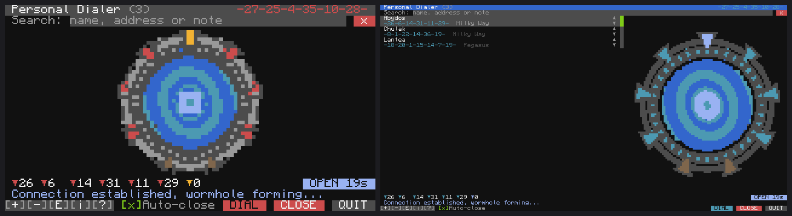

# Personal Dialer

An address book you can dial from. Save gates with a name and a note, find them with a live search, and dial with a double-click. The wormhole closes behind you after you step through.

Written for Stargate Journey on Minecraft 1.20.1 with CC: Tweaked. Also works with:

- **SGCraft** through its ComputerCraft interface: Greg Ewing's original and the 1.12.2 SGCraft 2.x line (2.3 shows ZPMs in the gate info panel). SGCraft doesn't tell the computer the gate type, so pick the Pegasus or Universe theme by hand for those gates.
- **Lantea: Stargates** 0.7.7.0+ (1.20.1 / 1.21.1): a gate controller with a Stargate Power Coupler Kit. Milky Way gates dial; Pegasus gates can't be dialed by a computer.
- **Just Stargate Mod** (1.20.1): the gate's base block. Addresses are symbol names, typed with commas: `Crater, Virgo, Bootes, Centaurus, Libra, Serpens Caput`.



*Top: dialing with the Milky Way theme, and an open wormhole with the Legacy Hybrid theme. Bottom: adding an address, and the gate info panel. These screens were rendered from a headless CC: Tweaked test harness, not captured in-game.*

## Features

- **Address book**: name, address and a free-text note (galaxy, dimension, owner...) for every gate, saved in `dialer_addresses.db`. The same file is used by the [Gate Room and the Network Hub](../StargateCommand/).
- **Planned entries**: an entry can have a name and no address yet (for a gate you have not found). It is listed as "no address yet" until you edit it.
- **Live search** by name, address or note.
- **Add, edit, remove and reorder** entries with the mouse or the keyboard.
- **Dials every gate type** through any interface:
  - **Milky Way:** rotates the ring, alternating direction like the show, then opens and closes each chevron. Fast mode engages symbols directly when the interface supports it.
  - **Pegasus, Universe, Tollan and Classic:** engages symbols directly.
  - **SGCraft:** dials letter addresses like `WLDQ-DQB-MT` (7 or 9 symbols); the gate does the chevron sequence itself.
- **Chevron bar**: shows the address being dialed and which chevrons are locked, plus the gate state (IDLE, DIALING, OPEN or INCOMING).
- **Auto-close**: closes your outgoing wormhole a few seconds after someone steps through, or after 30 s if nobody uses it. The countdown is shown on the OPEN badge.
- **Incoming wormholes**: shows the caller by name if the address is in your book. The *Add* dialog is pre-filled with the caller's address.
- **Last result marker**: green after a successful dial, red after a failed one.
- **Gate info panel**: gate type, local address, energy, iris open/close, colour theme and dial mode.
- **Colour themes**: Auto (follows the gate type and its variant), Milky Way, SG-1, Movie, Pegasus, Atlantis, Universe, Tollan, Classic, Infinity, Legacy Hybrid (amber, red and purple chevrons with a blue master chevron) and SGCraft. Auto picks SG-1, Movie or Atlantis from the gate's Stargate Journey variant, and matches resource pack variants by name ("lantea", "infinity", "hybrid", "legacy").
- **Gate picture**: click the chevron bar (or Ctrl+G) to swap the list for a drawing of the gate: chevrons, symbol ring, the open wormhole and the iris. On wide monitors (80+ columns) the gate is always shown next to the list.
- **Monitor mode**: runs on an advanced monitor. Touch to use it, or type on the computer.
- **Cartouche import**: on first start, imports `1_cartouche.lua` from [Stargate Monitor](../StargateMonitor/) if it is in the same folder.

## Requirements

- Minecraft 1.20.1, Stargate Journey 0.6.x, CC: Tweaked
- A basic, crystal or advanced crystal interface next to the computer or on a wired modem network. The local address in the title bar needs an advanced crystal interface.
- Or: SGCraft (original or 2.x) with its ComputerCraft stargate interface, a Lantea: Stargates controller with a Power Coupler Kit, or a JSG gate base.
- An advanced computer is recommended for mouse support and colour. Keyboard controls also work on a basic computer.

## Installation

With HTTP enabled in the CC: Tweaked config:

```
wget https://raw.githubusercontent.com/jarae1205-cpu/StargateJourney-ComputerCraft-Programs/main/PersonalDialer/dialer.lua dialer.lua
```

Or install it together with the Gate Room and the Network Hub:

```
wget run https://raw.githubusercontent.com/jarae1205-cpu/StargateJourney-ComputerCraft-Programs/main/StargateCommand/install.lua
```

Then run it:

```
dialer            -- on the computer screen
dialer monitor    -- on an attached advanced monitor
```

To start it automatically, create `startup.lua` containing `shell.run("dialer")`.

## Controls

| Mouse | Keyboard | Action |
|---|---|---|
| click an address | Up / Down, Page Up / Page Down | select |
| double-click, `DIAL` | Enter | dial the selected address |
| `[+]` | Ctrl+N or Insert | add an address |
| `[-]` | Ctrl+D or Delete | remove the selected address |
| `[E]` | Ctrl+E | edit the selected address |
| ▲ ▼ next to an address | Shift+Up / Shift+Down | move the address |
| `[i]` | Ctrl+I | gate info, iris, theme, dial mode |
| the chevron bar | Ctrl+G | show the gate picture / the list |
| `[?]` | Ctrl+H | help |
| `CLOSE` | Ctrl+X | close the gate or abort dialing |
| `[x] Auto-close` | Ctrl+A | toggle auto-close |
| `QUIT` | Ctrl+Q or Ctrl+T | exit |

Typing anywhere on the main screen goes into the search box. Addresses can be typed as `26 6 14 31 11 29`, `26,6,14,31,11,29` or `-26-6-14-31-11-29-`. The point of origin is added automatically when dialing. SGCraft addresses are typed as letters and digits: `WLDQ-DQB-MT` or `wldqdqbmt`. JSG addresses are symbol names separated by commas. Leave the address empty to keep a planned entry.



*Left: the gate picture on the computer screen, SG-1 theme. Right: the Atlantis theme on a 5x3 monitor, with the gate next to the list. Rendered from the headless test harness.*

## Configuration

The `CONFIG` table at the top of `dialer.lua` holds:

- `dataFile`: where the address book is stored
- `interfaceName`: which interface to use if the computer can reach several
- `symbolDelay`, `chevronDelay`: dialing speed
- `stepTimeout`, `connectTimeout`: when to give up on a stuck dial
- `autoCloseDelay`, `autoCloseIdle`: auto-close timings
- `pollInterval`: how often the gate state is re-read
- `monitorScale`: text scale in monitor mode

## Notes

- The three starting addresses (Abydos, Chulak and Lantea) are the defaults from the Stargate Journey examples. Your world may use different ones.
- Only one dial runs at a time. Dialing is refused while a wormhole is active or another gate is dialing in.
- Gate state is read from interface events and also re-checked every second, so a missed event does not leave the screen stuck.
