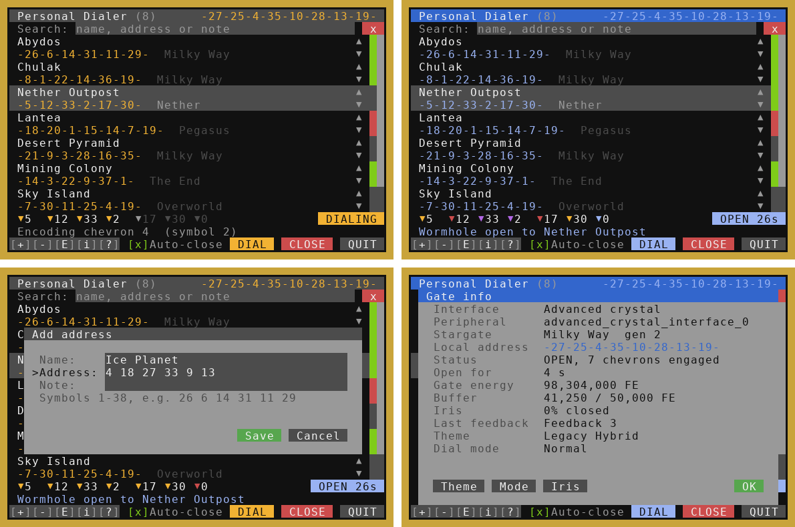
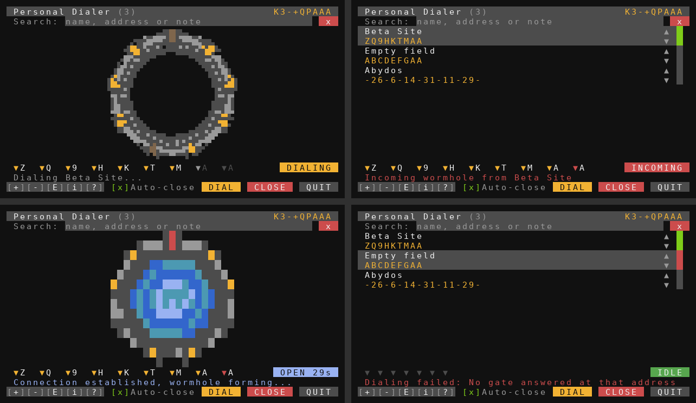
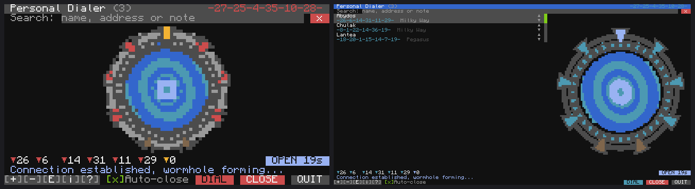

# Personal Dialer

An address book you can dial from. Save gates with a name and a note, find them with a live search, and dial with a double-click. The wormhole closes behind you after you step through.

Written for Stargate Journey on Minecraft 1.20.1 with CC: Tweaked. Also works with:

- **SGCraft** through its ComputerCraft interface: Greg Ewing's original and the 1.12.2 SGCraft 2.x line (2.3 shows ZPMs in the gate info panel). SGCraft doesn't tell the computer the gate type, so pick the Pegasus or Universe theme by hand for those gates.
- **Lantea: Stargates** 0.7.7.0+ (1.20.1 / 1.21.1): a gate controller with a Stargate Power Coupler Kit. Milky Way gates dial; Pegasus gates can't be dialed by a computer. Tested in a live game with 0.7.7.0 on 1.20.1.
- **Just Stargate Mod** (1.20.1): the gate's base block. Addresses are symbol names, typed with commas: `Crater, Virgo, Bootes, Centaurus, Libra, Serpens Caput`. Tested in a live game with JSG 5.1.2.0.
- **[Chevron Seven](../ChevronSeven/)** (1.20.1): any block of the gate ring. Its gate behaves like a Stargate Journey gate with a crystal interface, numbers and all.
- **LanteaCraft** 0.2.5+ (NeoForge 1.21.1): the gate's base block. Addresses are typed exactly as the gate shows them, such as `S9X-EGA`: `-` and `+` are glyphs. Tested in a live game.
- **LanteaCraft for Minecraft 1.7.10** (the 2014–2015 releases), with **ComputerCraft 1.75**: LanteaCraft's ComputerCraft Adapter placed against the gate's base block. Addresses are 7 or 9 glyphs, typed as the gate shows them, such as `K3-+QPAAA`. See [LanteaCraft on 1.7.10](#lanteacraft-on-1710).



*Top: dialing with the Milky Way theme, and an open wormhole with the Legacy Hybrid theme. Bottom: adding an address, and the gate info panel. These screens were rendered from a headless CC: Tweaked test harness, not captured in-game.*

## LanteaCraft on 1.7.10

ComputerCraft 1.75 is the last ComputerCraft for Minecraft 1.7.10, and the dialer runs on it as well as on CC: Tweaked. The Gate Room and the Network Hub need CC: Tweaked, so on 1.7.10 the Personal Dialer is the ComputerCraft program to use; with OpenComputers, use [gatedial](../OpenComputers/).

- **Install on ComputerCraft 1.75**: it has no `wget`, and runs a program only by its exact file name (no `.lua` added), so save the dialer as `dialer`. The HTTP API is on by default (`http_enable` in `ComputerCraft.cfg`). Type `lua` and then:
  ```lua
  local r = http.get("https://raw.githubusercontent.com/jarae1205-cpu/StargateJourney-ComputerCraft-Programs/main/PersonalDialer/dialer.lua") local f = fs.open("dialer", "w") f.write(r.readAll()) f.close() r.close()
  ```
  then `exit()` and run `dialer`. In the test world this line was tried against a local web server standing in for GitHub: it saved the dialer, and `dialer` ran it. The download from GitHub itself hasn't been tried.
- **Connect the gate**: craft LanteaCraft's **ComputerCraft Adapter** (obsidian around a control crystal, with redstone under it) and place it against the gate's base block, then put the computer next to the adapter (or reach it with a wired modem). The adapter must touch no other LanteaCraft block; against the DHD (the Stargate Controller) it gives a `stargate_controller`, which can't dial.
- **Dialing**: one call dials the whole address, about 2.5 seconds a chevron. The gate only says whether it is busy and whether it is dialing, so the dialer counts the chevrons and learns the direction from the gate's events.
- **Seven or nine chevrons**: A gate dials nine glyphs only if the two ring places two blocks to either side of the base, in the bottom row, hold chevrons. With plain ring blocks there it has seven chevrons, and LanteaCraft stops a nine-glyph dial after the sixth chevron. The dialer then says the gate has 7 chevrons; dial the first seven glyphs to reach a gate in the same dimension.
- **No gate there**: LanteaCraft accepts any well-formed address, dials every chevron, and only then gives up. The dialer says "No gate answered at that address" (there was no gate, or it was busy).
- **Incoming wormholes**: the gate sends the caller's address one glyph per chevron, and the dialer puts it together, so a caller in your book is named (a seven-glyph caller under its full address).
- **Closing** works from either end. A wormhole closes by itself after 5 minutes.
- **No iris and no iris codes**: a computer can't move a LanteaCraft 1.7.10 iris or send anything through the wormhole.
- **The gate picture** is drawn in whole character blocks on ComputerCraft 1.75, which lacks the small block characters CC: Tweaked uses. It is coarser but shows the same things.
- **Keep both gates' chunks loaded** while you use them: stand nearby, or build by the world spawn or use a chunk loader. LanteaCraft 1.7.10 doesn't save its ring blocks, so when a gate's chunk unloads and loads again the gate drops out of its call (the other side stays open) and stops counting as a built gate. This is LanteaCraft's own behaviour, seen in the [gatedial test world](../OpenComputers/README.md#tested).



*ComputerCraft 1.75 in a Minecraft 1.7.10 world. Top: the wormhole open to Alpha Site, and Alpha Site dialing in, named from its glyphs. Bottom: the gate picture in whole blocks, and a dial to an address with no gate. These are the computer's own screen, read from the server.*

**Tested in a Minecraft 1.7.10 world** with ComputerCraft 1.75 and LanteaCraft (the same world as [gatedial's test](../OpenComputers/README.md#tested)): an advanced computer at a nine-chevron gate, with LanteaCraft's ComputerCraft Adapter against the base. The dialer found the gate on the computer's `back` side and showed its address. It dialed another gate, lit the chevrons as they locked and opened the wormhole. It named a caller from its glyphs, saw the other side close the wormhole, and reported the reason for a dial to an address with no gate. Started from `startup` or typed into the shell as `dialer`, it ran the same. The test found three bugs, all fixed: ComputerCraft 1.75 has no `peripheral.getName`, its `table.pack` leaves out the count, and its Lua turns an error that isn't a string into "table: ...", which had hidden the reason for every failed dial.

## Features

- **Address book**: name, address and a free-text note (galaxy, dimension, owner...) for every gate, saved in `dialer_addresses.db`. The same file is used by the [Gate Room and the Network Hub](../StargateCommand/).
- **Planned entries**: an entry can have a name and no address yet (for a gate you have not found). It is listed as "no address yet" until you edit it.
- **Live search** by name, address or note.
- **Add, edit, remove and reorder** entries with the mouse or the keyboard.
- **Dials every gate type** through any interface:
  - **Milky Way:** rotates the ring, alternating direction like the show, then opens and closes each chevron. Fast mode engages symbols directly when the interface supports it.
  - **Pegasus, Universe, Tollan and Classic:** engages symbols directly.
  - **SGCraft:** dials letter addresses like `WLDQ-DQB-MT` (7 or 9 symbols); the gate does the chevron sequence itself.
  - **LanteaCraft:** one call dials the whole address; the bar follows the gate as it locks each chevron. Only the gate that dialed can close the wormhole, and the dialer shows LanteaCraft's reason if you try from the other side. On 1.7.10, either side can close it.
- **Chevron bar**: shows the address being dialed and which chevrons are locked, plus the gate state (IDLE, DIALING, OPEN or INCOMING).
- **Auto-close**: closes your outgoing wormhole a few seconds after someone steps through, or after 30 s if nobody uses it. The countdown is shown on the OPEN badge.
- **Incoming wormholes**: shows the caller by name if the address is in your book. The *Add* dialog is pre-filled with the caller's address.
- **Last result marker**: green after a successful dial, red after a failed one.
- **Iris codes**: give an entry an **Iris code** in its edit form and the dialer sends it through the gate as soon as the wormhole opens. A [Gate Room](../StargateCommand/#iris-codes-and-the-gate-log) at the other end that trusts the code opens its iris and answers; the answer ("accepted" or "rejected") is shown here. LanteaCraft gates take codes only from a GDO, so there the dialer reminds you to send it with yours, and shows when a GDO code reaches your own gate.
- **GDO relay**: with a wireless or ender modem on the computer, a traveller's [GDO](../StargateCommand/#gdo) (a pocket computer running `gdo`) can send its code through the open wormhole from here, and gets the answer back. This needs the `sgc` folder next to the dialer, which the [Stargate Command installer](../StargateCommand/#installation) puts there; with `dialer.lua` alone there is no relay.
- **One list per gate**: tick **Only list it at this gate** in the edit form, and the entry shows only on computers at this gate. Useful when a base has several gates sharing one address book. It needs an interface that tells the gate's own address (advanced crystal interface, SGCraft, Chevron Seven).
- **Gate info panel**: gate type, local address, energy, iris open/close, colour theme and dial mode.
- **Colour themes**: Auto (follows the gate type and its variant), Milky Way, SG-1, SGC Computer (teal lines on black, like the SGC's dialing computer and the Gate Room's look of the same name), Movie, Origins (the weathered 1939 Giza gate), Continuum (the frozen Arctic gate), Ark of Truth (a gold gate with a golden wormhole), Pegasus, Atlantis, Universe, Tollan, Classic, Infinity (the cartoon gate of the animated series, with its lime light bars), Ori Supergate (the gate picture shows 40 separate segments that light up as it dials), Legacy Hybrid (amber, red and purple chevrons with a blue master chevron), SGCraft, Carter Addon Pack (the Garry's Mod addon: red, orange and its DHD's blue dome) and Stargate Network (Chevron Seven's letter gate, with blue chevrons). Auto picks SG-1, Movie or Atlantis from the gate's Stargate Journey variant, and matches resource pack variants by name ("lantea", "infinity", "hybrid", "legacy"); Chevron Seven gates name their look.
- **Gate picture**: click the chevron bar (or Ctrl+G) to swap the list for a drawing of the gate: chevrons, symbol ring, the open wormhole and the iris. On wide monitors (80+ columns) the gate is always shown next to the list.
- **Monitor mode**: runs on an advanced monitor. Touch to use it, or type on the computer.
- **Cartouche import**: on first start, imports `1_cartouche.lua` from [Stargate Monitor](../StargateMonitor/) if it is in the same folder.

## Requirements

- Minecraft 1.20.1, Stargate Journey 0.6.x, CC: Tweaked
- A basic, crystal or advanced crystal interface next to the computer or on a wired modem network. The local address in the title bar needs an advanced crystal interface.
- Or: SGCraft (original or 2.x) with its ComputerCraft stargate interface, a Lantea: Stargates controller with a Power Coupler Kit, a JSG gate base, or a Chevron Seven gate.
- Or, on Minecraft 1.7.10: ComputerCraft 1.75 and a LanteaCraft gate with LanteaCraft's ComputerCraft Adapter.
- An advanced computer is recommended for mouse support and colour. Keyboard controls also work on a basic computer.

## Installation

With HTTP enabled in the CC: Tweaked config:

```
wget https://raw.githubusercontent.com/jarae1205-cpu/StargateJourney-ComputerCraft-Programs/main/PersonalDialer/dialer.lua dialer.lua
```

Or install it together with the Gate Room and the Network Hub:

```
wget run https://raw.githubusercontent.com/jarae1205-cpu/StargateJourney-ComputerCraft-Programs/main/StargateCommand/install.lua
```

Then run it:

```
dialer            -- on the computer screen
dialer monitor    -- on an attached advanced monitor
```

To start it automatically, create `startup.lua` containing `shell.run("dialer")`.

## Controls

| Mouse | Keyboard | Action |
|---|---|---|
| click an address | Up / Down, Page Up / Page Down | select |
| double-click, `DIAL` | Enter | dial the selected address |
| `[+]` | Ctrl+N or Insert | add an address |
| `[-]` | Ctrl+D or Delete | remove the selected address |
| `[E]` | Ctrl+E | edit the selected address |
| ▲ ▼ next to an address | Shift+Up / Shift+Down | move the address |
| `[i]` | Ctrl+I | gate info, iris, theme, dial mode |
| the chevron bar | Ctrl+G | show the gate picture / the list |
| `[?]` | Ctrl+H | help |
| `CLOSE` | Ctrl+X | close the gate or abort dialing |
| `[x] Auto-close` | Ctrl+A | toggle auto-close |
| `QUIT` | Ctrl+Q or Ctrl+T | exit |

Typing anywhere on the main screen goes into the search box. Addresses can be typed as `26 6 14 31 11 29`, `26,6,14,31,11,29` or `-26-6-14-31-11-29-`. The point of origin is added automatically when dialing. SGCraft addresses are typed as letters and digits: `WLDQ-DQB-MT` or `wldqdqbmt`. JSG addresses are symbol names separated by commas. Leave the address empty to keep a planned entry.



*Left: the gate picture on the computer screen, SG-1 theme. Right: the Atlantis theme on a 5x3 monitor, with the gate next to the list. Rendered from the headless test harness.*

## Configuration

The `CONFIG` table at the top of `dialer.lua` holds:

- `dataFile`: where the address book is stored
- `interfaceName`: which interface to use if the computer can reach several
- `symbolDelay`, `chevronDelay`: dialing speed
- `stepTimeout`, `connectTimeout`: when to give up on a stuck dial
- `autoCloseDelay`, `autoCloseIdle`: auto-close timings
- `pollInterval`: how often the gate state is re-read
- `monitorScale`: text scale in monitor mode
- `gdoRelay`: pass codes from travellers' GDOs through the open wormhole (on by default; needs a wireless or ender modem and the `sgc` folder)

## Notes

- The three starting addresses (Abydos, Chulak and Lantea) are the defaults from the Stargate Journey examples. Your world may use different ones.
- Only one dial runs at a time. Dialing is refused while a wormhole is active or another gate is dialing in.
- Gate state is read from interface events and also re-checked every second, so a missed event does not leave the screen stuck.
