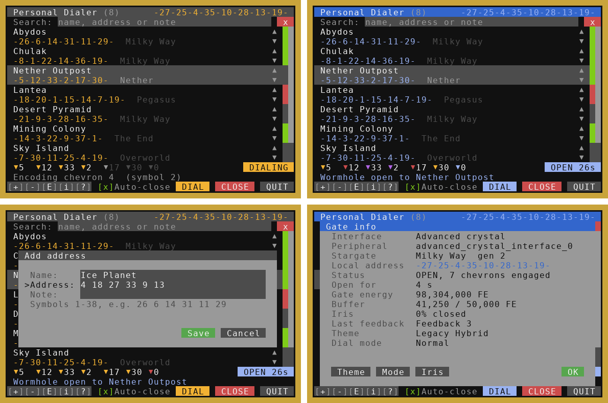
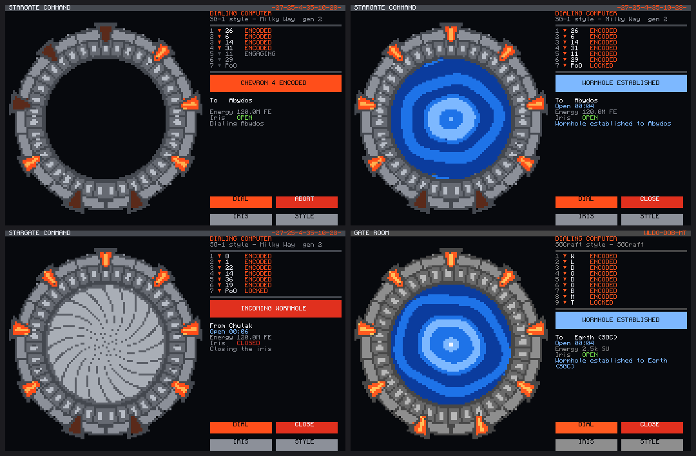
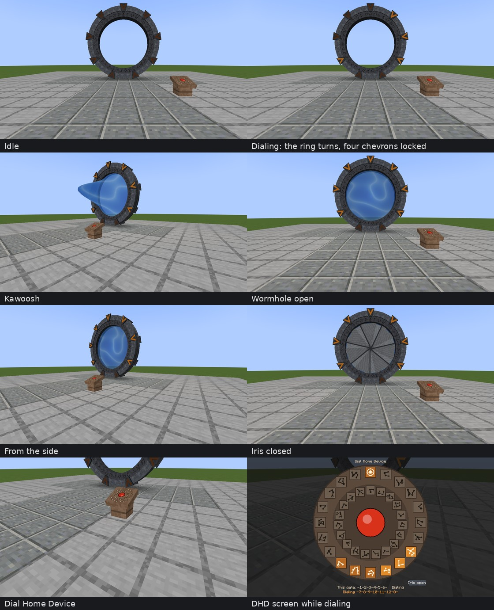
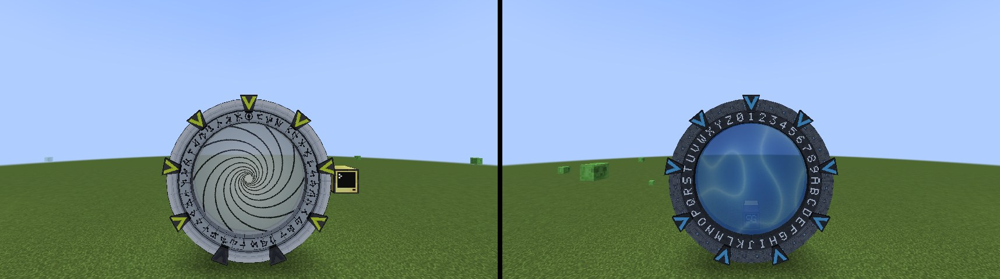
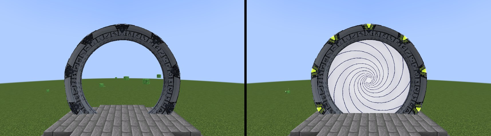

# ComputerCraft programs for the Stargate Journey Mod for Minecraft

## [MilkyWay Stargate Dialing](./MilkyWayStargateDialing.lua)
*Created by Povstalec*
 - By default works with basic interface nad milkyway stargate
 - Basic dialing
 - Predefined addresses - easily expandable
 - Two phase engage (Open / Close chevron)

## [SGC dialing](./SGCdialing.lua)
*Created by Povstalec*
 - Stargate Center like dialing
 - Three phase engage (Open / Encode / Close)§
 - Variant of [MilkyWay Stargate Dialing](./MilkyWayStargateDialing.lua)

## [Stargate Monitor](./StargateMonitor/) 
*Created by lukaskabc*  
 - Interaction via monitor
 - Stargate state
 - Dialing predefined addresses
 - Connection history

 
 

## [Personal Dialer](./PersonalDialer/)
 - Address book with live search: add, edit, remove and reorder gates
 - Dials every gate type (Milky Way ring rotation or direct symbol engaging), plus SGCraft (original and 2.3), Lantea: Stargates, LanteaCraft and Just Stargate Mod gates
 - Chevron progress bar, gate state, incoming caller lookup and a gate picture
 - Auto-close after you step through, iris control, colour themes (SG-1, Movie, Atlantis, Infinity, Legacy Hybrid, Stargate Network...)
 - Runs on the computer screen or an advanced monitor

## [Stargate Command: Gate Room and Network Hub](./StargateCommand/)
 - **Gate Room**: SGC style monitor with an animated gate in the look of its series (SG-1, Movie, Origins, Continuum, Ark of Truth, Atlantis/Lantea, Pegasus, Universe, Tollan, Classic, Infinity, Ori Supergate, Legacy Hybrid, SGCraft, Stargate Network): turning ring, chevrons, kawoosh, iris, dialing computer panel and incoming wormhole alarm
 - **Network Hub**: touch screen of destination cards with portal colours and tabs, planned destinations for worlds you have not built yet
 - Works with Stargate Journey (1.20.1), SGCraft (Greg's original and the 1.12.2 SGCraft 2.3), Lantea: Stargates (0.7.7.0+), LanteaCraft (1.21.1) and Just Stargate Mod (1.20.1)
 - Tested in a NeoForge 1.21.1 world with LanteaCraft 0.2.5 and CC: Tweaked: dialing both ways, the iris and LanteaCraft's GDO iris codes
 - Shares its address book with the Personal Dialer; one installer for all three

## [gatedial for OpenComputers](./OpenComputers/)
 - The dialer for OpenComputers (OpenOS): SGCraft (Greg's original and 2.x), Just Stargate Mod for 1.12.2 and LanteaCraft
 - Address book, dialing, iris, gate picture on a tier 3 screen, touch or keys
 - Iris codes and the gate log, through JSG's own GDO on JSG gates
 - Shares its address book, iris codes and gate log files with the ComputerCraft programs
 - Tested in Minecraft 1.12.2 worlds with OpenComputers 1.8.10 and JSG or SGCraft 2.3.0, and in a 1.7.10 world with SGCraft 1.13.3: dialing, iris codes and the iris

## Mods and resource packs

Not ComputerCraft programs, but made to go with them:

### [Chevron Seven](./ChevronSeven/)
A stargate mod for Minecraft 1.20.1 (Forge), built from scratch:
 - A 7-block ring gate with a turning symbol track, chevrons, kawoosh, event horizon and travel between gates, even across dimensions
 - Dial Home Device, iris, automatic closing, chunk loading while a wormhole is open
 - Three kinds of gate on one network: the classic gate, a **Stargate Infinity** cartoon gate, and a **Stargate Network** gate in the style of SGCraft that dials nine letters such as `1KA0-9KT-HY`
 - With CC: Tweaked the gate is a computer peripheral that the Gate Room, Network Hub and Personal Dialer drive like a Stargate Journey gate, and the SG Computer Interface block lets programs written for SGCraft drive it

### [Stargate Infinity look for Just Stargate Mod](./JSGInfinity/)
A resource pack for Just Stargate Mod 1.20.1: its Milky Way gate in the look of the animated series *Stargate Infinity*, with ink outlines, black glyphs, lime chevrons and a pale whirlpool. Every texture is drawn by the pack's own script; none are taken from JSG. Tested in a Minecraft 1.20.1 client with JSG 5.1.2.0.

### [Stargate Command Addon](./StargateCommandAddon/)
A Forge 1.20.1 add-on for Stargate Journey:
 - Gate room alarm light that flashes for incoming wormholes, gate monitor with redstone and comparator output
 - SGC ramp grating, wall, hazard stripe and floor blocks
 - Includes the variants below

### [Stargate Journey Variants](./StargateJourneyVariants/)
A resource and data pack for Stargate Journey's Milky Way gate: Origins, Continuum, Ark of Truth and Infinity looks, made in the crystallizer.

## Stargate mods on Minecraft 1.20.1

Which of the stargate mods run on Minecraft 1.20.1, and what this repository has for each (as of November 2026):

| Mod | Minecraft | Here |
|---|---|---|
| **Stargate Journey** | 1.20.1 (Forge) | every program, the [Stargate Command Addon](./StargateCommandAddon/) and the [variant pack](./StargateJourneyVariants/) with an Infinity look |
| **Just Stargate Mod** (JSG) | 1.20.1 (Forge and NeoForge, 5.1.x), and 1.12.2 | the ComputerCraft programs on 1.20.1, `gatedial` on 1.12.2, and the [Infinity pack](./JSGInfinity/) |
| **Stargate Network** (SGCraft 2.x, the continuation of Greg's SGCraft) | 1.12.2 only; no 1.20.1 version found | the programs on 1.12.2; on 1.20.1, [Chevron Seven](./ChevronSeven/)'s Stargate Network gate and SG Computer Interface stand in for it |
| **SGCraft** (Greg's original) | 1.7.10 to 1.12.2 | the programs, and `gatedial` |
| **Stargate Infinity** | no mod found | the Infinity looks: the [JSG pack](./JSGInfinity/), the [Stargate Journey variant](./StargateJourneyVariants/), [Chevron Seven](./ChevronSeven/)'s Infinity gate, and the Gate Room and Personal Dialer themes |
| **Lantea: Stargates** | 1.20.1 (Forge) and 1.21.1 (NeoForge) | the ComputerCraft programs |
| **LanteaCraft** | 1.21.1 (NeoForge) | the programs |
| **Chevron Seven** (in this repository) | 1.20.1 (Forge) | every program |

## [Window drawer test](./WIndow%20drawer%20test.lua)
*Created by Povstalec*
 - unfinished program
 - for testing purposes at this time
 - In future hopefully fancy in computer GUI

## [Danger's Dialler v2.0](./DangerDialler1.lua) 
*Created by Danger*  
**[old function names - outdated]**  
**Requires Advanced Peripherals**  
 - Command line interface for gate controlling
 - Supports iris
 - Internal address list

## License

MIT, see [LICENSE](./LICENSE), for the work added in this repository: the Personal Dialer, Stargate Command (Gate Room, Network Hub and the `sgc` library), Chevron Seven, the Stargate Command Addon, the Infinity pack for JSG, and the tools that build the variant pack.

Not covered:
 - The programs by other authors (MilkyWay Stargate Dialing, SGC dialing, Stargate Dialing and the Window drawer test by Povstalec, Stargate Monitor by lukaskabc, Danger's Dialler by Danger) belong to their authors and keep their authors' terms.
 - The textures of the [Stargate Journey Variants](./StargateJourneyVariants/) pack, and of the variants inside the Stargate Command Addon, are recoloured from Stargate Journey's textures and are CC BY-NC-SA 4.0, like the originals.

The textures of the [Infinity pack for JSG](./JSGInfinity/) are drawn by its script and are MIT; JSG itself is not included.
