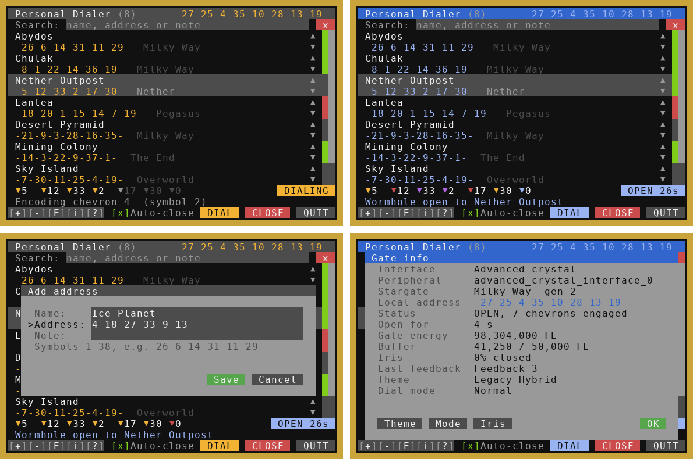
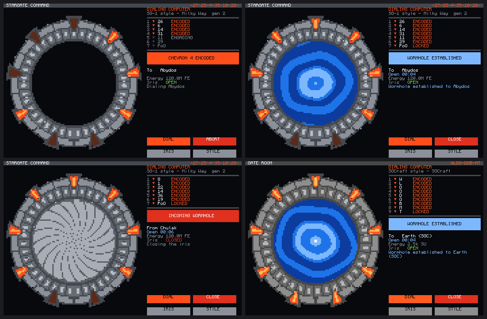

# ComputerCraft programs for the Stargate Journey Mod for Minecraft

## [MilkyWay Stargate Dialing](./MilkyWayStargateDialing.lua)
*Created by Povstalec*
 - By default works with basic interface nad milkyway stargate
 - Basic dialing
 - Predefined addresses - easily expandable
 - Two phase engage (Open / Close chevron)

## [SGC dialing](./SGCdialing.lua)
*Created by Povstalec*
 - Stargate Center like dialing
 - Three phase engage (Open / Encode / Close)§
 - Variant of [MilkyWay Stargate Dialing](./MilkyWayStargateDialing.lua)

## [Stargate Monitor](./StargateMonitor/) 
*Created by lukaskabc*  
 - Interaction via monitor
 - Stargate state
 - Dialing predefined addresses
 - Connection history

 
 

## [Personal Dialer](./PersonalDialer/)
 - Address book with live search: add, edit, remove and reorder gates
 - Dials every gate type (Milky Way ring rotation or direct symbol engaging), plus SGCraft (original and 2.3), Lantea: Stargates and Just Stargate Mod gates
 - Chevron progress bar, gate state, incoming caller lookup and a gate picture
 - Auto-close after you step through, iris control, colour themes (SG-1, Movie, Atlantis, Infinity, Legacy Hybrid...)
 - Runs on the computer screen or an advanced monitor

## [Stargate Command: Gate Room and Network Hub](./StargateCommand/)
 - **Gate Room**: SGC style monitor with an animated gate in the look of its series (SG-1, Movie, Origins, Continuum, Ark of Truth, Atlantis/Lantea, Pegasus, Universe, Tollan, Classic, Infinity, Ori Supergate, Legacy Hybrid, SGCraft): turning ring, chevrons, kawoosh, iris, dialing computer panel and incoming wormhole alarm
 - **Network Hub**: touch screen of destination cards with portal colours and tabs, planned destinations for worlds you have not built yet
 - Works with Stargate Journey (1.20.1), SGCraft (Greg's original and the 1.12.2 SGCraft 2.3), Lantea: Stargates (0.7.7.0+) and Just Stargate Mod (1.20.1)
 - Shares its address book with the Personal Dialer; one installer for all three

## [Window drawer test](./WIndow%20drawer%20test.lua)
*Created by Povstalec*
 - unfinished program
 - for testing purposes at this time
 - In future hopefully fancy in computer GUI

## [Danger's Dialler v2.0](./DangerDialler1.lua) 
*Created by Danger*  
**[old function names - outdated]**  
**Requires Advanced Peripherals**  
 - Command line interface for gate controlling
 - Supports iris
 - Internal address list

