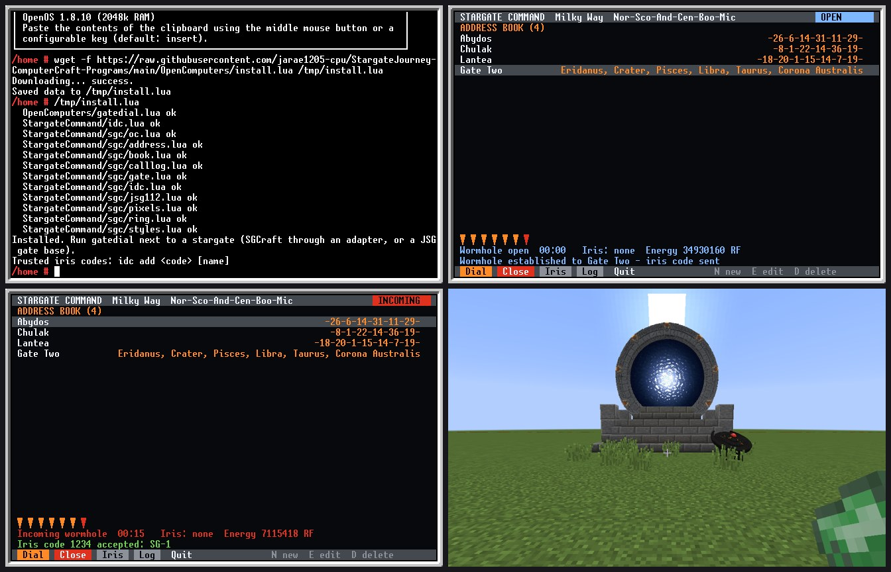
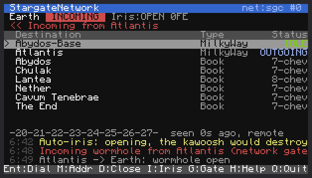
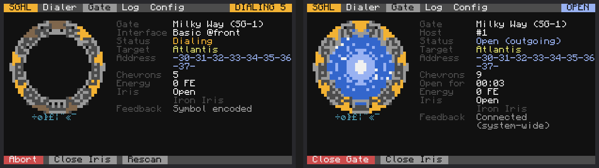
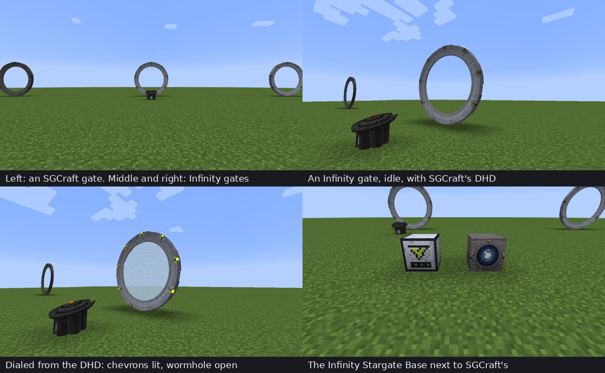

# ComputerCraft programs for the Stargate Journey Mod for Minecraft

## [MilkyWay Stargate Dialing](./MilkyWayStargateDialing.lua)
*Created by Povstalec*
 - By default works with basic interface nad milkyway stargate
 - Basic dialing
 - Predefined addresses - easily expandable
 - Two phase engage (Open / Close chevron)

## [SGC dialing](./SGCdialing.lua)
*Created by Povstalec*
 - Stargate Center like dialing
 - Three phase engage (Open / Encode / Close)§
 - Variant of [MilkyWay Stargate Dialing](./MilkyWayStargateDialing.lua)

## [Stargate Monitor](./StargateMonitor/) 
*Created by lukaskabc*  
 - Interaction via monitor
 - Stargate state
 - Dialing predefined addresses
 - Connection history

 
 

## [Personal Dialer](./PersonalDialer/)
 - Address book with live search: add, edit, remove and reorder gates
 - Dials every gate type (Milky Way ring rotation or direct symbol engaging), plus SGCraft (original and 2.3), Lantea: Stargates, LanteaCraft and Just Stargate Mod gates
 - Chevron progress bar, gate state, incoming caller lookup and a gate picture
 - Auto-close after you step through, iris control, colour themes (SG-1, SGC Computer, Movie, Atlantis, Infinity, Legacy Hybrid, Stargate Network...)
 - Runs on the computer screen or an advanced monitor

## [Stargate Command: Gate Room, Network Hub, DHD and GDO](./StargateCommand/)
 - **Gate Room**: SGC style monitor with an animated gate in the look of its series (SG-1, Movie, Origins, Continuum, Ark of Truth, Atlantis/Lantea, Pegasus, Universe, Tollan, Classic, Infinity, Ori Supergate, Legacy Hybrid, SGCraft, Carter Addon Pack, Chevron Seven's Stargate Network gate): turning ring, chevrons, kawoosh, iris, dialing computer panel and incoming wormhole alarm
 - **SGC Computer** style for the Gate Room: the gate in teal lines like the SGC's dialing computer screen, each symbol shown big over the gate as it is encoded, then filed in its numbered box
 - **Network Hub**: touch screen of destination cards with portal colours and tabs, planned destinations for worlds you have not built yet
 - **Dial Home Device**: the show's DHD on a touch screen, two rings of symbol keys around a big dome. On Stargate Journey, Chevron Seven and Lantea gates each key locks its chevron as you press it; on SGCraft, LanteaCraft and JSG gates the dome dials the address. Six looks: Milky Way, Pegasus, Universe, Carter Addon Pack, Infinity and LanteaCraft. Tried in a test harness so far, not yet in a game
 - **GDO**: a pocket computer that sends your iris code through the wormhole from the far gate, like the team's GDO in the show; the Gate Room at home opens its iris for a trusted code
 - Works with Stargate Journey (1.20.1), SGCraft (Greg's original and the 1.12.2 SGCraft 2.3), Lantea: Stargates (0.7.7.0+), LanteaCraft (1.21.1) and Just Stargate Mod (1.20.1)
 - Tested in a NeoForge 1.21.1 world with LanteaCraft 0.2.5 and CC: Tweaked: dialing both ways, the iris and LanteaCraft's GDO iris codes
 - Tested on Stargate Journey 0.6.54 gates with every interface tier: dialing, errors, incoming wormholes and the automatic iris
 - Tested on JSG 1.20.1 (5.1.2.0) gates: dialing between gates and the automatic iris
 - Tested on Lantea: Stargates 0.7.7.0 gates, in the same world as Stargate Journey and JSG: dialing between gates
 - Shares its address book with the Personal Dialer; one installer for all of them

## [gatedial for OpenComputers](./OpenComputers/)
 - The dialer for OpenComputers (OpenOS): SGCraft (Greg's original and 2.x), Just Stargate Mod for 1.12.2 and LanteaCraft
 - A gate room console on tier 2 and 3 screens: address book, big Dial, Close Gate and Iris buttons, switches for the automatic iris and the alarm, a GDO panel for iris codes, and the gate with a box for each chevron
 - Address book, dialing, iris, gate picture on a tier 3 screen, touch or keys
 - Iris codes and the gate log, through JSG's own GDO on JSG gates
 - Shares its address book, iris codes and gate log files with the ComputerCraft programs
 - Tested in Minecraft 1.12.2 worlds with OpenComputers 1.8.10 and JSG or SGCraft 2.3.0, and in a 1.7.10 world with SGCraft 1.13.3: dialing, iris codes and the iris

## [Stargate Network](./StargateNetwork/)
 - Links every gate in your world over rednet (wireless/ender modem)
 - Finds gates automatically, with live status, and remembers them so you can still dial unloaded gates
 - Dial from a list or type an address, with caller ID on incoming wormholes
 - Optional auto-iris that only opens for gates from your network
 - Remote control from a computer or pocket computer, protected by a network key
 - Stargate Journey (1.20.1), basic, crystal and advanced crystal interfaces; tested on Stargate Journey 0.6.54 gates

## [Stargate Hybrid Legacy](./StargateHybridLegacy/)
 - Address book dialer in the style of the 1.12.2 personal dialers, with search, glyph marks and reordering
 - Works with every Stargate Journey gate type (Milky Way, Pegasus, Universe, Classic, Tollan, Andromeda) and every interface tier
 - Gate display: V-shaped chevrons, a symbol track that turns with the ring, an event horizon with a kawoosh, and an iris that closes from the rim
 - Gate styles for every gate type, plus styles based on SGCraft, Stargate Network and JSG
 - Config page: Auto Close, open time limit, automatic iris, SGC 3-step dialing, address access list
 - Optional monitor status board and pocket computer dialer over rednet; tested on Stargate Journey 0.6.54 gates

## Mods and resource packs

Not ComputerCraft programs, but made to go with them:

### [Chevron Seven](./ChevronSeven/)
A stargate mod for Minecraft 1.20.1 (Forge), built from scratch:
 - A 7-block ring gate with a turning symbol track, chevrons, kawoosh, event horizon and travel between gates, even across dimensions
 - Dial Home Device, a spiral iris, automatic closing, chunk loading while a wormhole is open
 - 14 gate looks (SG-1, Movie, Origins, Ark of Truth, Atlantis, Universe, Infinity, Stargate Network and more), gate platforms and an Infinity-style gate room
 - A **Stargate Network gate** in the style of SGCraft: a ring of letters and nine chevrons; it dials letter addresses such as `1KA0-9KT-HY`, and every gate has one, so it can dial and be dialed by any other gate
 - A Carter Addon Pack pedestal with a red carpet, a round DHD whose keys light up as the gate dials, and `/chevron7 pedestal` to build the pedestal for a Stargate Journey, Lantea or JSG gate
 - An Ori supergate four times the size of a gate, a row of gates in every look, and a dark DHD with a red dome like JSG's
 - Gates built SGCraft style from a base, Ring Blocks and Chevron Blocks, which come apart into those blocks again, and a Gate Computer Interface for the computer
 - With CC: Tweaked the gate is a computer peripheral that the Gate Room, Network Hub and Personal Dialer drive like a Stargate Journey gate, and the SG Computer Interface block lets programs written for SGCraft drive it

### [Stargate Infinity look for Just Stargate Mod](./JSGInfinity/)
A resource pack for Just Stargate Mod 1.20.1: its Milky Way gate in the look of the animated series *Stargate Infinity*, with ink outlines, black glyphs, lime chevrons and a pale whirlpool. Every texture is drawn by the pack's own script; none are taken from JSG. Tested in a Minecraft 1.20.1 client with JSG 5.1.2.0. It restyles every JSG Milky Way gate; for a separate Infinity gate next to ordinary ones, use the [Infinity Stargate add-on](./JSGInfinityGate/) below.

### [Infinity Stargate for SGCraft](./SGCraftInfinityGate/)
An add-on for SGCraft 2.3 on Minecraft 1.12.2 (Forge): the gate from *Stargate Infinity*.
 - An Infinity Stargate Base, built into a ring of SGCraft's own Ring and Chevron Blocks; the gate is SGCraft's in every way, with its DHD, power, iris and computer interfaces
 - Drawn by SGCraft's renderer in the cartoon's colours (pale stone, lime-yellow chevrons, a pale wormhole), recoloured from SGCraft's own textures as the game loads them
 - Its code and the textures its script draws are MIT, like this repository's other work

### [Stargate Command Addon](./StargateCommandAddon/)
A Forge 1.20.1 add-on for Stargate Journey:
 - Gate room alarm light that flashes for incoming wormholes, gate monitor with redstone and comparator output
 - SGC ramp grating, wall, hazard stripe and floor blocks
 - Includes the variants below

### [Stargate Journey Variants](./StargateJourneyVariants/)
A resource and data pack for Stargate Journey's Milky Way gate: Origins, Continuum, Ark of Truth and Infinity looks, made in the crystallizer.

### [Infinity Stargate for JSG](./JSGInfinityGate/)
An add-on for Just Stargate Mod 1.20.1 (Forge): the gate from *Stargate Infinity*, built from its own base, ring and chevron blocks in JSG's pattern:
 - JSG's own Milky Way gate underneath, so it has Milky Way addresses and is meant to take the DHD, upgrades, the iris and computers like one (see [what was tested](./JSGInfinityGate/README.md#tested))
 - Drawn with JSG's models, in the cartoon's colours: blue-grey metal with ink outlines and dark chevrons that glow pale cyan, a white wormhole with Carter's Addon Pack's turning blue swirl, and a spiral iris
 - An Infinity DHD to go with it: a console with a tilted screen, its symbols glowing on the glass, which is JSG's Milky Way DHD underneath and links to Infinity gates and JSG's Milky Way gates alike
 - An orange DHD in the style of Carter's Addon Pack, also JSG's Milky Way DHD underneath
 - Commands for operators: `/jsginfinity build` lays out a whole gate, `/jsginfinity platform` builds it on Carter's stone pyramid with the orange DHD, and `/jsginfinity room` builds the *Stargate Infinity* gate room around it

## Stargate mods on Minecraft 1.20.1

Which of the stargate mods run on Minecraft 1.20.1, and what this repository has for each (as of November 2026):

| Mod | Minecraft | Here |
|---|---|---|
| **Stargate Journey** | 1.20.1 (Forge) | every program, the [Stargate Command Addon](./StargateCommandAddon/) and the [variant pack](./StargateJourneyVariants/) with an Infinity look |
| **Just Stargate Mod** (JSG) | 1.20.1 (Forge and NeoForge, 5.1.x), and 1.12.2 | the ComputerCraft programs on 1.20.1, `gatedial` on 1.12.2, the [Infinity pack](./JSGInfinity/) and the [Infinity Stargate add-on](./JSGInfinityGate/) |
| **Stargate Network** (SGCraft 2.x, the continuation of Greg's SGCraft) | 1.12.2 only; no 1.20.1 version found | the programs on 1.12.2; on 1.20.1, [Chevron Seven](./ChevronSeven/)'s Stargate Network gate and SG Computer Interface stand in for it |
| **SGCraft** (Greg's original) | 1.7.10 to 1.12.2 | the programs, and `gatedial` |
| **Stargate Infinity** | no mod found | the Infinity looks: the [JSG pack](./JSGInfinity/) and [JSG add-on](./JSGInfinityGate/), the [SGCraft add-on](./SGCraftInfinityGate/), the [Stargate Journey variant](./StargateJourneyVariants/), [Chevron Seven](./ChevronSeven/)'s Infinity look, and the Gate Room and Personal Dialer themes |
| **Lantea: Stargates** | 1.20.1 (Forge) and 1.21.1 (NeoForge) | the ComputerCraft programs |
| **LanteaCraft** | 1.21.1 (NeoForge) | the programs |
| **Chevron Seven** (in this repository) | 1.20.1 (Forge) | every program |

### Stargate Journey 0.6.55

Stargate Journey 0.6.55 came out on 23 November 2026. It rewrote the mod's Java API, the part other mods build on. The computer side is the same as in 0.6.54: comparing the two versions' code, the interfaces have the same 78 methods, taking the same arguments, and the gates send the same events with the same values and report the same error codes. Only one method, `engageStargate`, changed in its code, and it does what it did before. The gate's own code was rewritten underneath, so a game may still turn up a difference, but the programs here should work with 0.6.55 as they do with 0.6.54.

The [Stargate Command Addon](./StargateCommandAddon/) asks the gate four things (`getChevronsEngaged`, `isConnected`, `isDialingOut` and `isWormholeOpen`), and 0.6.55 still has all four, unchanged. All 47 settings in the [variant pack](./StargateJourneyVariants/)'s gate files are still read, and the crystallizer recipes and the items they use are still there.

That was checked against 0.6.55's code, not yet in a game. The games were played on 0.6.54.

## [Window drawer test](./WIndow%20drawer%20test.lua)
*Created by Povstalec*
 - unfinished program
 - for testing purposes at this time
 - In future hopefully fancy in computer GUI

## [Danger's Dialler v2.0](./DangerDialler1.lua) 
*Created by Danger*  
**[old function names - outdated]**  
**Requires Advanced Peripherals**  
 - Command line interface for gate controlling
 - Supports iris
 - Internal address list

## License

MIT, see [LICENSE](./LICENSE), for the work added in this repository: the Personal Dialer, Stargate Command (Gate Room, Network Hub, Dial Home Device, GDO and the `sgc` library), Stargate Network, Stargate Hybrid Legacy, Chevron Seven, the Stargate Command Addon, the Infinity pack for JSG, and the tools that build the variant pack.

Not covered:
 - The programs by other authors (MilkyWay Stargate Dialing, SGC dialing, Stargate Dialing and the Window drawer test by Povstalec, Stargate Monitor by lukaskabc, Danger's Dialler by Danger) belong to their authors and keep their authors' terms.
 - The textures of the [Stargate Journey Variants](./StargateJourneyVariants/) pack, and of the variants inside the Stargate Command Addon, are recoloured from Stargate Journey's textures and are CC BY-NC-SA 4.0, like the originals.

The textures of the [Infinity pack for JSG](./JSGInfinity/) are drawn by its script and are MIT; JSG itself is not included.

The [Infinity Stargate for JSG](./JSGInfinityGate/) is MIT as well: its code and the textures its script draws.
