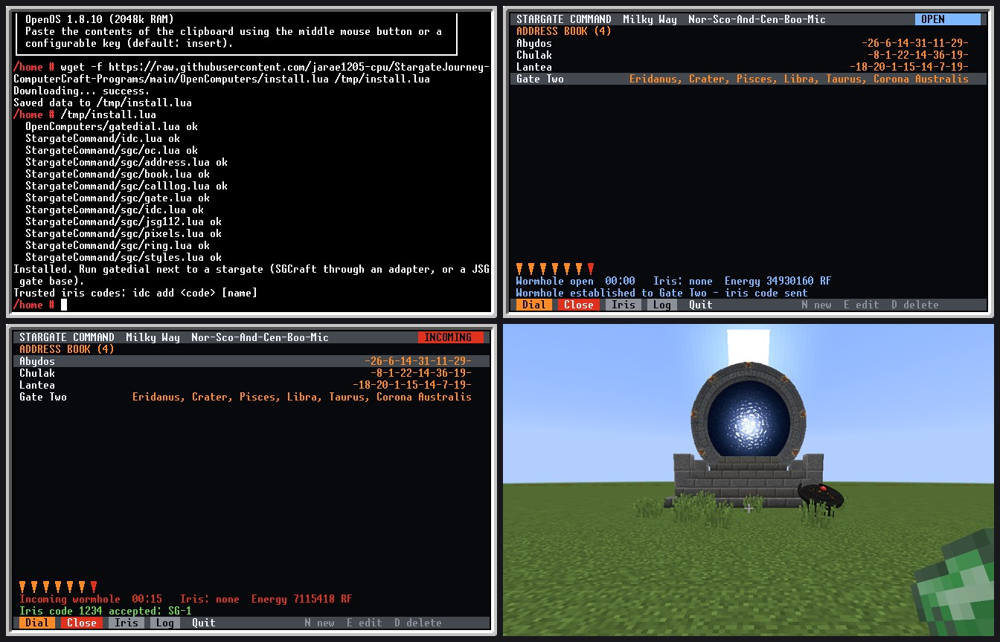
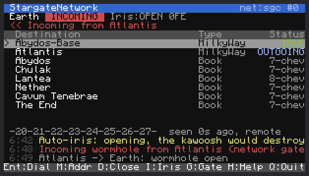
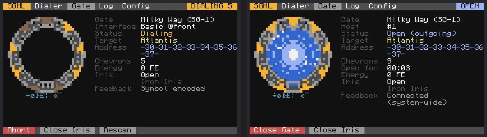
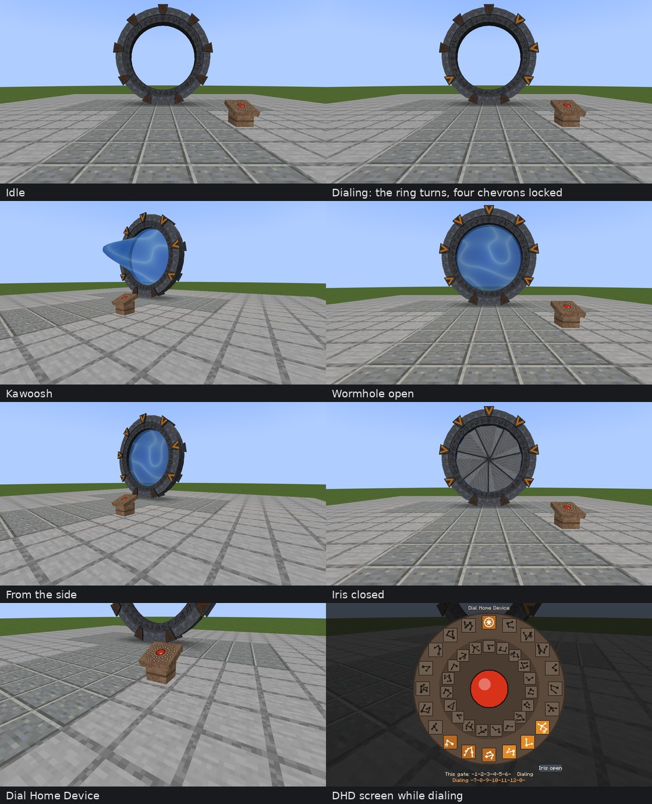

# ComputerCraft programs for the Stargate Journey Mod for Minecraft

## [MilkyWay Stargate Dialing](./MilkyWayStargateDialing.lua)
*Created by Povstalec*
 - By default works with basic interface nad milkyway stargate
 - Basic dialing
 - Predefined addresses - easily expandable
 - Two phase engage (Open / Close chevron)

## [SGC dialing](./SGCdialing.lua)
*Created by Povstalec*
 - Stargate Center like dialing
 - Three phase engage (Open / Encode / Close)§
 - Variant of [MilkyWay Stargate Dialing](./MilkyWayStargateDialing.lua)

## [Stargate Monitor](./StargateMonitor/) 
*Created by lukaskabc*  
 - Interaction via monitor
 - Stargate state
 - Dialing predefined addresses
 - Connection history

 
 

## [Personal Dialer](./PersonalDialer/)
 - Address book with live search: add, edit, remove and reorder gates
 - Dials every gate type (Milky Way ring rotation or direct symbol engaging), plus SGCraft (original and 2.3), Lantea: Stargates, LanteaCraft and Just Stargate Mod gates
 - Chevron progress bar, gate state, incoming caller lookup and a gate picture
 - Auto-close after you step through, iris control, colour themes (SG-1, Movie, Atlantis, Infinity, Legacy Hybrid...)
 - Runs on the computer screen or an advanced monitor

## [Stargate Command: Gate Room and Network Hub](./StargateCommand/)
 - **Gate Room**: SGC style monitor with an animated gate in the look of its series (SG-1, Movie, Origins, Continuum, Ark of Truth, Atlantis/Lantea, Pegasus, Universe, Tollan, Classic, Infinity, Ori Supergate, Legacy Hybrid, SGCraft): turning ring, chevrons, kawoosh, iris, dialing computer panel and incoming wormhole alarm
 - **Network Hub**: touch screen of destination cards with portal colours and tabs, planned destinations for worlds you have not built yet
 - Works with Stargate Journey (1.20.1), SGCraft (Greg's original and the 1.12.2 SGCraft 2.3), Lantea: Stargates (0.7.7.0+), LanteaCraft (1.21.1) and Just Stargate Mod (1.20.1)
 - Tested in a NeoForge 1.21.1 world with LanteaCraft 0.2.5 and CC: Tweaked: dialing both ways, the iris and LanteaCraft's GDO iris codes
 - Tested on Stargate Journey 0.6.54 gates with every interface tier: dialing, errors, incoming wormholes and the automatic iris
 - Tested on JSG 1.20.1 (5.1.2.0) gates: dialing between gates and the automatic iris
 - Tested on Lantea: Stargates 0.7.7.0 gates, in the same world as Stargate Journey and JSG: dialing between gates
 - Shares its address book with the Personal Dialer; one installer for all three

## [gatedial for OpenComputers](./OpenComputers/)
 - The dialer for OpenComputers (OpenOS): SGCraft (Greg's original and 2.x), Just Stargate Mod for 1.12.2 and LanteaCraft
 - Address book, dialing, iris, gate picture on a tier 3 screen, touch or keys
 - Iris codes and the gate log, through JSG's own GDO on JSG gates
 - Shares its address book, iris codes and gate log files with the ComputerCraft programs
 - Tested in Minecraft 1.12.2 worlds with OpenComputers 1.8.10 and JSG or SGCraft 2.3.0, and in a 1.7.10 world with SGCraft 1.13.3: dialing, iris codes and the iris

## [Stargate Network](./StargateNetwork/)
 - Links every gate in your world over rednet (wireless/ender modem)
 - Finds gates automatically, with live status, and remembers them so you can still dial unloaded gates
 - Dial from a list or type an address, with caller ID on incoming wormholes
 - Optional auto-iris that only opens for gates from your network
 - Remote control from a computer or pocket computer, protected by a network key
 - Stargate Journey (1.20.1), basic, crystal and advanced crystal interfaces; tested on Stargate Journey 0.6.54 gates

## [Stargate Hybrid Legacy](./StargateHybridLegacy/)
 - Address book dialer in the style of the 1.12.2 personal dialers, with search, glyph marks and reordering
 - Works with every Stargate Journey gate type (Milky Way, Pegasus, Universe, Classic, Tollan, Andromeda) and every interface tier
 - Gate display: V-shaped chevrons, a symbol track that turns with the ring, an event horizon with a kawoosh, and an iris that closes from the rim
 - Gate styles for every gate type, plus styles based on SGCraft, Stargate Network and JSG
 - Config page: Auto Close, open time limit, automatic iris, SGC 3-step dialing, address access list
 - Optional monitor status board and pocket computer dialer over rednet; tested on Stargate Journey 0.6.54 gates

## Mods and resource packs

Not ComputerCraft programs, but made to go with them:

### [Chevron Seven](./ChevronSeven/)
A stargate mod for Minecraft 1.20.1 (Forge), built from scratch:
 - A 7-block ring gate with a turning symbol track, chevrons, kawoosh, event horizon and travel between gates, even across dimensions
 - Dial Home Device, a spiral iris, automatic closing, chunk loading while a wormhole is open
 - 13 gate looks (SG-1, Movie, Origins, Ark of Truth, Atlantis, Universe, Infinity and more), gate platforms and an Infinity-style gate room
 - With CC: Tweaked the gate is a computer peripheral that the Gate Room, Network Hub and Personal Dialer drive like a Stargate Journey gate

### [Stargate Command Addon](./StargateCommandAddon/)
A Forge 1.20.1 add-on for Stargate Journey:
 - Gate room alarm light that flashes for incoming wormholes, gate monitor with redstone and comparator output
 - SGC ramp grating, wall, hazard stripe and floor blocks
 - Includes the variants below

### [Stargate Journey Variants](./StargateJourneyVariants/)
A resource and data pack for Stargate Journey's Milky Way gate: Origins, Continuum, Ark of Truth and Infinity looks, made in the crystallizer.

## [Window drawer test](./WIndow%20drawer%20test.lua)
*Created by Povstalec*
 - unfinished program
 - for testing purposes at this time
 - In future hopefully fancy in computer GUI

## [Danger's Dialler v2.0](./DangerDialler1.lua) 
*Created by Danger*  
**[old function names - outdated]**  
**Requires Advanced Peripherals**  
 - Command line interface for gate controlling
 - Supports iris
 - Internal address list

## License

MIT, see [LICENSE](./LICENSE), for the work added in this repository: the Personal Dialer, Stargate Command (Gate Room, Network Hub and the `sgc` library), Stargate Network, Stargate Hybrid Legacy, Chevron Seven, the Stargate Command Addon, and the tools that build the variant pack.

Not covered:
 - The programs by other authors (MilkyWay Stargate Dialing, SGC dialing, Stargate Dialing and the Window drawer test by Povstalec, Stargate Monitor by lukaskabc, Danger's Dialler by Danger) belong to their authors and keep their authors' terms.
 - The textures of the [Stargate Journey Variants](./StargateJourneyVariants/) pack, and of the variants inside the Stargate Command Addon, are recoloured from Stargate Journey's textures and are CC BY-NC-SA 4.0, like the originals.
