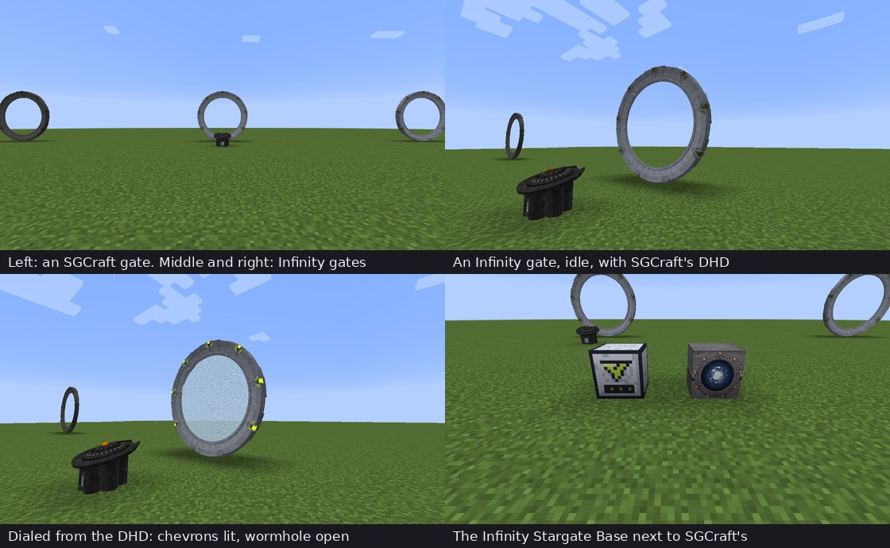

# Infinity Stargate for SGCraft

An add-on for **SGCraft 2.3** (the "Stargate Network" mod on CurseForge) on **Minecraft 1.12.2** (Forge): the gate from the animated series *Stargate Infinity*. It adds one block, the **Infinity Stargate Base**. Build SGCraft's own ring around it, and the gate it forms is drawn in the cartoon's colours: pale stone, lime-yellow chevrons and a pale blue-white wormhole.



*In a Minecraft 1.12.2 client with SGCraft 2.3.1.*

## Building the gate

Craft an **Infinity Stargate Base** from SGCraft's Stargate Base and lime dye (shapeless). It's in SGCraft's creative tab, next to SGCraft's base.

Build the gate exactly as you build an SGCraft gate, with SGCraft's own Stargate Ring Blocks and Chevron Blocks round the base:

```
C R C R C      C  Stargate Chevron Block (7)
R . . . R      R  Stargate Ring Block (8)
C . . . C      B  Infinity Stargate Base
R . . . R      .  empty
C R B R C
```

When the last block is in place, the ring merges into a gate. Everything else is SGCraft's: addresses, the DHD and its fuel, power, upgrades, the iris, the OpenComputers and ComputerCraft interfaces. Programs that drive SGCraft gates, such as [gatedial](../OpenComputers/) and the [Gate Room](../StargateCommand/), drive this one the same way.

## How the look works

The gate is drawn by SGCraft's own renderer, so it turns, locks chevrons, opens and closes exactly as SGCraft's gates do. While an Infinity gate is drawn, SGCraft's Milky Way gate textures are swapped for Infinity versions, and SGCraft gets its own back straight afterwards:

- The add-on makes the Infinity versions from SGCraft's textures when the game loads them, colour by colour: grey stone turns pale, the darkest grooves go ink-dark, orange chevron lights turn lime-yellow, and the event horizon turns pale blue-white.
- So nothing of SGCraft's is copied into this mod. A resource pack that changes SGCraft's gate changes the Infinity gate too, in the Infinity colours.
- SGCraft's other gates, the DHD and everything else keep their own look.

Only the Milky Way style of gate has an Infinity base; Pegasus, Universe and supergates don't.

## Install

Put `dist/sginfinity-1.0.0.jar` in the `mods` folder (client and server) next to SGCraft 2.3.0 or newer, on Forge 1.12.2 14.23.5.2838 or newer (what SGCraft itself needs). SGCraft isn't included.

## Tested

**On a dedicated server** (Forge 14.23.5.2860, SGCraft 2.3.1), with the blocks placed by commands:
- Both mods loaded with no errors.
- An Infinity base merged with SGCraft's Ring and Chevron Blocks, kept its own block and tile entity, and got an SGCraft address. Its ring blocks merged into it.
- A ring one chevron short didn't merge, and merged when the chevron went in.
- Breaking a Chevron Block unmerged the base; putting it back merged it again.

**In a Minecraft 1.12.2 client** (Forge 14.23.5.2847, software rendering), joined to that server, for the picture above:
- Infinity gates drew pale with lime chevrons while an SGCraft gate beside them kept SGCraft's colours.
- A merged Infinity base doesn't show at the bottom of the ring, as SGCraft's own base doesn't.
- SGCraft's DHD, fuelled with naquadah, dialed one Infinity gate from the other: the chevrons lit lime-yellow, the wormhole opened pale blue-white at both gates, and the DHD's dome closed it again.

**Not tested yet:** crafting in survival, the iris, the computer interfaces on an Infinity gate, a resource pack that changes SGCraft's gate.

## Build

Needs a Java 8 JDK (ForgeGradle 2.3 on Gradle 4.10.3):

```
python3 tools/make_resources.py     # only after changing it: the base's textures, models, recipe and names
JAVA_HOME=/path/to/jdk8 ./gradlew build
```

The jar is `build/libs/sginfinity-1.0.0.jar`. `./gradlew runClient -PjoinServer=localhost:25565` starts a client that joins a test server. SGCraft 2.3.1 comes from CurseForge through [CurseMaven](https://www.cursemaven.com/).

## License

MIT, see [LICENSE](../LICENSE): the code, and the textures, which `tools/make_resources.py` draws. SGCraft, by Greg Ewing, AlmuraDev and Radviger, isn't included and keeps its own license; you need it installed.
