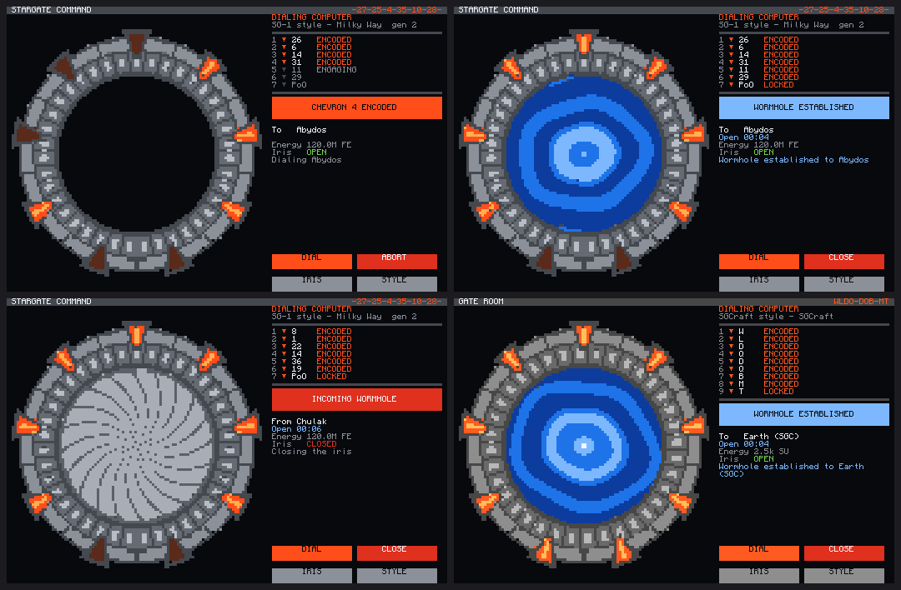
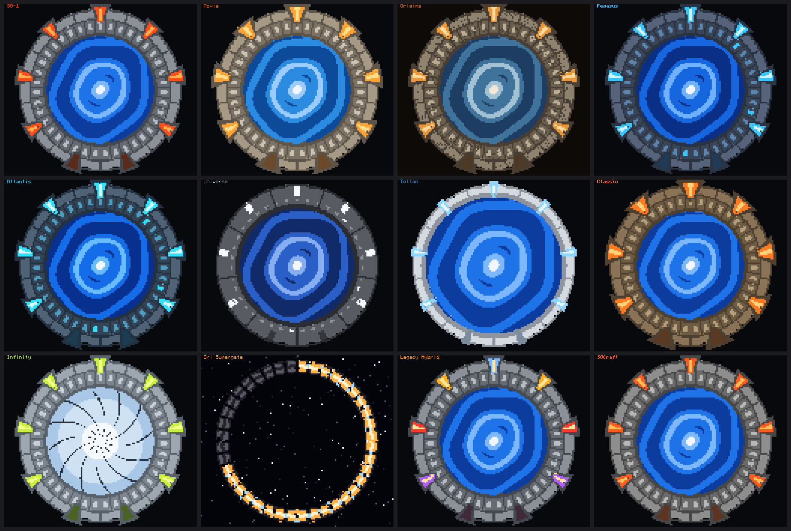
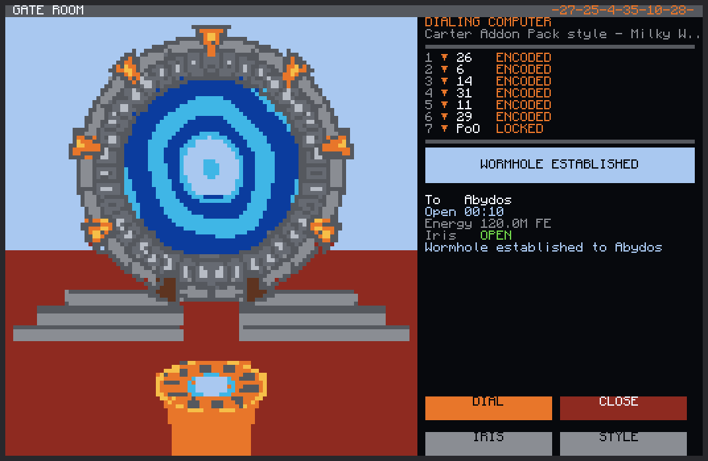
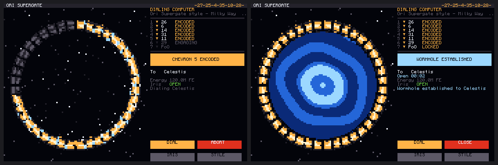
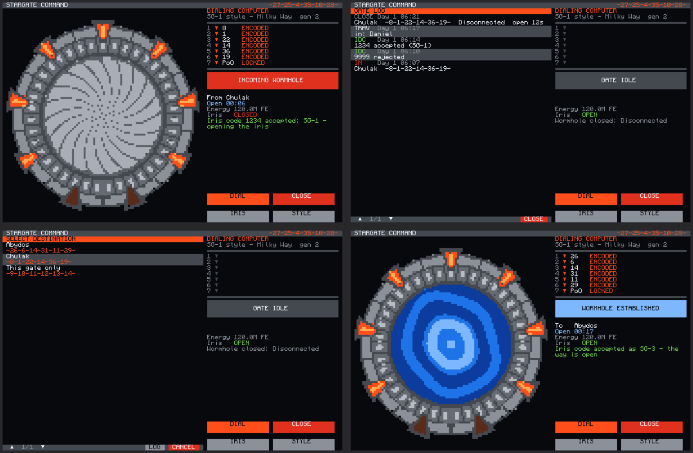
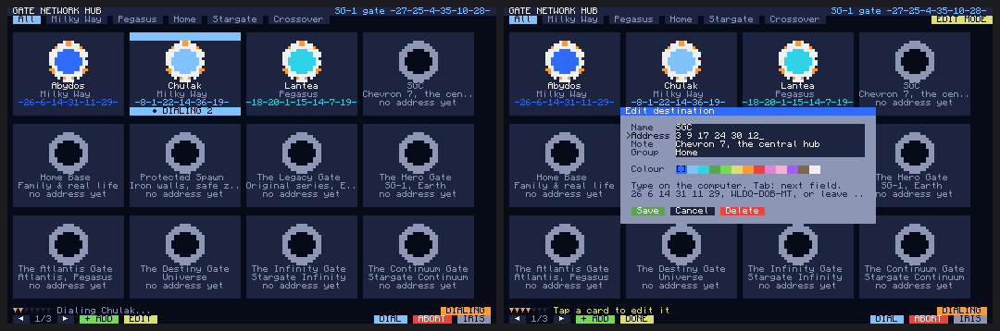
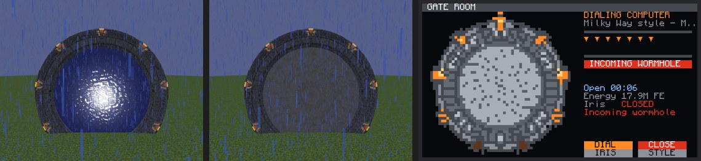
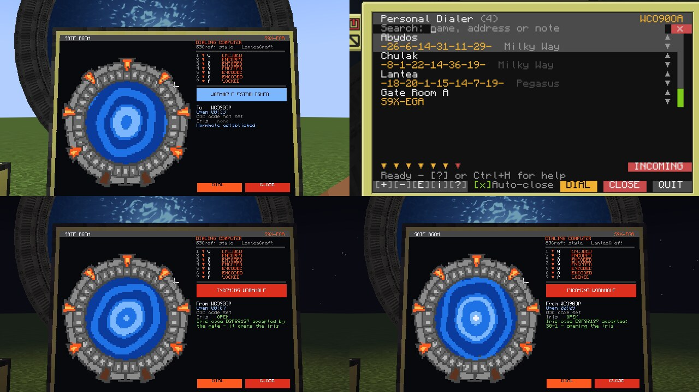

# Stargate Command

Two monitor programs and a shared library for ComputerCraft stargates:

- **Gate Room**: an SGC style gate room screen. The gate is drawn in the look of its series, the chevrons lock one by one, the inner ring turns, the wormhole forms with a kawoosh and the iris closes over it.
- **Gate Network Hub**: a touch screen of destination cards. Each card has its own portal colour and a tab (Milky Way, Pegasus, Crossover...). Tap a card to dial it.

They share one address book with the [Personal Dialer](../PersonalDialer/) and work with these mods:

| Mod | Minecraft | What the computer needs | Dials |
|---|---|---|---|
| **Stargate Journey** | 1.20.1 | a basic, crystal or advanced crystal interface | every gate type |
| **SGCraft** (Greg Ewing's, and SGCraft 2.x, the "Stargate Network" mod) | 1.7.10 to 1.12.2 | the ComputerCraft stargate interface | every gate |
| **Lantea: Stargates** 0.7.7.0+ | 1.20.1 (Forge), 1.21.1 (NeoForge) | a Stargate Power Coupler Kit on the gate controller | Milky Way gates (Pegasus gates can be watched, not dialed) |
| **Just Stargate Mod** (JSG) | 1.20.1 | the gate's base block (it is a CC: Tweaked peripheral) | every gate |
| **[Chevron Seven](../ChevronSeven/)** | 1.20.1 | any block of the gate ring (it is a CC: Tweaked peripheral) | every gate |

On OpenComputers (SGCraft, and Just Stargate Mod for 1.12.2), use [gatedial](../OpenComputers/) instead. It reads and writes the same address book, iris codes and gate log.



*Gate Room on a 4x3 monitor. Top: dialing Abydos on an SG-1 gate, and the open wormhole. Bottom: the iris closed over an incoming wormhole, and an SGCraft gate with a 9-symbol address. These screens were rendered from a headless CC: Tweaked test harness with simulated gates, not captured in-game.*

## Gate looks

The look is picked from the gate type and its Stargate Journey variant. You can also cycle it with the **STYLE** button.



| Style | Used for |
|---|---|
| Milky Way | Stargate Journey Milky Way gates |
| SG-1 | the `milky_way_sg-1` and `milky_way_promo` variants |
| Movie | the `milky_way_movie` variant: sand coloured stone, big amber chevrons |
| Continuum | variants with "continuum" or "arctic" in their name: the gate found frozen in the Arctic in Stargate: Continuum, frosted blue-grey stone flecked with ice, an icy horizon |
| Ark of Truth | variants named with the word "ark" or "truth" (e.g. `ark_of_truth`): an Ancient gate in aged gold, white-hot gold chevrons, a golden wormhole whose light shines out in rays around the ring |
| Origins | variants with "origins" or "1939" in their name: the Giza gate of Stargate Origins, weathered dusty stone, amber chevrons, a faded film-toned horizon |
| Pegasus | Stargate Journey Pegasus gates: slate ring, the dialed symbols light up |
| Atlantis | the `pegasus_atlantis` variant, and any variant with "lantea" in its name |
| Universe | Universe gates: dark ring, white chevron lights |
| Tollan | Tollan gates: slim white ring |
| Classic | Classic gates: bronze ring |
| Infinity | variants with "infinity" in their name: the gate of the animated series *Stargate Infinity*. A cartoon gate with black ink outlines and dark claw chevrons that light lime-yellow, a white-blue whirlpool drawn with ink lines, in front of the brown gate room wall with its lime light bars |
| Legacy Hybrid | variants with "hybrid" or "legacy" in their name: amber, red and purple chevrons with a blue master chevron |
| Ori Supergate | variants named with "supergate" or the word "ori" (e.g. `ori_gate`, not "origins"); pick it with STYLE for an SGCraft 2.3 Ori supergate. A ring of 40 separate segments in space, no symbols or chevrons |
| SGCraft | gates from Greg's SGCraft |
| Carter Addon Pack | pick it with STYLE, or a variant named "cap" or "carter". After the Garry's Mod addon: the gate a little smaller, on a stepped grey pedestal with a red carpet, under the sky, with the round orange DHD and its blue dome in front |



*The Gate Room's Carter Addon Pack style with a wormhole open, rendered from the test harness.*

Variants from resource packs are matched by name, so a variant called `lantea_gate` gets the Atlantis look.

### Ori Supergate

The supergate has no chevrons. Its segments light up one after another, clockwise from the top, as the address is encoded, with energy arcing between the lit segments. When the wormhole forms the whole ring glows. It is drawn against a starfield.



*Left: chevron 5 of 7 encoded. Right: the wormhole established.*

## Requirements

- **Stargate Journey**: a basic, crystal or advanced crystal interface next to the computer or on a wired modem network. Pegasus, Universe, Tollan and Classic gates need a crystal interface to dial. The local address and the caller's address need an advanced crystal interface.
- **SGCraft**: the ComputerCraft stargate interface under the gate base.
- **Lantea: Stargates**: right-click a Stargate Power Coupler Kit onto the finished controller, then put the computer against the controller (or connect it with a wired modem). Needs Lantea 0.7.7.0 or newer.
- **Just Stargate Mod**: put the computer against the gate's base block, or connect it with a wired modem. To open and close the iris from a computer, set the iris mode to OC/computer in the gate's GUI.
- **Chevron Seven**: put the computer against any block of the gate ring, or connect it with a wired modem.
- **LanteaCraft** (NeoForge 1.21.1, 0.2.5 or newer): put the computer against the gate's base block, or connect it with a wired modem.
- An advanced computer and an advanced monitor. The programs also run on the computer's own screen.
- Optional: a speaker (alarm for incoming wormholes) and redstone alarm lights.

Mods without a ComputerCraft interface can't be driven by these programs. The Gate Room and the Hub find the gate by itself; SGCraft, Lantea, LanteaCraft and JSG all call their peripheral `stargate`, and the programs tell them apart by the methods they have. Chevron Seven's gate (`chevron7_stargate`) speaks the same language as Stargate Journey's crystal interface.

## Installation

With HTTP enabled in the CC: Tweaked config:

```
wget run https://raw.githubusercontent.com/jarae1205-cpu/StargateJourney-ComputerCraft-Programs/main/StargateCommand/install.lua
```

This downloads `gateroom.lua`, `hub.lua`, `dialer.lua` and the `sgc` folder into the current folder. Run it again to update; your address book is kept.

To start one of them when the computer boots, add its name:

```
wget run https://raw.githubusercontent.com/jarae1205-cpu/StargateJourney-ComputerCraft-Programs/main/StargateCommand/install.lua gateroom
```

Without HTTP, copy `gateroom.lua`, `hub.lua` and the whole `sgc` folder to the computer. The programs need `sgc` next to them.

## Gate Room

```
gateroom              first advanced monitor (or the computer screen if there is none)
gateroom monitor_3    a specific monitor
gateroom term         the computer screen
```

A 4x3 or 5x3 advanced monitor gives the best picture. 3x2 works with a compact panel.

| Touch | Computer | Action |
|---|---|---|
| `DIAL` | Ctrl+D | pick a destination from the address book |
| | type an address, Enter | dial it (see [address formats](#addresses)) |
| `CLOSE` / `ABORT` | Ctrl+X | close the wormhole or stop dialing |
| `IRIS` or the gate | Ctrl+I | open or close the iris |
| `STYLE` | Ctrl+S | next gate look (Auto, then every style) |
| `LOG` in the destination list | Ctrl+L | the gate log |
| | Ctrl+Q | quit |

Ctrl+D and Ctrl+L close their list again.

The dialing computer panel shows each chevron as it is encoded and locked, the destination or caller, how long the wormhole has been open, the gate's energy and the iris. Gates dialed from a DHD show up the same way.

An incoming wormhole flashes the screen red ("OFFWORLD ACTIVATION"), sounds an alarm on an attached speaker and can power a redstone line for alarm lights.

Settings at the top of `gateroom.lua`:

- `interfaceName`: which gate interface to use if the computer reaches several
- `textScale`, `frameTime`: monitor detail and animation speed (raise `frameTime` on a busy server)
- `fastDial`: engage symbols directly instead of turning the Milky Way ring
- `autoIris`: close the iris when another gate dials in. Off by default, because your own team coming home hits the iris too. On Stargate Journey the kawoosh destroys an iris that is closed when the wormhole forms, so there the Gate Room keeps the iris open (opening it if needed) until the wormhole is open, then closes it: it shuts within about three seconds, and survives
- `alarmSide`: redstone side powered while an incoming wormhole forms, e.g. `"back"`
- `klaxon`: speaker alarm on or off
- `autoClose`: close an outgoing wormhole this many seconds after someone steps through (0 = never)
- `irisCodes`: check iris codes from the gate that dialed in (on by default), `codesFile`: where the trusted codes are kept
- `logFile`, `logSize`: the gate log and how many entries it keeps

## Iris codes and the gate log

Like the GDO in the show: the team dialing home sends a code through the wormhole, and the Gate Room opens the iris if the code is trusted.

1. On the home gate's computer, trust the code with the `idc` program and set `autoIris = true` in `gateroom.lua`, so the iris closes when a wormhole comes in.
2. On the computer that dials home, give the home gate's address book entry the same code: the **Iris code** field in the Personal Dialer's edit form.
3. Dial home. The Personal Dialer or the Gate Room sends the code as soon as the wormhole opens. The Gate Room at home opens the iris and answers "accepted"; an unknown code gets "rejected", and the iris stays shut.

```
idc                     list the trusted codes
idc add 1234 SG-1       trust code 1234, under the name SG-1
idc remove 1234         stop trusting it
idc log                 print the gate log
```



*Top left: a trusted code arrives during an incoming wormhole and the iris opens. Top right: the gate log. Bottom left: the destination list leaves out an entry tied to another gate. Bottom right: our code accepted at the other end. Rendered from the headless test harness.*

Codes are 1 to 16 letters, digits or dashes. They travel as gate messages (`IDC:1234`, answered by `IDC:ACCEPTED SG-1` or `IDC:REJECTED`), so both gates need a mod that sends messages: Stargate Journey's crystal interfaces, SGCraft and Chevron Seven do. Lantea and JSG gates don't, so their computers can't send or check codes.

The Gate Room keeps a log in `gate_log.db`: incoming and outgoing wormholes with how long they stayed open, failed dials, travellers and codes, each with the in-game day and time. See it with `LOG` in the destination list, Ctrl+L, or `idc log`.

## Gate Network Hub

```
hub              first advanced monitor (or the computer screen)
hub monitor_3    a specific monitor
hub term         the computer screen
hub chart        add the planned destinations from the crossover network chart
```



*Left: dialing Chulak from the hub. Right: giving a planned destination an address.*

- **Tap a card** to select it, tap it again (or `DIAL`) to dial.
- **Tabs** along the top filter by group. The tab is remembered.
- **`+ ADD`** adds a destination. **`EDIT`**, then a card, edits or deletes one. Type on the computer; Tab moves to the next field; tap a colour swatch to pick the portal colour.
- **Planned destinations** have a name but no address yet. They show a dark gate until you add the address. `hub chart` adds the gates and worlds from the crossover network chart (SGC, Home Base, the Atlantis Gate, the Republic Gate, the Aperture Gate...) as planned cards, so you can fill in the addresses as you build those worlds.
- `CLOSE` closes the wormhole, `IRIS` opens or closes the iris.

A 4x3 monitor shows 12 cards per page, a 3x2 monitor 6. Smaller screens use compact cards.

## Addresses

Each mod writes addresses its own way. Type them like this; the point of origin is added when dialing:

| Mod | Example |
|---|---|
| Stargate Journey, Lantea, Chevron Seven | `26 6 14 31 11 29` or `-26-6-14-31-11-29-` (symbols 1-38; Lantea's 7th symbol is the galaxy) |
| SGCraft | `WLDQ-DQB-MT` (7 or 9 letters/digits) |
| LanteaCraft | `S9X-EGA` (7 to 9 glyphs, typed exactly as the gate shows them: `-` and `+` are glyphs) |
| Just Stargate Mod | `Crater, Virgo, Bootes, Centaurus, Libra, Serpens Caput` (symbol names, separated by commas) |

A gate only dials addresses in its own format; the programs say so if you pick the wrong one.

## Shared address book

The Gate Room, the Hub and the Personal Dialer all read `/dialer_addresses.db`. On an advanced computer you can run the Gate Room on the monitor and the dialer in a second tab (`bg dialer`). Each entry has:

- `name`, `note`
- `address`: numbers (Stargate Journey, Lantea), a string of letters (SGCraft, LanteaCraft), a list of symbol names (JSG), or nothing for a planned destination
- `group` and `color` (used by the Hub)
- `idc`: an [iris code](#iris-codes-and-the-gate-log) to send after the wormhole opens
- `home`: the local address of one gate. The entry is listed only on computers at that gate, for bases with several gates. Set it with **Only list it at this gate** in the Personal Dialer's edit form

## The sgc library

`sgc/` can be used by your own programs:

| Module | What it does |
|---|---|
| `sgc.gate` | finds the gate interface (Stargate Journey, SGCraft, Lantea, LanteaCraft or JSG), reads its state, turns events into simple messages, dials, iris |
| `sgc.lantea`, `sgc.lanteacraft`, `sgc.jsg` | the Lantea, LanteaCraft and JSG parts of `sgc.gate` |
| `sgc.address` | parses, formats and compares the three address formats |
| `sgc.book` | the shared address book |
| `sgc.styles` | the gate looks and their palettes |
| `sgc.pixels` | a pixel canvas drawn with teletext characters (2x3 pixels per character) |
| `sgc.ring` | draws a gate on a canvas: ring, chevrons, symbols, event horizon, kawoosh, iris |
| `sgc.ui` | buttons and touch areas |

```lua
local gate = require("sgc.gate").find()
print(gate.typeName, gate.state)
local ok, why = gate:dial({ 26, 6, 14, 31, 11, 29 })
```

## SGCraft 2.3 notes

- The computer interface doesn't report whether a gate is Milky Way, Pegasus, Universe or an Ori supergate, so every SGCraft gate starts with the SGCraft look. Tap **STYLE** in the Gate Room (or pick a theme in the dialer's gate info) to match a Pegasus, Universe or Ori Supergate gate. The choice is remembered.
- ZPMs feeding the gate are shown next to its energy.
- Incoming wormholes are recognised from the gate's dialing direction, which 2.3 reports instead of the old `sgDialIn`/`sgDialOut` events.
- Dialing errors are shown as text ("No stargate at that address", "Not enough energy to dial"...) instead of SGCraft's message keys.

## Lantea notes

- Lantea numbers its Milky Way symbols like Stargate Journey (1-38, point of origin 0), so the same address works in both mods' notation. A same-galaxy address is the first six symbols; another galaxy needs all seven and a Range Crystal.
- The program turns the ring to each symbol and locks it (`encodeSymbol`); locking the point of origin reaches out.
- Lantea counts a chevron as locked about a second before it has finished locking, and refuses the next symbol until then ("A chevron is still locking"). The programs wait and try again.
- The gates need power: by default opening a wormhole costs 2,000,000 EU (4 FE each), and the programs report "Not enough power" otherwise. Any Forge Energy source next to the controller works; in the test a JSG Creative Capacitor powered a Lantea gate.
- Pegasus gates have no ring to turn, so Lantea doesn't let computers dial them. The Gate Room still shows them, their chevrons and wormholes.
- Energy is shown in EU, as Lantea reports it.

## LanteaCraft notes

- An address is 7 to 9 glyphs from A-Z, 0-9, `-` and `+`. The last glyph names the dimension (A the overworld, N the Nether, E the End). Because `-` is a glyph, LanteaCraft addresses are shown and typed without SGCraft's dashes.
- The gate dials the whole address by itself, about 3 seconds a chevron. The programs follow its progress and light the chevrons.
- Only the gate that dialed can close the wormhole. Closing from the other side shows LanteaCraft's reason instead.
- The gate checks iris codes itself. Each gate has one GDO code, and using a GDO on a gate pairs it and gives that gate a new code. When a traveller's GDO sends that code through the wormhole, the gate opens or closes its iris on its own. The Gate Room logs it as "accepted by the gate".
- A code the gate refuses still opens the iris if `idc` trusts it, so several teams can have codes of their own.
- A computer can't send a code; when you dial an entry with an iris code, the programs remind you to send it with your GDO.
- LanteaCraft reports no energy; the Gate Room shows whether the gate's GDO code is set instead (never the code itself).
- LanteaCraft's kawoosh kills whatever stands in front of the gate (`kawooshDeath` in its config).

## Just Stargate Mod notes

- JSG addresses are symbol names. The program sends the whole address to the gate (`dialAddress`), lets the gate dial it, then opens it (`engageGate`) if it did not open by itself.
- JSG's iris can only be toggled by a computer when its mode is OC/computer. Otherwise JSG refuses, and the Gate Room says so ("Could not close the iris: Iris mode must be set to OC").
- JSG's iris stops the kawoosh, so with `autoIris` the Gate Room closes it as soon as another gate starts dialing in.
- A gate built with `/jsg buildgate` has its base block (the bottom middle of the ring) one block into the ground: put the computer against it there, or use a wired modem.
- JSG Movie gates get the Movie look; Pegasus, Universe and Tollan gates get theirs.

## Stargate Journey notes

- Stargate Journey's kawoosh destroys an iris that is closed when the wormhole forms (in 0.6.54 a full iron iris is gone at once), so with `autoIris` the Gate Room keeps the iris open until the wormhole is open, then closes it. It shuts in about three seconds and keeps its durability.
- The gates run on Forge Energy (FE) unless the server turns energy off. BuildCraft Community Edition's engines make MJ, which the gates don't take: a Creative Engine against a crystal interface sent it nothing. BuildCraft's FE Engine turns FE into MJ, not the other way. BuildCraft's Forge Energy pipes should be able to carry FE from another mod's generator; that hasn't been tried.

## Notes

- Dialing reads the gate state from events and also polls it, so a missed event does not leave the screen stuck.
- Gate events, keys, clicks and touches are queued by a task that never calls the gate, so none are lost while the screen waits for a slow gate.
- On an SGCraft gate the inner ring animation is drawn by the program; SGCraft does not report the ring position.
- The Gate Room changes the colour palette of its monitor and restores it when it quits.
- Tested in live games with Stargate Journey 0.6.54, JSG 1.20.1 5.1.2.0 and Lantea: Stargates 0.7.7.0 (all three in one world, with CC: Tweaked 1.120.2 on Forge 1.20.1), and with LanteaCraft 0.2.5 (CC: Tweaked 1.121.0, NeoForge 1.21.1). SGCraft (original and 2.3) was tested against a simulated interface built from its source code; gatedial was tested with SGCraft in game.
- Lantea: Stargates in a live game: the Personal Dialer dialed the other gate through its Power Coupler Kit, all seven chevrons, and the Gate Room there showed the wormhole coming in. Without power both reported "Not enough power".
- Stargate Journey in a live game: dialing through the basic, crystal and advanced crystal interfaces, *Invalid address* for an address with no gate, and an incoming wormhole with `autoIris` on. The iris was opened for the kawoosh and closed after it, at full durability.
- JSG in a live game, in a world that also had JSG Decoration, Stargate Additions, Stargate Journey and BuildCraft: the Personal Dialer dialed the other gate and the Gate Room there showed it coming in. With the iris mode on OC the Gate Room closed the iris as the dial began; with another mode it said why it couldn't.



*JSG 5.1.2.0 in a Minecraft 1.20.1 world (in the rain). Left: the gate the Personal Dialer dialed from. Middle: the gate it reached, its iris closed by the Gate Room. Right: that Gate Room's screen.*
- LanteaCraft in a live game: the Gate Room and the Personal Dialer dialed each other's gates, including an address with a `-` glyph. Closing worked from the dialing side, and the receiving side was refused with LanteaCraft's reason. The iris closed from the Gate Room. A GDO code the gate accepted opened the iris by itself; a code the gate refused but `idc` trusted opened it through the Gate Room. A player who walked through was logged.



*LanteaCraft 0.2.5 with CC: Tweaked in a Minecraft 1.21.1 world. Top left: the Gate Room after dialing the other gate; behind the monitor the real gate is open. Top right: the Personal Dialer at the other gate, with the wormhole coming in. Bottom left: a traveller's GDO sent the gate's own code, so the gate opened its iris and the Gate Room says so. Bottom right: the gate refused another code, which `idc` trusts as SG-1, so the Gate Room opened the iris.*
