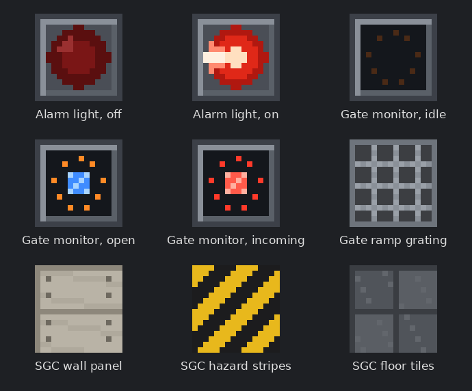
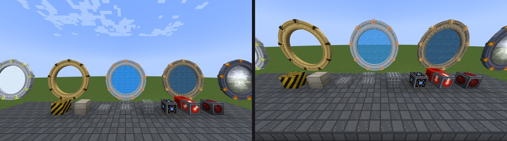

# Stargate Command Addon

A small Forge mod for **Minecraft 1.20.1** that adds gate-room blocks to [Stargate Journey](https://github.com/Povstalec/StargateJourney). Nothing to program: the blocks watch the nearest stargate by themselves.



| Block | What it does |
|---|---|
| **Gate Room Alarm Light** | Flashes red and sounds a klaxon when a wormhole is coming in to the nearest stargate (within 16 blocks). The klaxon stops once the wormhole is open; the light stays on until it closes. A redstone signal also turns it on, so you can wire your own alarm. |
| **Gate Monitor** | Gives a redstone signal (15) while the nearest stargate's wormhole is open. A comparator reads the number of engaged chevrons (0 to 9). The screen shows the gate's state: idle, open (blue) or incoming (red). |
| **Gate Ramp Grating**, **Stairs**, **Slab** | The metal grating of the SGC ramp. |
| **SGC Wall Panel**, **Hazard Stripes**, **Floor Tiles** | For building the gate room around them. |

The mod also carries the four [Stargate Journey Variants](../StargateJourneyVariants/) (Origins, Continuum, Ark of Truth and Infinity) with their crystallizer recipes, so you don't need the separate pack.

Everything is in the **Stargate Command** creative tab.

## Install

1. Install Forge 47 for Minecraft 1.20.1 and Stargate Journey 0.6.40 or newer.
2. Put [`dist/sgcaddon-1.0.0.jar`](dist/sgcaddon-1.0.0.jar) in your `mods` folder, on the client and on the server.

## Recipes

| Block | Recipe (shaped) |
|---|---|
| Gate Room Alarm Light | red dye on top, glass pane, redstone lamp, glass pane in the middle, iron ingot below |
| Gate Monitor | iron ingots around a redstone dust (top middle) and a comparator (centre) |
| Gate Ramp Grating ×4 | 2×2 iron bars |
| Gate Ramp Stairs ×4, Slab ×6 | the usual stairs and slab shapes from grating |
| SGC Wall Panel ×4 | 2×2 smooth stone |
| SGC Hazard Stripes ×4 | yellow and black concrete, checkered 2×2 |
| SGC Floor Tiles ×4 | gray and light gray concrete, checkered 2×2 |

## Ideas

- An alarm light next to the gate, and a Gate Monitor wired to iron doors or a piston that seals the gate room while a wormhole is open.
- A comparator on a Gate Monitor, feeding a line of redstone lamps: a chevron counter.
- The [Gate Room program](../StargateCommand/) on a ComputerCraft monitor beside it all.

## Tested

On a dedicated Forge 1.20.1 (47.4.29) server with Stargate Journey 0.6.54: two gates on the network, one dials the other (with a kawoosh), then disconnects. The alarm by the receiving gate came on during the kawoosh, stayed on while the wormhole was open and went off after the disconnect. Its redstone input also worked. The monitor read incoming, then open, then idle, counting the chevrons up to 9. The four variants and all recipes loaded into the game.

In a Minecraft 1.20.1 client joined to that server, the blocks and the four gate variants render as intended:



*Stargate Journey 0.6.54 in a Minecraft 1.20.1 client. Left, from the left: the Infinity, Ark of Truth, Continuum and Origins looks and an ordinary Milky Way gate; all but the Ark of Truth gate have a wormhole open. In front: hazard stripes, wall panel, ramp slab, ramp stairs, ramp grating, the gate monitor and two alarm lights (the one with a redstone block behind it is lit). Right: the same blocks closer.*

The ramp blocks are see-through grating, so a full block of it looks like a cage, the way other see-through blocks do. The klaxon was checked by recording the client's audio to a file: with the alarm lights next to a gate, the seconds while an incoming wormhole forms were 2 to 4 times louder than the same dial without them, and the klaxon stopped once the wormhole was stable. Not checked yet: the alarm light's flashing (seen only lit and unlit).

## Build

```
./gradlew build
```

It needs internet access the first time (Forge, Minecraft and Stargate Journey from Modrinth's maven); Gradle downloads JDK 17 by itself if needed. The jar to install is `build/libs/sgcaddon-1.0.0.jar`. The textures, models and recipes are made by `tools/make_resources.py` (Python with Pillow), and the gate variants are copied in from `../StargateJourneyVariants/pack`.

## License

The code and the block textures are MIT, see [LICENSE](../LICENSE). The gate variant textures are recoloured from Stargate Journey's textures and stay CC BY-NC-SA 4.0 (see [the variant pack's license](../StargateJourneyVariants/LICENSE.txt)). The block textures are original, drawn by `tools/make_resources.py`.
