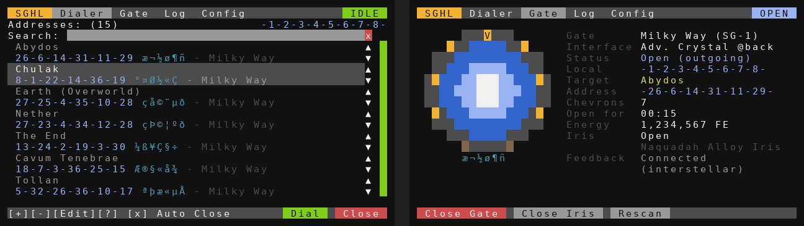
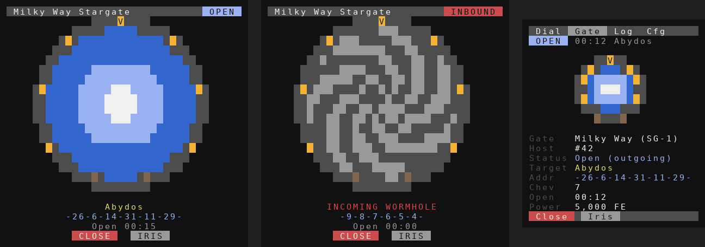

# Stargate Hybrid Legacy (SGHL)

A dialing computer for the **Stargate Journey** mod on **Minecraft Java Edition 1.20.1** with **CC:Tweaked**.

The layout borrows from the 1.12.2 era Stargate mods: an address book like a personal dialer, a configurator page and an SGC-style status board on a monitor. Underneath, it is built on the Stargate Journey interface API.




*The screenshots come from a test emulator, so the font differs from the in-game one.*

## What it does

- **Dialer page**: a searchable address book. Each entry shows the name, the address, a strip of glyph marks and a note such as the galaxy. A bar on the right is green when this gate can dial the address and red when a symbol is out of range. You can add, edit, delete and reorder entries.
- **Gate page**: a ring display with live chevrons, the event horizon and the iris. It shows the status, target, local and remote address, open time, energy, iris state and the gate's last feedback. It has buttons to close the gate, toggle the iris and rescan.
- **Log page**: chevrons, wormholes, travellers, iris hits and errors, with the in-game time.
- **Config page**: Auto Close after someone steps through, a time limit for open wormholes, closing the iris on incoming wormholes and putting it back afterwards, the SGC 3-step chevron style, ring dialing speed, instant dialing, themes and the address access list.
- **Monitor status board**: if a monitor is attached, it shows a large gate with the target and two touch buttons, **CLOSE** and **IRIS**.
- **Pocket dialer**: run `sghl remote` on an Advanced Pocket Computer with a wireless or ender modem. It keeps its own address book and sends dial, close and iris requests to the dialing computer.

## Supported gates and interfaces

| Gate | Basic Interface | Crystal Interface | Advanced Crystal Interface |
|---|---|---|---|
| Milky Way (SG-1) | Ring dialing (spin, open, close or SGC 3-step) | DHD-style | DHD-style or instant |
| Classic (movie) | Ring dialing (spin, encode) | DHD-style | DHD-style or instant |
| Universe | Ring dialing (spin, encode) | DHD-style | DHD-style or instant |
| Pegasus (Atlantis) | Can't dial (status only) | DHD-style | DHD-style or instant |
| Tollan | Can't dial (status only) | DHD-style | DHD-style or instant |
| Andromeda | Can't dial (status only) | DHD-style | DHD-style or instant |

The Advanced Crystal Interface also shows the local and connected address and unlocks the gate address whitelist and blacklist.

The theme follows the gate automatically: SG-1 orange for Milky Way, Atlantis blue for Pegasus, Universe white, red for the Classic movie gate and light blue for Tollan. An extra Infinity palette can be picked on the Config page.

The program was written against the Stargate Journey **0.6.54** sources for 1.20.1. Older 0.6.x builds that use `raiseChevron` and `lowerChevron` are handled as well.

## Requirements

- Advanced Computer
- A Stargate interface with its front against the gate, touching the computer or connected to it with wired modems
- Optional: an Advanced Monitor for the status board
- Optional: a wireless or ender modem on both computers for pocket dialers

## Installation

With HTTP enabled in the ComputerCraft config:

```
wget run https://raw.githubusercontent.com/jarae1205-cpu/StargateJourney-ComputerCraft-Programs/main/StargateHybridLegacy/installer.lua
```

For a pocket dialer, add `remote` at the end of that command.

Or download just the program:

```
wget https://raw.githubusercontent.com/jarae1205-cpu/StargateJourney-ComputerCraft-Programs/main/StargateHybridLegacy/sghl.lua sghl.lua
```

Then run `sghl`, or `sghl remote` on a pocket computer.

## Controls

| Where | Input | Action |
|---|---|---|
| Dialer | Click an entry | Select it. Click it again to dial |
| Dialer | Type | Search |
| Dialer | Up / Down / Page Up / Page Down | Move the selection |
| Dialer | Enter | Dial the selected address |
| Dialer | Insert / Delete | Add / remove an address |
| Dialer | ▲ ▼ next to an entry | Reorder the book (only while the search box is empty) |
| Gate | `c` / `i` | Close the gate / toggle the iris |
| Anywhere | Tab | Next page |
| Anywhere | Hold Ctrl+T, or **[Quit]** on the Config page | Quit |

## Address book

The book starts with Stargate Journey's built-in addresses: Abydos, Chulak, Earth, the Nether, the End, Cavum Tenebrae, Tollan, Rima, Unitas and Proxima Centauri. It also has the 8-chevron addresses of Lantea, Athos and Othala. Servers can randomize these, so edit them if a dial fails with *Invalid address*.

Addresses are stored in `sghl_book.db` and settings in `sghl_config.db`, both next to the program. Type addresses without the point of origin (for example `26-6-14-31-11-29`). The program adds the `0` when it dials.

The glyph marks next to each address are characters from the ComputerCraft font, one per symbol, so you can recognise an address at a glance. They are not the real gate glyphs.

## Pocket dialers

1. On the dialing computer, attach a wireless or ender modem and turn on **Allow pocket dialers** on the Config page. You can also set a password.
2. On an Advanced Pocket Computer with a modem, run `sghl remote`. It looks the dialing computer up over rednet. Set **Host name** to the dialing computer's label if you have more than one gate, and **Password** if you set one.

The password only stops casual use. Rednet traffic is not encrypted.

## Notes

- Only the gate that dialed can close a wormhole, unless the mod's config allows either end. The log says so when a Close is refused.
- Tollan gates have no iris in Stargate Journey. Pegasus, Tollan and Andromeda gates need a Crystal Interface to dial from a computer.
- Auto Close and the open-time limit only close wormholes this gate dialed.
