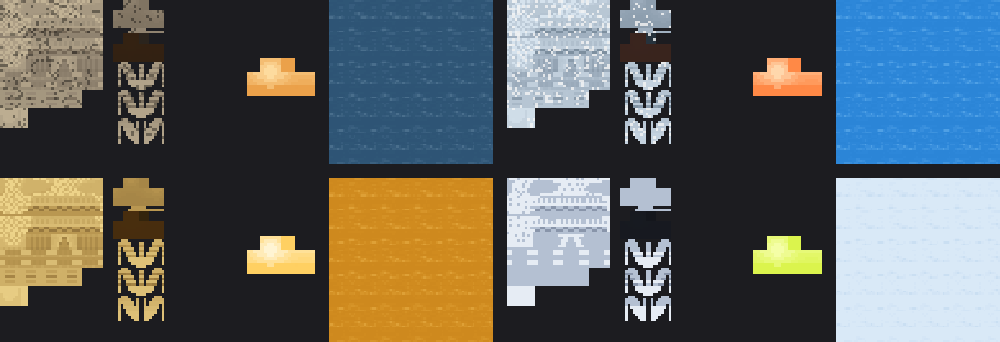

# Stargate Journey Variants

Four new looks for **Stargate Journey's Milky Way stargate** on Minecraft 1.20.1. They change the real gate in your world: stone, chevron lights, event horizon and kawoosh.

| Variant | id | Look |
|---|---|---|
| Origins | `sgcvariants:milky_way_origins` | the Giza gate of 1939: weathered, dusty stone with worn specks, amber chevrons, a faded film-toned horizon |
| Continuum | `sgcvariants:milky_way_continuum` | the gate found frozen in the Arctic: frosted blue-grey stone flecked with ice, an icy horizon |
| Ark of Truth | `sgcvariants:milky_way_ark_of_truth` | an Ancient gate in aged gold, white-gold chevrons, a wormhole of golden light |
| Infinity | `sgcvariants:milky_way_infinity` | the cartoon gate of the animated series: pale stone with ink-dark shading, lime-yellow chevrons, a pale whirlpool |



*The textures of each variant: the gate texture sheet, a lit chevron, and one frame of the event horizon. Top: Origins, Continuum. Bottom: Ark of Truth, Infinity.*

The [Gate Room and the Personal Dialer](../StargateCommand/) recognise these variant names and switch their screens to the matching look by themselves.

## Install

`StargateJourneyVariants-1.20.1.zip` is a resource pack and a data pack in one file:

1. Put it in `.minecraft/resourcepacks` and turn it on (the textures).
2. Put the same zip in your world's `datapacks` folder (the variant definitions and recipes). On a server, put it in the world's `datapacks` folder on the server and give the zip to players as a resource pack.

Or install the [Stargate Command Addon](../StargateCommandAddon/) mod, which carries this pack inside it, so there is nothing else to set up.

## Use

Make a variant crystal in Stargate Journey's crystallizer, starting from a blank Stargate Variant Crystal:

| Variant | Primary | Secondary |
|---|---|---|
| Origins | chiseled sandstone | naquadah |
| Continuum | blue ice | naquadah |
| Ark of Truth | gold block | naquadah |
| Infinity | lime dye | book |

Then use the crystal on a Milky Way stargate. In creative, or with cheats:

```
/give @p sgjourney:stargate_variant_crystal{Variant:"sgcvariants:milky_way_origins"}
```

Stargate Journey's client config option `stargate_variants` must be on (it is by default).

## Rebuild

`tools/make_variants.py` builds the pack from Stargate Journey's own Milky Way textures (it needs Python with Pillow):

```
python3 tools/make_variants.py <StargateJourney checkout> pack StargateJourneyVariants-1.20.1.zip
```

Each variant is a few colour ramps in that script, so new ones are easy to add.

## License

The textures are recoloured from Stargate Journey's textures, which are CC BY-NC-SA 4.0 (Povstalec and contributors). This pack is shared under the same license; see [LICENSE.txt](LICENSE.txt).

Not tested in a live game yet: the files follow the format of Stargate Journey's own variants (checked against its 1.20.1 source), but nobody has loaded them in Minecraft.
